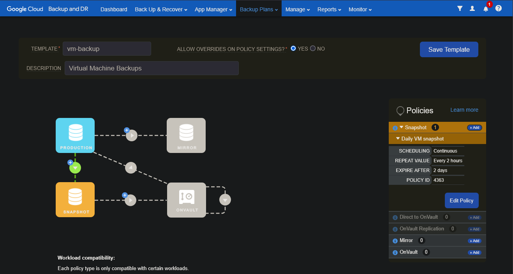
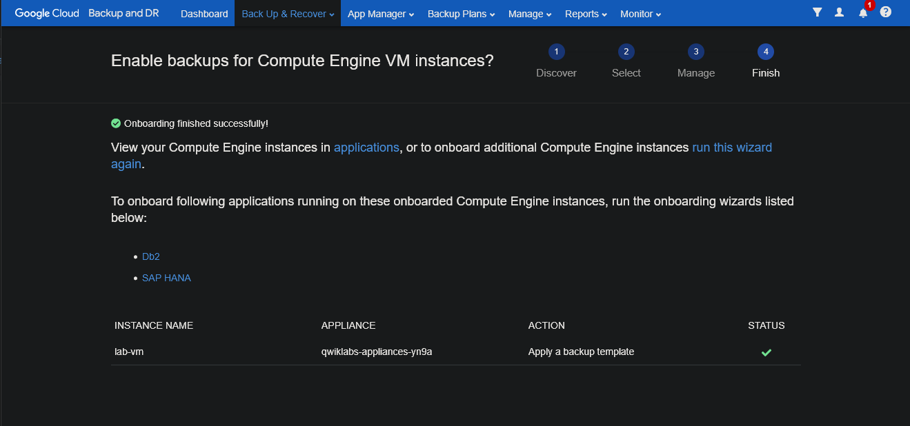
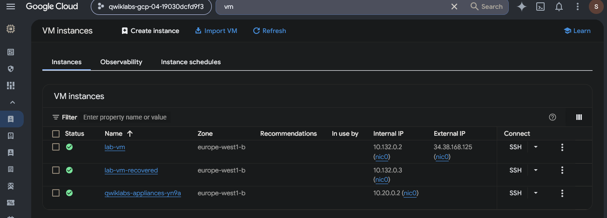
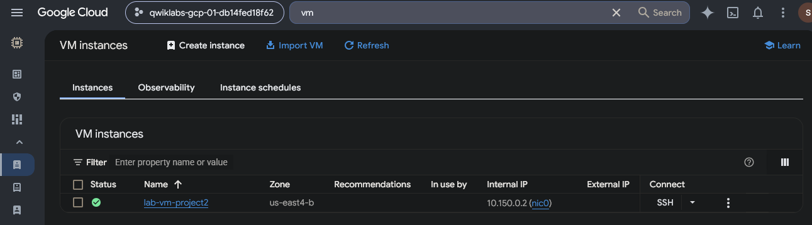

# Google Cloud Backup and Disaster Recovery — Cross-Project VM Restoration

## Executive Summary

This investigation documents an authorized Google Cloud backup and disaster recovery exercise involving Compute Engine virtual machines, snapshot policies, backup management, and cross-project recovery.

The fictional Cymbal Bank scenario involved restoring infrastructure following a simulated security incident.

Using Google Cloud Backup and DR, I configured a backup plan template, enrolled a Compute Engine virtual machine for protection, and performed recovery workflows within the original project and into a separate Google Cloud project.

The backup template used a continuous scheduling policy with a two-hour backup interval and two-day snapshot retention.

The preserved evidence demonstrates successful backup policy onboarding and the existence of running recovery instances in two different Google Cloud projects.

The objective was to demonstrate cloud recovery preparation, backup-policy configuration, protected workload onboarding, and infrastructure restoration across regional and project boundaries.

## Investigation Scenario

Cymbal Bank's fictional incident response team had completed containment of a simulated unauthorized-access incident and was preparing recovery actions for affected virtual machines.

The analyst was tasked with connecting to Google Cloud Backup and DR, establishing a backup policy, registering a Compute Engine instance, and restoring that instance to new locations.

The exercise included both recovery within the original project and restoration to an alternate project with the required service account permissions.

The preserved screenshots demonstrate selected backup configuration and VM recovery results, rather than independently validating the integrity or application functionality of the restored systems.

## Investigation Scope

| Component | Investigation Purpose |
| --- | --- |
| Google Cloud Backup and DR | Manage VM protection and recovery workflows |
| Backup and DR management console | Configure policies and monitor backup operations |
| Backup/recovery appliance | Support workload backup and restoration |
| Backup template `vm-backup` | Define the VM snapshot policy |
| Snapshot policy `Daily VM snapshot` | Configure continuous snapshots every two hours |
| Compute Engine `lab-vm` | Source workload for backup and recovery |
| `lab-vm-recovered` | Restored VM in the original project |
| `lab-vm-project2` | Restored VM in the alternate project |
| IAM service account roles | Support backup and recovery access across projects |
| Compute Engine VM instances | Verify the resulting restored infrastructure |

### Investigation Objectives

1\. Review the Backup and DR management environment.

2\. Create a backup template with an appropriate snapshot schedule and retention period.

3\. Review the appliance's required service account permissions.

4\. Discover and enroll `lab-vm` using the backup template.

5\. Examine the protected workload onboarding result.

6\. Restore a new Compute Engine instance within the original project.

7\. Verify that the original and recovered VMs exist and are running.

8\. Grant the required backup and recovery permissions in an alternate project.

9\. Restore the workload into the alternate project.

10\. Verify the resulting cross-project VM deployment and document recovery limitations.

## Evidence Sources and Methodology

### Evidence Sources

The investigation uses four preserved screenshots from the Google Cloud Backup and DR management console and the Compute Engine VM instances pages.

The lab instructions provide the authorized recovery scenario and prescribed backup, IAM, and restoration workflow.

### Investigation Methodology

| Phase | Analyst Activity |
| --- | --- |
| Backup management | Review the Backup and DR console and appliance |
| Policy configuration | Define a backup plan and snapshot schedule |
| Identity review | Examine the appliance service account's required permissions |
| Workload protection | Enroll the Compute Engine instance for backup |
| Backup workflow | Review the prescribed backup creation and monitoring process |
| Same-project recovery | Mount a backup image as a new Compute Engine instance |
| Cross-project recovery | Configure target-project permissions and restore the workload |
| Verification | Inspect recovered VM instances in both projects |
| Reporting | Document evidence-supported outcomes and remaining limitations |

### Evidence Standards

The exercise was performed in an authorized, temporary Google Cloud training environment.

The lab instructions distinguish the intended configuration steps from the resulting cloud resources. The preserved screenshots establish selected policy settings, successful workload onboarding, and running recovered VM instances.

The backup policy schedule represents the configured backup frequency. It does not independently establish the actual timing or success of every scheduled backup.

Likewise, a recovered VM displaying Running status demonstrates that the instance is operational at the Compute Engine level, but it does not prove that applications, data, or dependent services were successfully restored.

The report will distinguish between procedures prescribed by the lab and results independently supported by the preserved evidence.

## Investigation Organization

The report will document four findings:

1\. Backup Plan and Snapshot Policy Configuration

2\. Compute Engine Workload Onboarding and Backup Protection

3\. Same-Project Compute Engine Recovery Verification

4\. Cross-Project Compute Engine Disaster Recovery

The final sections will summarize security implications, recovery limitations, recommendations, skills demonstrated, and supporting evidence.

## Investigation Findings

### Finding 1 — Backup Plan and Snapshot Policy Configuration

#### Investigation Context

The first phase of the Cymbal Bank disaster recovery exercise involved creating a backup plan template for Google Cloud Compute Engine virtual machines.

The fictional incident scenario required preparing a recovery mechanism that could support restoration of cloud infrastructure following a security incident or operational disruption.

The objective was to define a repeatable backup policy, examine its snapshot frequency and retention settings, and establish the intended protection configuration before enrolling the source virtual machine.

#### Backup Template Configuration

I opened the Google Cloud Backup and DR management console and navigated to:

`Backup Plans → Templates → Create Template`

I configured a backup template named:

`vm-backup`

The template description was:

`Virtual Machine Backups`

I then added a Production-to-Snapshot backup policy.

The preserved screenshot showed the following settings:

| Backup Configuration | Observed Value |
| --- | --- |
| Template name | `vm-backup` |
| Description | `Virtual Machine Backups` |
| Policy name | `Daily VM snapshot` |
| Policy type | Snapshot |
| Scheduling mode | Continuous |
| Repeat interval | Every 2 hours |
| Snapshot expiration | After 2 days |
| Policy ID | `4363` |
| Policy setting overrides | Yes |
| Snapshot policies displayed | 1 |

**Figure 1 — Google Cloud Backup and DR template `vm-backup`, showing the `Daily VM snapshot` policy configured for continuous scheduling every two hours, with a two-day expiration setting.**

The screenshot showed one snapshot policy associated with the backup template.

The configuration also permitted policy-setting overrides.

The policy's intended backup schedule was every two hours, with snapshots configured to expire after two days.

#### Backup Frequency and Retention Analysis

The policy name, `Daily VM snapshot`, could suggest a once-per-day backup schedule.

However, the actual configuration specified:

- Scheduling: `Continuous`

- Repeat value: `Every 2 hours`

- Expire after: `2 days`

Therefore, the intended backup interval was two hours rather than twenty-four hours.

The configured expiration setting established a two-day retention period for snapshots produced under the policy, subject to the service's actual retention behavior and successful backup execution.

| Recovery Planning Attribute | Configured Value | Security Relevance |
| --- | --- | --- |
| Backup scheduling mode | Continuous | Supports recurring backup execution |
| Backup repeat interval | Every 2 hours | Defines the intended frequency of recovery-point creation |
| Snapshot expiration | 2 days | Limits how long snapshots are retained under the policy |
| Policy overrides | Enabled | Permits applicable policy settings to be overridden |

A more frequent backup schedule can reduce the amount of recent data potentially lost during recovery when backups complete successfully.

However, the two-hour interval does not independently establish a guaranteed two-hour Recovery Point Objective (RPO).

The actual recoverable point depends on successful backup execution, backup timing, and the availability and integrity of the resulting recovery images.

Similarly, the two-day retention setting does not establish a Recovery Time Objective (RTO).

RTO depends on the time needed to restore systems and resume required services.

#### Backup Policy Verification

The preserved screenshot displayed the configured snapshot policy within the backup template editor.

It showed a ****Save Template**** button, indicating that the interface was displaying the configuration prior to, or during, the template-saving workflow.

The image did not independently establish that the template had already been saved or that the scheduled backups had executed successfully.

Subsequent evidence from the workload onboarding and recovery stages would provide additional information about use of the configured backup template.

#### Security Relevance

Backup policies contribute to organizational resilience by defining how protected workloads are backed up and how long recovery images remain available.

In an incident response context, accessible and trustworthy recovery points may help restore operations following accidental deletion, system failure, ransomware, or another disruptive event.

However, backup configuration alone is not equivalent to validated recoverability.

Effective disaster recovery also requires verifying that backups complete successfully, recovery images remain usable, access controls protect backup infrastructure, and restored systems meet operational requirements.

Retention policies should also reflect business, legal, and security requirements rather than relying solely on a training environment's short retention period.

#### Analyst Assessment

****Assessment: Continuous snapshot backup policy configured with a two-hour repeat interval and two-day expiration setting.****

The preserved evidence showed a backup template named `vm-backup` containing the `Daily VM snapshot` policy.

Despite the policy name, the configured schedule specified continuous backup execution every two hours.

The screenshot established the intended backup frequency and retention settings but did not independently confirm successful template saving, scheduled backup execution, or recovery-point integrity.

The next phase examines enrollment of the source Compute Engine instance into the configured backup protection workflow.

### Finding 2 — Compute Engine Workload Onboarding and Backup Protection

#### Investigation Context

After configuring the `vm-backup` backup template, the next phase involved enrolling the source Compute Engine instance in Google Cloud Backup and DR.

The exercise required associating the VM with the backup/recovery appliance and applying the previously configured backup template.

The objective was to establish that the source workload was registered for protection before attempting the disaster recovery procedures.

#### Backup Appliance and IAM Preparation

The supplied lab environment included a preconfigured backup/recovery appliance.

Before onboarding the workload, the lab procedure instructed me to review the appliance's associated service account and confirm that the necessary Backup and DR permissions were available.

The procedure specifically referenced the ****Backup DR Appliance Service Account**** and its assigned ****Backup and DR Cloud Storage Operator**** role.

These permissions supported the authorized backup and restoration workflow.

The preserved onboarding screenshot did not display the IAM role assignments or a separate service-account verification result.

Therefore, the service-account review is documented as part of the prescribed procedure rather than independently verified configuration evidence.

#### Compute Engine Onboarding Procedure

Using the Backup and DR management console, I followed the guided onboarding process:

1\. Navigated to ****Back Up & Recover → Back Up****.

2\. Selected the Backup DR Appliance Service Account credential.

3\. Selected the appropriate project and Compute Engine zone.

4\. Discovered the available Compute Engine instances.

5\. Selected the source virtual machine, `lab-vm`.

6\. Chose ****Apply a backup template**** as the onboarding action.

7\. Selected the previously configured `vm-backup` template.

8\. Completed the onboarding wizard.

9\. Reviewed the displayed completion status.

The onboarding workflow was intended to associate the backup template with the source VM.

The lab instructions explained that completion of this process triggers backup activity according to the selected policy.

However, the preserved screenshot did not show an individual backup job or a completed snapshot.

#### Onboarding Verification

The final screen of the wizard displayed:

****Onboarding finished successfully!****

The following information was visible:

| Onboarding Attribute | Observed Value |
| --- | --- |
| Workflow | Enable backups for Compute Engine VM instances |
| Wizard stage | Finish |
| Instance name | `lab-vm` |
| Backup appliance | `qwiklabs-appliances-yn9a` |
| Selected action | Apply a backup template |
| Status | Green checkmark |
| Completion message | Onboarding finished successfully |
| Applied template name | Not displayed |
| Backup job result | Not displayed |
| Recovery image status | Not displayed |

**Figure 2 — Google Cloud Backup and DR onboarding completion page showing `lab-vm`, the selected Apply a backup template action, the backup appliance, and a successful status indicator.**

The green status indicator established that the onboarding operation completed successfully.

The selected action confirmed that the workflow was configured to apply a backup template to the VM.

The lab procedure identified this template as `vm-backup`, but the screenshot did not independently show the exact template selected.

The evidence therefore supports successful workload onboarding rather than independently verified backup completion.

#### Backup Job Monitoring

The lab instructions directed reviewing backup activity through:

****Monitor → Jobs****

This view can provide information about backup job execution and completion status.

A successful backup job would provide stronger evidence that a recoverable image had been created.

The preserved screenshot, however, showed only the onboarding completion page.

It did not establish:

- The exact time a backup job started or completed.

- Whether an individual backup operation succeeded.

- The size or integrity of the resulting backup image.

- Whether subsequent scheduled backups executed successfully.

- The age of the most recent recoverable image.

These details would require additional backup-job records or recovery-image evidence.

The later recovery stages provide separate evidence concerning the existence of restored Compute Engine instances.

#### Security and Recovery Relevance

Enrolling a virtual machine into a backup policy is a necessary administrative step in establishing workload protection.

It connects the source resource with the backup infrastructure and defines how the configured policy should be applied.

However, a workload being registered for backup does not automatically mean its data can be restored successfully.

Effective disaster recovery requires verifying backup execution, recovery-image availability, restore permissions, restored-system integrity, and application functionality.

The distinction between successful onboarding and verified recoverability is important when evaluating an organization's backup security posture.

#### Analyst Assessment

****Assessment: Compute Engine instance `lab-vm` successfully onboarded into the Google Cloud Backup and DR workflow.****

The screenshot displayed a successful onboarding message and a green status indicator for `lab-vm`.

The workflow showed the action ****Apply a backup template****, associated with the backup appliance `qwiklabs-appliances-yn9a`.

The lab instructions identified `vm-backup` as the intended template, but the screenshot did not independently display its name or prove that a backup job had completed.

The next phase evaluates the same-project restoration procedure and the resulting recovered virtual machine.

### Finding 3 — Same-Project Compute Engine Recovery Verification

#### Investigation Context

After onboarding the source Compute Engine virtual machine into Google Cloud Backup and DR, the next phase involved restoring a separate VM from an available recovery image.

The objective was to perform the prescribed same-project restoration workflow and verify that the resulting virtual machine existed alongside the original workload.

The fictional Cymbal Bank incident scenario required recovery of affected infrastructure following containment of a simulated security incident.

This exercise focused on demonstrating infrastructure restoration rather than independently conducting a forensic investigation or validating production application recovery.

#### Same-Project Recovery Procedure

Following the lab instructions, I used the Backup and DR management console to begin the restoration workflow.

The prescribed procedure involved:

1\. Navigating to ****Backup & Recover → Recover****.

2\. Selecting the protected Compute Engine instance `lab-vm`.

3\. Reviewing the available backup images.

4\. Selecting an available recovery image.

5\. Choosing ****Mount****.

6\. Selecting ****Mount as new GCE instance****.

7\. Configuring the destination region as `europe-west1`.

8\. Configuring the destination zone as `europe-west1-b`.

9\. Naming the recovered instance `lab-vm-recovered`.

10\. Submitting the mount operation.

11\. Reviewing the recovery operation through the Job Monitor.

12\. Opening the Compute Engine VM instances page to verify the restored resource.

The lab instructions described an expected recovery workflow in which the mount operation creates a new Compute Engine instance using a previously generated backup image.

The preserved screenshot, however, does not show the backup-image identifier, mount configuration, or individual recovery job result.

#### Recovered VM Verification

I opened Compute Engine → VM instances in the original Google Cloud project.

The preserved screenshot displayed the following resources:

| VM Attribute | Original Instance | Recovered Instance |
| --- | --- | --- |
| Instance name | `lab-vm` | `lab-vm-recovered` |
| Google Cloud project | `qwiklabs-gcp-04-19030dcfdf93` | `qwiklabs-gcp-04-19030dcfdf93` |
| Zone | `europe-west1-b` | `europe-west1-b` |
| Status | Running | Running |
| Internal IP | `10.132.0.2` | `10.132.0.3` |
| External IP | `34.38.168.125` | Not displayed |
| Connection option | SSH | SSH |

**Figure 3 — Compute Engine VM instances in project `qwiklabs-gcp-04-19030dcfdf93`, showing the original `lab-vm`, recovered `lab-vm-recovered`, and backup appliance running in `europe-west1-b`. The recovered VM has a separate internal IP address.**

Both instances displayed green running-status indicators.

The screenshot also showed the backup/recovery appliance:

`qwiklabs-appliances-yn9a`

The appliance was running in `europe-west1-b` with internal IP `10.20.0.2`.

The original and recovered instances had distinct internal IP addresses, demonstrating that they were separate Compute Engine resources.

#### Recovery Outcome Analysis

The observed configuration was consistent with the lab's intended same-project recovery operation.

The original `lab-vm` remained present and running.

A second instance, `lab-vm-recovered`, was also present and running in the same zone.

This supports the conclusion that the exercise resulted in a separately deployed recovery VM.

However, the screenshot does not independently confirm the precise backup image or recovery point used to create that instance.

It also does not establish that the restored VM's filesystem, applications, data, or dependencies were functioning correctly.

The visible SSH connection option does not constitute proof of successful administrative access or application-level connectivity.

#### Recovery Validation Considerations

A production disaster recovery validation would require more than confirming that a Compute Engine instance was running.

Additional validation could include:

- Confirming the recovery-image identifier and backup timestamp.

- Reviewing the recovery job's final completion status.

- Verifying restored disks and filesystem consistency.

- Confirming required applications and services start successfully.

- Comparing critical restored data against expected recovery-state records.

- Reviewing security configuration, IAM permissions, and network access.

- Measuring the actual recovery duration and recovered data age.

- Documenting whether established Recovery Time Objective (RTO) and Recovery Point Objective (RPO) requirements were met.

These are recommended validation activities rather than additional checks established by the preserved screenshot.

The configured two-hour backup interval from Finding 1 did not independently establish an achieved two-hour RPO.

Likewise, the screenshot did not provide sufficient timing data to calculate the actual RTO.

#### Security and Business Continuity Relevance

Same-project restoration can provide an additional virtual machine to support recovery testing or operational restoration.

Maintaining the original instance during the recovery process also allows comparison between source and recovered infrastructure.

However, same-project recovery does not independently establish resilience against a project-wide compromise, access-control failure, or regional outage.

A broader disaster recovery strategy should consider alternate locations, appropriate backup isolation, recovery permissions, and regular restoration testing.

The following investigation phase examines restoration to a separate Google Cloud project.

#### Analyst Assessment

****Assessment: Same-project recovery instance `lab-vm-recovered` verified as running alongside the original `lab-vm`.****

The Compute Engine instances page showed both VMs in project `qwiklabs-gcp-04-19030dcfdf93`, located in `europe-west1-b`, with separate internal IP addresses.

This demonstrated a successful infrastructure-level recovery outcome consistent with the prescribed Backup and DR mounting procedure.

The preserved evidence did not independently verify the specific backup image, restored data integrity, application functionality, or recovery performance objectives.

The next phase examines restoration into an alternate Google Cloud project to demonstrate a broader disaster recovery deployment scenario.

### Finding 4 — Cross-Project Compute Engine Disaster Recovery

#### Investigation Context

Following the same-project recovery exercise, the final phase involved restoring the protected Compute Engine workload into a separate Google Cloud project.

The objective was to demonstrate an alternate recovery destination and evaluate the resulting infrastructure deployment.

The source workload, `lab-vm`, originated from project `qwiklabs-gcp-04-19030dcfdf93` in `europe-west1-b`.

The recovery exercise used a second Google Cloud project, `qwiklabs-gcp-01-db14fed18f62`, with the destination zone `us-east4-b`.

This provided a broader recovery scenario than restoring an instance within the original project and zone.

#### Cross-Project IAM Preparation

The prescribed recovery workflow required authorizing the backup/recovery appliance's service account to perform recovery operations in the destination project.

The lab instructions directed the following steps:

1\. Opening ****IAM & Admin → IAM**** in the original project.

2\. Locating the ****Backup DR Appliance Service Account****.

3\. Copying the appliance service account's email address.

4\. Switching to the destination project, `qwiklabs-gcp-01-db14fed18f62`.

5\. Granting the source project's appliance service account access to the destination project.

6\. Assigning the ****Backup and DR Compute Engine Operator**** role.

7\. Assigning the ****Backup and DR Cloud Storage Operator**** role.

8\. Saving the IAM configuration before initiating recovery.

These roles were specified by the lab to support the cross-project restoration workflow.

The preserved screenshot does not show the IAM permissions page or the final service account role assignments.

Therefore, these permissions are documented as prescribed steps rather than independently verified IAM configuration evidence.

#### Alternate-Project Recovery Procedure

After preparing the destination project's permissions, the lab instructed me to initiate a recovery operation using the Backup and DR management console.

The prescribed workflow involved:

1\. Navigating to ****Backup & Recover → Recover****.

2\. Selecting the protected source VM, `lab-vm`.

3\. Reviewing the available backup images.

4\. Selecting a recovery image.

5\. Choosing ****Mount → Mount as new GCE instance****.

6\. Changing the destination project to `qwiklabs-gcp-01-db14fed18f62`.

7\. Setting the recovered instance name to `lab-vm-project2`.

8\. Selecting the destination region `us-east4`.

9\. Selecting the destination zone `us-east4-b`.

10\. Submitting the mount operation.

11\. Reviewing the recovery job through Job Monitor.

12\. Opening Compute Engine in the destination project to verify the recovered VM.

The procedure was intended to deploy a new Compute Engine instance using an available backup image.

The preserved screenshot documents the resulting destination VM rather than the selected recovery image or recovery job execution.

#### Cross-Project Recovery Verification

I opened Compute Engine → VM instances in the alternate Google Cloud project.

The preserved screenshot displayed the following configuration:

| Recovery Attribute | Observed Value |
| --- | --- |
| Destination project | `qwiklabs-gcp-01-db14fed18f62` |
| Recovered instance | `lab-vm-project2` |
| Region | `us-east4` |
| Zone | `us-east4-b` |
| Instance status | Running |
| Internal IP address | `10.150.0.2` |
| External IP address | Not displayed |
| Connection option | SSH |
| Backup image identifier | Not visible |
| Recovery job completion details | Not visible |
| Application validation results | Not visible |

**Figure 4 — Compute Engine VM instances page showing `lab-vm-project2` running in alternate project `qwiklabs-gcp-01-db14fed18f62`, in zone `us-east4-b`, with internal IP address `10.150.0.2`.**

The screenshot showed a green running-status indicator for `lab-vm-project2`.

The selected Google Cloud project was different from the original project's identifier.

The recovered instance also resided in a different geographic region from the source environment.

These observations support the conclusion that the exercise resulted in a running Compute Engine instance in the designated alternate project and region.

#### Recovery Location Comparison

The investigation documented two recovery destinations.

| Recovery Attribute | Same-Project Recovery | Alternate-Project Recovery |
| --- | --- | --- |
| Source workload | `lab-vm` | `lab-vm` |
| Destination project | `qwiklabs-gcp-04-19030dcfdf93` | `qwiklabs-gcp-01-db14fed18f62` |
| Recovered instance | `lab-vm-recovered` | `lab-vm-project2` |
| Destination region | `europe-west1` | `us-east4` |
| Destination zone | `europe-west1-b` | `us-east4-b` |
| Observed instance status | Running | Running |
| Infrastructure-level recovery result | Recovered VM visible | Recovered VM visible |
| Application-level recovery | Not independently verified | Not independently verified |

The first recovery demonstrated a separate VM running in the original project.

The second recovery demonstrated a separate VM running in an alternate project and region.

Together, the screenshots provided evidence of infrastructure deployment at both recovery destinations.

#### Security and Disaster Recovery Implications

Cross-project restoration can support disaster recovery planning by providing an alternate destination for restored infrastructure.

This approach may be valuable when recovery within the original project is unavailable or undesirable.

Restoration into a different region can also reduce dependence on the original regional environment.

However, cross-project restoration introduces additional security and operational considerations.

****Identity and access management****

The recovery service account must have the permissions required to operate in the destination project.

Those permissions should be reviewed and limited to the authorized recovery workflow.

****Recovery image security****

Recovery images should be protected against unauthorized modification or deletion.

A recovery image also requires integrity validation before it can be considered trustworthy following a security incident.

****Network and application dependencies****

A recovered VM may depend on external services, firewall rules, IAM configurations, DNS records, databases, and other infrastructure.

A Running status does not establish that those dependencies have been restored.

****Recovery objectives****

The screenshot does not provide the recovery-image timestamp, time required to restore the VM, or results of application testing.

Consequently, achieved Recovery Point Objective (RPO) and Recovery Time Objective (RTO) values cannot be calculated from the preserved evidence.

****Administrative isolation****

A separate Google Cloud project can provide an additional administrative boundary.

However, project separation alone does not establish that the recovery environment is isolated from every threat affecting the original project.

#### Analyst Assessment

****Assessment: Cross-project recovery instance `lab-vm-project2` verified as running in an alternate Google Cloud project and region.****

The Compute Engine screenshot showed the recovered instance in project `qwiklabs-gcp-01-db14fed18f62`, located in `us-east4-b`, with internal IP `10.150.0.2`.

This result was consistent with the prescribed cross-project Backup and DR recovery procedure.

Together with the same-project recovery evidence, the investigation demonstrated infrastructure-level recovery outcomes across two Google Cloud projects and two regions.

The preserved evidence did not independently establish the selected backup image, restored data integrity, application availability, IAM role assignments, or achieved recovery objectives.

## Security Implications

This investigation demonstrated how Google Cloud Backup and DR can support recovery preparation and infrastructure restoration following a simulated security incident or operational disruption.

The exercise included configuring a snapshot-based backup policy, onboarding a Compute Engine workload, and restoring virtual machine instances into both the original project and an alternate project.

The strongest recovery evidence came from the Compute Engine screenshots showing the recovered virtual machines running in their respective environments.

| Security Area | Observation | Security Implication |
| --- | --- | --- |
| Backup policy | Snapshot policy configured every two hours with two-day retention | Recurring backups can provide recovery points, subject to successful execution |
| Workload protection | `lab-vm` onboarding completed successfully | Backup enrollment establishes a protection workflow but does not independently prove backup completion |
| Same-project recovery | `lab-vm-recovered` running alongside `lab-vm` | A separate recovery VM can support restoration and testing within the original environment |
| Cross-project recovery | `lab-vm-project2` running in a different project and region | Alternate recovery destinations can reduce dependence on the original infrastructure environment |
| Recovery permissions | Backup and DR service account roles prescribed for cross-project restoration | Recovery access requires appropriate IAM authorization and permission governance |
| Recovery validation | VM running status confirmed in both recovery environments | Infrastructure availability alone does not demonstrate application functionality or data integrity |
| Recovery objectives | Backup interval configured, but recovery timing and data age not measured | RPO and RTO achievement cannot be established from configuration alone |

### Disaster Recovery Lessons

****1. Configured backup frequency is not a verified recovery objective.****

The backup template was configured to create snapshots every two hours.

However, a scheduled backup interval does not independently demonstrate an achieved two-hour Recovery Point Objective.

Successful backups, available recovery images, and actual recovered data age must be evaluated before an RPO can be confirmed.

****2. Successful onboarding is different from successful backup execution.****

The Backup and DR console displayed a successful onboarding result for `lab-vm`.

This verified the workload registration process but did not independently show a completed backup job.

Production backup monitoring should include job execution results, failure alerts, and recovery-image availability.

****3. A running recovered VM is not the same as complete service recovery.****

Both the same-project and cross-project recovery screenshots showed running Compute Engine instances.

However, the evidence did not include application tests, restored data validation, or dependent service checks.

A complete disaster recovery exercise should demonstrate that critical business services function correctly after restoration.

****4. Cross-project recovery can improve recovery options.****

The alternate-project recovery demonstrated a VM running in a different Google Cloud project and region.

This provided evidence of an alternate infrastructure deployment destination.

However, project separation does not automatically ensure administrative isolation, backup integrity, or protection from all incidents affecting the source environment.

## Recovery Summary and Recommendations

### Observed Recovery Outcomes

| Recovery Area | Procedure or Configuration | Evidence-Supported Result |
| --- | --- | --- |
| Backup template | Configure `vm-backup` | Template editor displayed the intended configuration |
| Snapshot scheduling | Continuous scheduling every two hours | Configured interval visible |
| Snapshot retention | Expire after two days | Configured expiration visible |
| Workload onboarding | Apply a backup template to `lab-vm` | Successful onboarding message displayed |
| Backup job execution | Monitor backup operations | Individual job completion not independently verified |
| Same-project recovery | Restore `lab-vm-recovered` | Recovered VM observed running in the original project |
| Cross-project recovery | Restore `lab-vm-project2` | Recovered VM observed running in alternate project and region |
| IAM authorization | Assign Backup and DR roles in destination project | Prescribed workflow documented; final role assignments not independently verified |
| Recovery-image integrity | Validate restored backup contents | Not independently verified |
| Application recovery | Test restored applications and services | No preserved application-level validation |
| RPO and RTO | Measure actual recovery performance | Not established by available evidence |

### Recommended Production Follow-Up

Before considering a production disaster recovery workflow fully validated, a cloud security analyst should:

1\. Verify that the backup template is saved and correctly assigned to the intended workloads.

2\. Review backup job execution results and investigate failures.

3\. Confirm that recovery images are created at the expected frequency.

4\. Validate retention settings against business, security, and compliance requirements.

5\. Review backup infrastructure permissions and administrative access.

6\. Protect backup images against unauthorized modification and deletion.

7\. Verify recovery-point integrity before restoration.

8\. Confirm that the selected restore image corresponds to the intended recovery point.

9\. Review the completed recovery job and measure its duration.

10\. Validate restored disks, filesystems, and critical application data.

11\. Test required applications, authentication, and dependent services.

12\. Verify network access controls and IAM configuration in the recovered environment.

13\. Evaluate whether the recovered data age meets the defined RPO.

14\. Evaluate whether service restoration time meets the defined RTO.

15\. Periodically test same-project and cross-project recovery procedures.

16\. Preserve recovery evidence and document unresolved risks.

These recommendations describe production validation practices rather than additional actions independently demonstrated by the lab screenshots.

## Evidence Limitations

This investigation was conducted within an authorized, temporary Google Cloud training environment involving a simulated incident response scenario.

The following limitations apply:

1\. ****Simulated incident:**** The exercise described fictional unauthorized access. The screenshots do not independently establish an actual intrusion or compromise.

2\. ****Backup configuration:**** The first screenshot displayed the template settings but did not independently prove the template had already been saved.

3\. ****Backup interval:**** The configured two-hour schedule did not establish that backups consistently completed every two hours.

4\. ****Retention:**** The two-day expiration setting was visible, but actual backup retention behavior was not independently tested.

5\. ****Workload onboarding:**** The second screenshot confirmed successful onboarding but did not display the exact template name or a completed backup job.

6\. ****Service account roles:**** IAM roles were described in the lab instructions, but the preserved screenshots did not verify the final role assignments.

7\. ****Recovery images:**** The evidence did not display the selected backup-image identifiers or recovery-point timestamps.

8\. ****Same-project recovery:**** The original and recovered VMs were running, but restored data and applications were not independently validated.

9\. ****Cross-project recovery:**** The alternate-project VM was running, but the screenshot did not independently verify the image source or recovery job details.

10\. ****Application availability:**** No preserved application-level connectivity or functionality testing demonstrated complete service restoration.

11\. ****Data integrity:**** Filesystem consistency and restored data integrity were not independently established.

12\. ****Recovery objectives:**** Actual Recovery Point Objective and Recovery Time Objective values could not be calculated from the available screenshots.

13\. ****Recovery isolation:**** Cross-project deployment demonstrated a separate destination project but did not establish complete security or administrative isolation.

## Skills Demonstrated

### Cloud Backup Management

- Configured a Google Cloud Backup and DR template.

- Evaluated snapshot backup frequency and retention settings.

- Reviewed the relationship between backup intervals and recovery objectives.

- Documented workload onboarding into a backup protection workflow.

### Disaster Recovery Operations

- Followed a Compute Engine snapshot-based recovery workflow.

- Verified a recovered instance running alongside its source VM.

- Documented recovery into an alternate Google Cloud project and region.

- Compared same-project and cross-project recovery outcomes.

### Identity and Recovery Security

- Reviewed prescribed service account permissions for backup operations.

- Examined the role of cross-project IAM access in recovery.

- Identified security considerations involving backup integrity, permissions, and recovery isolation.

### Security Validation and Reporting

- Distinguished configured backup policies from completed backup operations.

- Evaluated recovered VM status without overstating application recovery.

- Identified evidence required to validate RPO and RTO.

- Documented recovery outcomes, security implications, and limitations.

- Preserved screenshots supporting infrastructure-level recovery observations.

## Conclusion

This investigation examined Google Cloud Backup and DR procedures for a fictional Cymbal Bank incident response scenario.

The exercise began with configuration of a backup template named `vm-backup`, containing a continuous snapshot policy scheduled every two hours with a two-day expiration setting.

The source Compute Engine instance, `lab-vm`, was subsequently enrolled through the Backup and DR management console, which displayed a successful onboarding result.

The same-project recovery stage resulted in a second Compute Engine instance, `lab-vm-recovered`, running alongside the original VM in project `qwiklabs-gcp-04-19030dcfdf93`.

The cross-project recovery stage resulted in another instance, `lab-vm-project2`, running in project `qwiklabs-gcp-01-db14fed18f62` in zone `us-east4-b`.

These results demonstrated infrastructure-level recovery outcomes within the original environment and at an alternate project and regional destination.

However, the preserved evidence did not independently establish successful backup job execution, recovery-image integrity, restored application functionality, or achieved recovery performance objectives.

The investigation reinforced the distinction between backup configuration, protected workload onboarding, infrastructure restoration, and fully validated disaster recovery.

Overall, the exercise demonstrated skills relevant to cloud incident response, business continuity, infrastructure recovery, backup security, and evidence-based security reporting.

## Evidence Index

| Figure | Evidence File | Description |
| --- | --- | --- |
| 1 | `01-backup-template-snapshot-policy.png` | Backup template with two-hour snapshot scheduling and two-day retention |
| 2 | `02-compute-engine-backup-onboarding-success.png` | Successful onboarding of `lab-vm` |
| 3 | `03-same-project-vm-recovery-verification.png` | Original and recovered VMs running in the original project |
| 4 | `04-cross-project-vm-recovery-verification.png` | Recovered VM running in the alternate project and region |

All four screenshots are located in the accompanying [`evidence/`](evidence/) directory.
