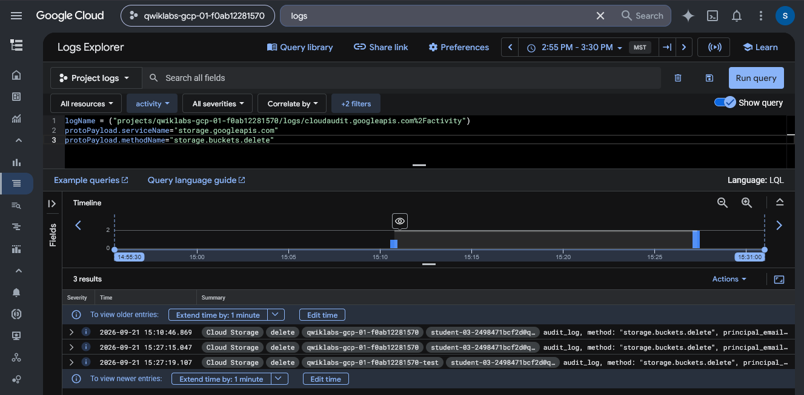
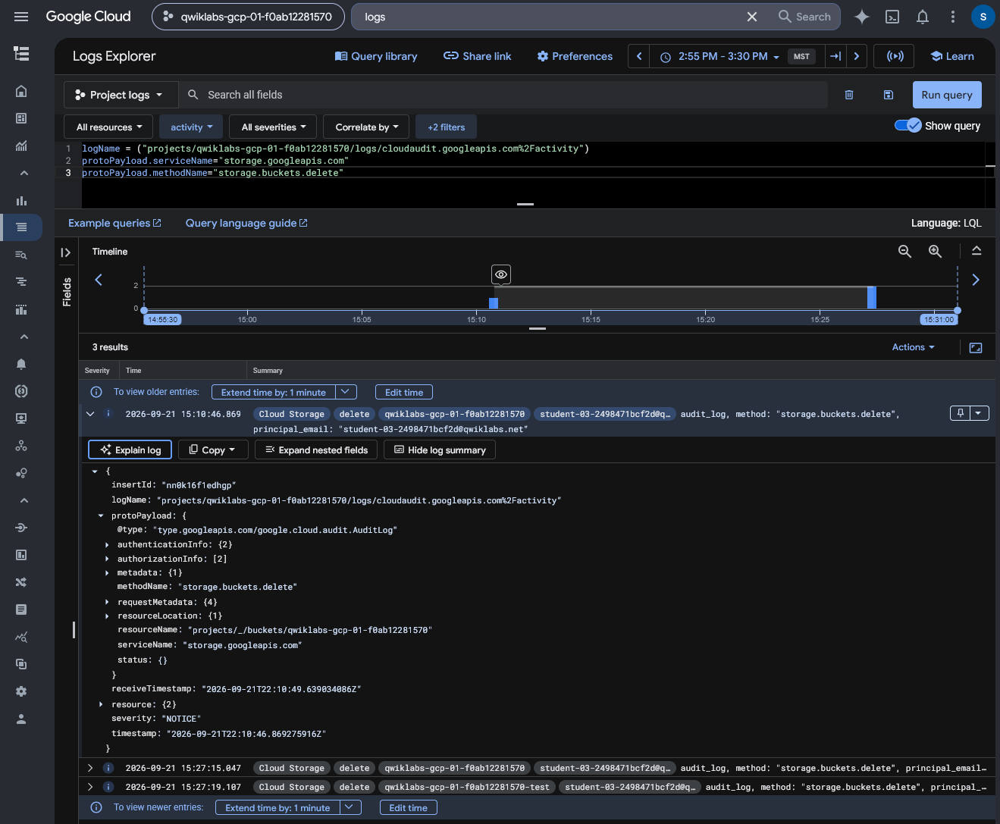

# Google Cloud Audit Log Analysis — Destructive Activity Investigation

## Executive Summary

This investigation examines administrative activity in Google Cloud using Cloud Audit Logs, Logs Explorer, Log Router, BigQuery, and SQL.

The exercise was based on a simulated security incident involving unauthorized cloud resource access at Cymbal Bank. A controlled Google Cloud lab environment was used to generate administrative actions and analyze the resulting audit events.

The investigation focused on identifying destructive operations involving Compute Engine virtual machines and Cloud Storage buckets.

An independent investigation extended the guided analysis by correlating multiple resource-deletion events into a single administrative activity timeline.

The objective was to demonstrate how cloud audit telemetry can support incident reconstruction, identity attribution, and security investigations.

## Investigation Scope

The investigation was conducted in a temporary, authorized Google Cloud lab environment using test accounts and cloud resources.

| Component | Investigation Purpose |
| --- | --- |
| Cloud Audit Logs | Record administrative activity |
| Logs Explorer | Search and inspect cloud audit events |
| Log Router | Export selected log events |
| BigQuery | Analyze exported audit records |
| SQL | Filter and correlate administrative operations |
| Compute Engine | Investigate VM deletion events |
| Cloud Storage | Investigate bucket deletion events |
| IAM principals | Attribute logged operations to authenticated identities |

### Investigation Objectives

1. Generate controlled administrative events involving cloud resources.
2. Examine the resulting Cloud Audit Logs.
3. Configure a Log Router sink for audit-log export.
4. Analyze exported events in BigQuery.
5. Identify Compute Engine virtual machine deletion operations.
6. Identify Cloud Storage bucket deletion operations.
7. Independently correlate destructive operations across cloud resource types.
8. Assess what audit logs establish and what requires additional evidence.

## Evidence Sources and Methodology

### Evidence Sources

The investigation used Google Cloud audit records, log-export configuration, BigQuery SQL results, and saved screenshots from the lab.

The source materials include guided exercise instructions and independent investigation notes.

### Investigation Methodology

| Phase | Analyst Activity |
| --- | --- |
| Preparation | Establish authorized test accounts and cloud resources |
| Activity generation | Perform controlled cloud administrative operations |
| Log analysis | Examine administrative records in Logs Explorer |
| Log export | Configure Log Router and BigQuery |
| SQL investigation | Query VM and bucket deletion events |
| Correlation | Build a cross-service activity timeline |
| Assessment | Interpret the observed activity and document limitations |

### Evidence Standards

The investigation distinguishes recorded administrative operations from assumptions about an attacker's identity, intent, or access method.

A cloud audit entry can identify a logged operation, associated principal, resource, and timestamp. It does not independently establish that the activity was malicious.

The destructive actions in this exercise were intentionally generated within an authorized training environment.

The final analysis will therefore describe the observed administrative actions as simulated incident activity rather than an independently verified real-world compromise.

## Investigation Organization

The report will document the following investigation stages:

1. Administrative Activity Generation and Audit Log Inspection
2. Audit Log Export and BigQuery Configuration
3. Compute Engine Deletion Analysis
4. Cloud Storage Deletion Analysis
5. Independent Cross-Service Activity Correlation

The final sections will summarize security implications, evidence limitations, skills demonstrated, and supporting evidence.

## Investigation Findings

### Finding 1 — Cloud Storage Deletion Activity in Audit Logs

#### Investigation Context

The first investigation examined Google Cloud Admin Activity logs to identify administrative operations involving Cloud Storage resources.

The scenario involved suspected unauthorized activity within Cymbal Bank's cloud environment. To reproduce relevant evidence, administrative operations were performed in an authorized training project.

The objective was to isolate bucket-deletion events, identify the affected cloud service, and determine which details were available for further investigation.

#### Log Query

I used Google Cloud Logs Explorer to filter Admin Activity records for Cloud Storage deletion operations.

The query was:

```text
logName = "projects/qwiklabs-gcp-01-f0ab12281570/logs/cloudaudit.googleapis.com%2Factivity"
protoPayload.serviceName="storage.googleapis.com"
protoPayload.methodName="storage.buckets.delete"
```

The filters targeted:

| Field | Purpose |
| --- | --- |
| `logName` | Select Admin Activity audit records |
| `protoPayload.serviceName` | Restrict results to Cloud Storage |
| `protoPayload.methodName` | Identify bucket-deletion operations |

#### Observed Audit Events

The filtered query returned three matching entries.

| Event | Timestamp (MST) | Operation |
| --- | --- | --- |
| 1 | 15:10:46 | `storage.buckets.delete` |
| 2 | 15:27:15 | `storage.buckets.delete` |
| 3 | 15:27:19 | `storage.buckets.delete` |



*Figure 1 — Google Cloud Logs Explorer displaying three Admin Activity records filtered by `storage.googleapis.com` and `storage.buckets.delete`. The results identify bucket-deletion operations and their timestamps.*

All three records were associated with Cloud Storage bucket-deletion activity.

The results included event summaries and principal-identification fields. However, the screenshot did not expand the individual records sufficiently to establish every affected resource or fully verify the principal associated with each event.

The visible records supported identification of the deletion method and event sequence, but further field inspection would be required for a complete attribution assessment.

#### Security Relevance

Cloud Storage bucket deletion is a destructive administrative operation that can affect resource availability and data retention.

In a security investigation, such events may warrant review of the acting principal, affected resource, authorization context, and related administrative activity.

However, the presence of bucket-deletion records does not independently establish malicious intent or unauthorized access.

In this exercise, the operations were generated in an authorized test environment to reproduce a simulated incident.

#### Analyst Assessment

**Assessment: Three Cloud Storage bucket-deletion audit records identified.**

Logs Explorer successfully isolated administrative activity associated with the `storage.buckets.delete` method.

The events provided a starting point for investigating destructive cloud-resource activity and demonstrated the value of filtering audit records by service and operation.

The next stages will examine log export, BigQuery analysis, and correlation across multiple cloud resource types.

### Finding 2 — Audit Event Attribution and Log Export Configuration

#### Investigation Context

After identifying Cloud Storage bucket-deletion events, I examined the structure of an individual Google Cloud Admin Activity audit record.

The objective was to identify the fields available for reconstructing administrative activity and prepare the logs for further analysis in BigQuery.

#### Audit Record Inspection

Using Logs Explorer, I expanded a `storage.buckets.delete` audit event and examined its structured payload.

The selected record was timestamped September 21, 2026, at approximately 15:10:46 MST.

| Audit Field | Investigation Value |
| --- | --- |
| `protoPayload.methodName` | Identifies the administrative operation |
| `protoPayload.serviceName` | Identifies the Google Cloud service |
| `protoPayload.authenticationInfo` | Contains information about the authenticated principal |
| `protoPayload.authorizationInfo` | Contains authorization-related information |
| `protoPayload.requestMetadata` | May provide additional request context |
| `protoPayload.resourceName` | Identifies the resource associated with the event |
| `timestamp` | Supports chronological investigation |
| `receiveTimestamp` | Records when Cloud Logging received the event |



*Figure 2 — Expanded Google Cloud Admin Activity record for a Cloud Storage bucket-deletion operation. The structured payload exposes service, method, resource, timestamp, and attribution-related fields.*

The expanded event identified `storage.googleapis.com` as the service and `storage.buckets.delete` as the administrative method.

The record also included a Cloud Storage bucket resource name and principal information in the event summary.

Although the audit payload exposed additional structured fields, several nested objects remained collapsed in the preserved screenshot. Their complete contents were not independently verified from that image.

#### Log Export Configuration

The next stage of the exercise configured Google Cloud Log Router to send Admin Activity logs to BigQuery.

Following the lab procedure, I created a log sink with the following configuration:

| Component | Configuration |
| --- | --- |
| Sink name | `AuditLogsExport` |
| Destination type | BigQuery dataset |
| Dataset | `auditlogs_dataset` |
| Included logs | Cloud Audit Logs Admin Activity |

The sink was configured to route matching future log entries to BigQuery for SQL-based analysis.

An important operational consideration is that creating a Log Router sink does not automatically backfill earlier log records.

Consequently, additional administrative activity was generated after sink creation so the corresponding records could be investigated in BigQuery.

The log-export configuration is documented in the original exercise notes; the accompanying screenshot preserves the expanded audit event rather than the Log Router configuration screen.

#### Security Relevance

Cloud Audit Logs provide valuable information for investigating destructive administrative actions.

The combination of operation names, affected resources, principal information, and timestamps can support investigation timelines and help analysts identify accounts requiring further review.

Exporting logs to BigQuery enables more flexible SQL-based filtering and correlation across larger sets of audit records.

However, a logged principal identity does not independently establish who physically performed an action or whether the operation was malicious.

#### Analyst Assessment

**Assessment: Structured audit-event fields identified and an export workflow established for subsequent BigQuery analysis.**

The expanded Cloud Storage deletion record exposed relevant administrative metadata, including the service, operation, resource, and attribution-related fields.

The exercise then established a Log Router workflow for analyzing subsequent audit activity in BigQuery.

The next findings examine the resulting SQL queries and their evidence.