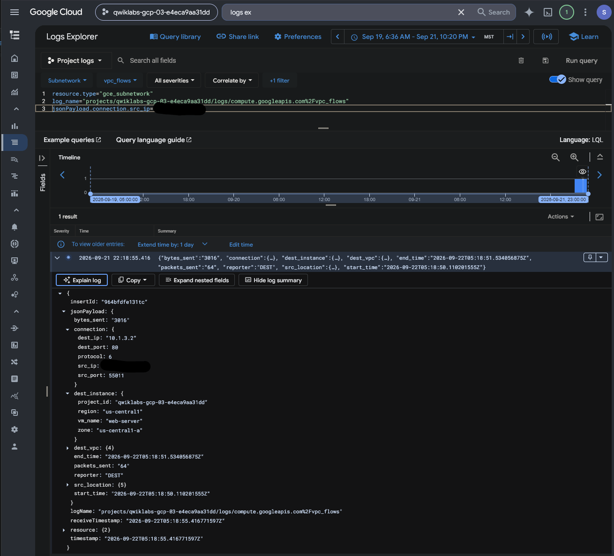
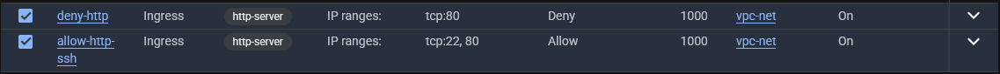

# Google Cloud Firewall Analysis — Network Traffic and Control Validation

## Executive Summary

This investigation documents an authorized Google Cloud firewall analysis exercise involving network access controls, HTTP connectivity, VPC Flow Logs, and firewall rule logging.

The scenario involved a fictional Cymbal Bank web server running Apache within an existing Google Cloud Virtual Private Cloud (VPC) environment.

The primary objective was to assess inbound network traffic, configure firewall rules to allow and deny HTTP connections, and validate the observed network behavior through Cloud Logging.

The guided exercise included creating an ingress firewall rule allowing HTTP and SSH, generating web traffic, reviewing VPC Flow Logs, creating a rule to deny HTTP, and analyzing firewall logs.

An independent investigation extended the exercise by comparing earlier allowed traffic with later denied traffic using a broader log query.

The preserved telemetry displayed both `ALLOWED` and `DENIED` dispositions for HTTP traffic at different timestamps.

This provided evidence of a change in observed firewall enforcement behavior during the exercise.

The investigation demonstrates practical skills in cloud network security, firewall rule evaluation, security telemetry analysis, and evidence-based control validation.

## Investigation Scenario

Cymbal Bank, a fictional financial institution, maintained a demonstration Apache web server in an existing Google Cloud VPC.

The team lead, Chloe, requested an assessment of the server's inbound network access and verification that unnecessary traffic could be blocked using firewall rules.

My role was to configure the prescribed network access controls, generate test traffic, review the corresponding logs, and assess whether the configured deny rule produced the expected result.

This was an authorized training exercise, not an investigation of a confirmed unauthorized intrusion.

## Investigation Scope

| Component | Investigation Purpose |
| --- | --- |
| `vpc-net` | Existing custom-mode VPC network |
| `vpc-subnet` | Subnet with VPC Flow Logs enabled |
| `web-server` | Compute Engine VM hosting Apache |
| `http-server` | Network tag used to target firewall rules |
| `allow-http-ssh` | Ingress rule permitting TCP ports `80` and `22` |
| `deny-http` | Ingress rule denying TCP port `80` |
| VPC Flow Logs | Examine observed HTTP connections |
| Firewall Rules Logging | Evaluate firewall actions and traffic disposition |
| Logs Explorer | Query, filter, and compare connection events |

### Investigation Objectives

1. Examine the supplied web-server and VPC environment.
2. Review the configuration of HTTP and SSH firewall permissions.
3. Generate and inspect HTTP traffic using VPC Flow Logs.
4. Configure a firewall rule intended to deny inbound HTTP.
5. Analyze firewall log records for denied connections.
6. Review the firewall rule details associated with the observed traffic.
7. Independently compare earlier allowed and later denied HTTP traffic.
8. Assess the security implications and limitations of the recorded evidence.

## Evidence Sources and Methodology

### Evidence Sources

The investigation uses five preserved screenshots from Google Cloud VPC firewall configuration and Cloud Logging.

The supplied lab instructions document the environment, guided configuration tasks, and expected testing workflow.

The independent investigation notes describe a broader log query used to compare observed HTTP traffic before and after the firewall change.

### Investigation Methodology

| Phase | Analyst Activity |
| --- | --- |
| Network access configuration | Review the rules permitting HTTP and SSH |
| Traffic generation | Access the Apache web server over HTTP |
| Flow-log analysis | Examine the recorded network connection |
| Firewall modification | Introduce an ingress HTTP deny rule |
| Denied-traffic analysis | Query firewall logs for denied connections |
| Rule evaluation | Examine the connection disposition and rule details |
| Independent validation | Compare allowed and denied connection events |
| Reporting | Document observed behavior and limitations |

### Evidence Standards

The exercise was performed in an authorized, temporary Google Cloud training project.

The existing VPC, subnet, and web server were supplied as part of the exercise.

The lab instructions identify intended configurations and expected outcomes. The preserved screenshots provide evidence of selected firewall states and logged connections.

The report will distinguish between prescribed steps, observed log events, and conclusions that would require additional verification.

A firewall log recording `DENIED` supports a conclusion about the specific connection represented by that event. It does not independently establish that all possible network paths or access attempts were blocked.

Likewise, the `ALLOWED` and `DENIED` comparison documents observed traffic behavior at two points in time, rather than a complete assessment of every effective firewall policy.

## Investigation Organization

The report will document four findings:

1. Initial HTTP Network Traffic and VPC Flow Log Analysis
2. Firewall Rule Configuration and HTTP Denial
3. Denied Connection Investigation and Firewall Rule Attribution
4. Independent Before-and-After Traffic Validation

The final sections will summarize security implications, evidence limitations, skills demonstrated, and the supporting screenshot index.

## Investigation Findings

### Finding 1 — Initial HTTP Network Traffic and VPC Flow Log Analysis

#### Investigation Context

The first phase of the Cymbal Bank firewall investigation involved establishing a baseline of network traffic associated with the supplied Apache web server.

The training environment included an existing Google Cloud VPC named `vpc-net`, a subnet named `vpc-subnet` with VPC Flow Logs enabled, and a Compute Engine instance named `web-server`.

The VM was located in `us-central1-a` and carried the `http-server` network tag.

The guided exercise involved permitting HTTP and SSH access, generating an HTTP connection to the server, and examining the associated VPC Flow Logs.

The objective was to identify the network connection recorded in Cloud Logging before evaluating the subsequent HTTP denial configuration.

#### VPC Flow Log Investigation

I opened Google Cloud Logs Explorer and selected the VPC Flow Logs associated with the subnet.

The preserved query included the following log source filters:

```text
resource.type="gce_subnetwork"
log_name="projects/qwiklabs-gcp-03-e4eca9aa31dd/logs/compute.googleapis.com%2Fvpc_flows"
```

An additional source-IP condition was visible in the query editor, but the actual address was redacted in the screenshot.

The query returned one matching log entry in the displayed results.

#### Observed Network Connection

I expanded the log entry and examined the connection and destination-instance fields.

| Log Attribute | Observed Value |
| --- | --- |
| Resource type | `gce_subnetwork` |
| Log source | `compute.googleapis.com/vpc_flows` |
| Destination VM | `web-server` |
| Destination zone | `us-central1-a` |
| Destination IP address | `10.1.3.2` |
| Destination port | `80` |
| Protocol number | `6` |
| Transport protocol | TCP |
| Source IP address | Redacted in screenshot |
| Source port | `55011` |
| Bytes sent | `3016` |
| Packets sent | `64` |
| Log entry timestamp | September 21, 2026, 22:18:55.416, as displayed |



*Figure 1 — Google Cloud Logs Explorer showing a VPC Flow Log entry for TCP traffic to destination IP `10.1.3.2` on port `80`, associated with the `web-server` instance. The source IP is redacted, and no firewall disposition is shown.*

The destination port `80` corresponded to HTTP traffic.

The protocol value `6` identified TCP.

The `dest_instance` fields associated the flow with the `web-server` Compute Engine instance.

The source-IP address was obscured in the preserved evidence and was not reconstructed.

The `bytes_sent` and `packets_sent` values represented the traffic measurements recorded for the flow-log entry.

#### Traffic Analysis

The record established that Cloud Logging captured TCP traffic associated with the Apache web server.

The observed destination port and instance metadata were consistent with the lab's HTTP connection-generation procedure.

However, a VPC Flow Log is not equivalent to a firewall rules logging entry.

The preserved record did not include an explicit `ALLOWED` or `DENIED` disposition.

Therefore, this screenshot independently verifies observed TCP traffic to destination port `80`, but it does not establish which firewall rule evaluated the connection or whether the HTTP request completed successfully.

The lab procedure described accessing the Apache web server through its external IP address, but the screenshot alone does not verify the HTTP response or application content.

#### Security Relevance

VPC Flow Logs can help security analysts investigate network communication by providing connection metadata, including IP addresses, protocols, destination ports, associated resources, and traffic measurements.

In a firewall investigation, these logs provide useful context for identifying traffic patterns before or after a configuration change.

However, determining the action taken by a firewall requires appropriate firewall rule logging or other supporting evidence.

The distinction is important when validating security controls: evidence of traffic does not automatically demonstrate that the traffic was permitted or blocked by a particular rule.

#### Analyst Assessment

**Assessment: Initial TCP traffic to the Apache web server's HTTP port identified in Google Cloud VPC Flow Logs.**

The preserved log entry associated destination IP `10.1.3.2` and TCP port `80` with the `web-server` instance in `us-central1-a`.

The record included the source port, protocol, and traffic measurements, establishing a network-activity baseline for the investigation.

The screenshot did not independently establish firewall disposition or successful HTTP application access.

The next phase examines the configured firewall rules and the introduction of the HTTP denial control.

### Finding 2 — Firewall Rule Configuration and HTTP Denial

#### Investigation Context

After establishing the initial HTTP traffic baseline, I reviewed the VPC firewall rules configured for the Cymbal Bank web server.

The guided exercise required creating an ingress rule permitting HTTP and SSH traffic, followed by a separate ingress rule denying HTTP traffic.

The objective was to examine the configured access controls, identify overlapping rules, and determine how Google Cloud firewall priority and action evaluation affected incoming HTTP connections.

#### Firewall Rule Configuration

I opened the VPC firewall rules page for the `vpc-net` network.

The preserved screenshot displayed two enabled firewall rules:

- `allow-http-ssh`
- `deny-http`

The following settings were visible:

| Firewall Attribute | `allow-http-ssh` | `deny-http` |
| --- | --- | --- |
| VPC network | `vpc-net` | `vpc-net` |
| Direction | Ingress | Ingress |
| Target network tag | `http-server` | `http-server` |
| Action | Allow | Deny |
| TCP ports | `22`, `80` | `80` |
| Priority | `1000` | `1000` |
| Firewall logging | On | On |



*Figure 2 — Google Cloud VPC firewall list showing `allow-http-ssh` and `deny-http`, both targeting the `http-server` network tag with priority `1000` and logging enabled. The deny rule targets TCP port 80, while the allow rule permits TCP ports 22 and 80.*

Both rules targeted instances carrying the `http-server` network tag.

The allow rule permitted SSH and HTTP, while the deny rule explicitly blocked HTTP for matching traffic.

The original lab instructions specified `0.0.0.0/0` as the source IPv4 range for both rules.

The screenshot displayed the source-filter category but did not independently reveal the complete source range values.

#### HTTP and SSH Access Analysis

The `allow-http-ssh` rule was configured to permit incoming connections on:

- TCP port `22` — SSH
- TCP port `80` — HTTP

The `deny-http` rule was configured to deny incoming connections on:

- TCP port `80` — HTTP

Because both rules used the same target network tag and priority, their conditions overlapped for HTTP traffic matching both rules' source criteria.

This created an opportunity to evaluate how Google Cloud resolves conflicting firewall actions.

#### Firewall Priority and Rule Evaluation

Google Cloud VPC firewall rules use numerical priorities, with lower values representing higher priority.

When an applicable allow rule and deny rule share the same priority, the deny action takes precedence for traffic matching both rules.

The preserved screenshot showed both rules configured with priority `1000`.

| Traffic | Allow Rule | Deny Rule | Expected Result Under These Rules |
| --- | --- | --- | --- |
| TCP `80` | Allow | Deny | Deny takes precedence |
| TCP `22` | Allow | No matching TCP 22 denial in this rule | Allowed by `allow-http-ssh`, subject to other applicable controls |

This rule evaluation explains why introducing an HTTP deny rule can override an existing allow rule without deleting the allow rule.

The expected outcome remains subject to the complete effective firewall policy and whether traffic matches the configured source and target criteria.

#### Firewall Logging Configuration

The firewall list displayed logging as **On** for both rules.

Firewall Rules Logging can provide records of connections matching logged rules, including information about the firewall action and connection attributes.

The screenshot established the enabled logging configuration but did not itself display any recorded connection events.

The following investigation stage examines the corresponding firewall logs to evaluate actual denied traffic.

#### Security Implications

This configuration illustrates the importance of understanding overlapping access-control rules.

An administrator reviewing only the `allow-http-ssh` rule might incorrectly assume HTTP access remained available.

However, the additional `deny-http` rule could override that permission for matching traffic because of its action and equal priority.

Security analysts must therefore consider all applicable rules rather than interpreting a firewall rule in isolation.

The rule configuration also highlights that allowing SSH or HTTP from the source ranges prescribed by the exercise is appropriate only within the intended training context.

In production, administrative access and public-facing services should be scoped according to verified operational requirements.

#### Analyst Assessment

**Assessment: Overlapping HTTP allow and deny rules identified, with the deny action taking precedence at equal priority for matching traffic.**

The screenshot showed two enabled ingress rules targeting the `http-server` network tag.

Both rules used priority `1000` and had firewall logging enabled.

The allow rule permitted TCP ports `22` and `80`, while the deny rule targeted TCP port `80`.

Under Google Cloud VPC firewall evaluation behavior, the deny rule takes precedence for HTTP traffic matching both rules.

The screenshot established the intended firewall configuration, but actual connection denial required supporting traffic evidence.

The next phase examines the firewall log records generated during the HTTP connection test.