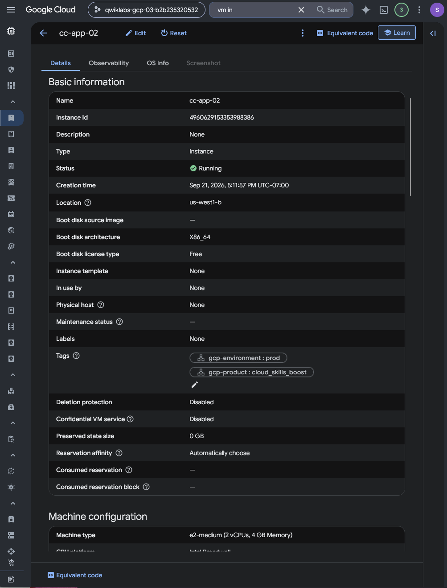
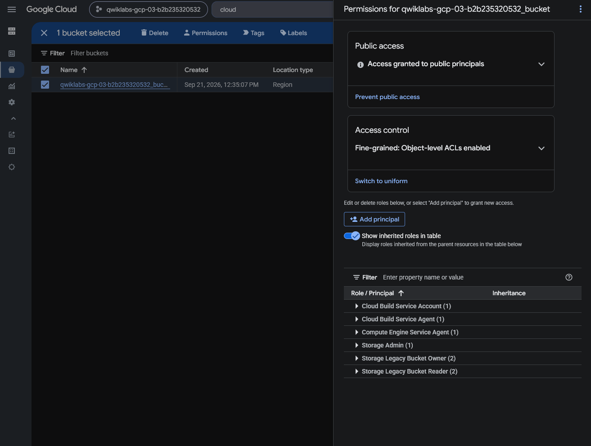
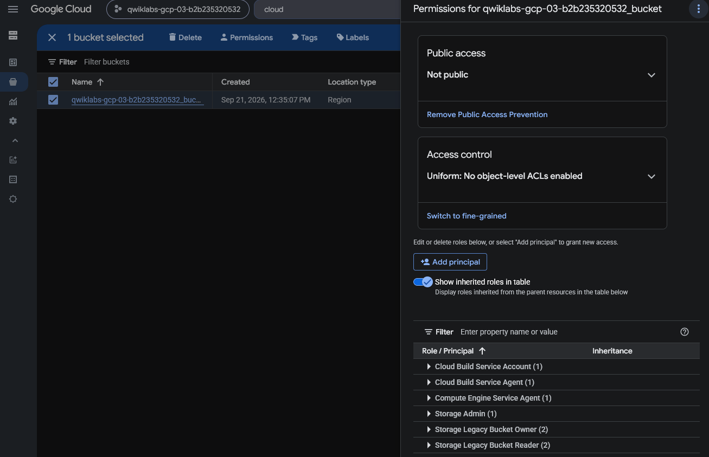
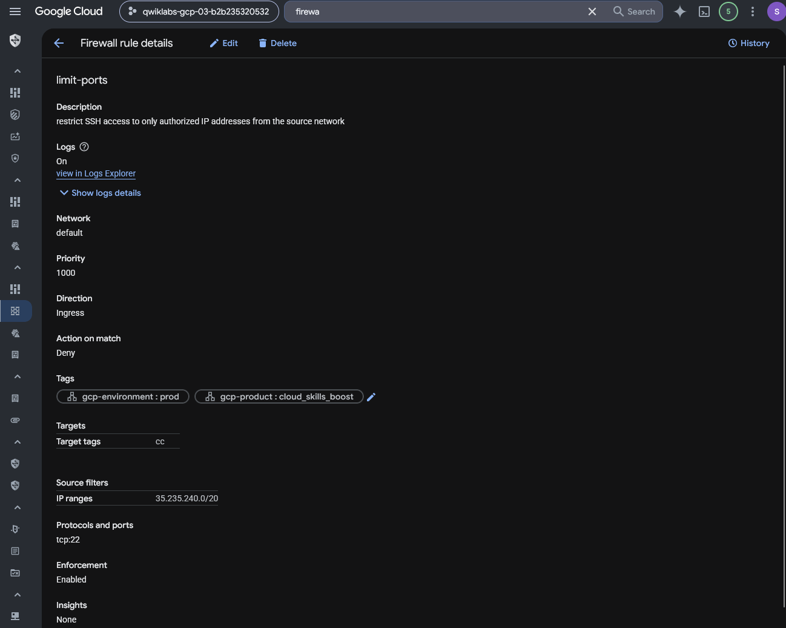
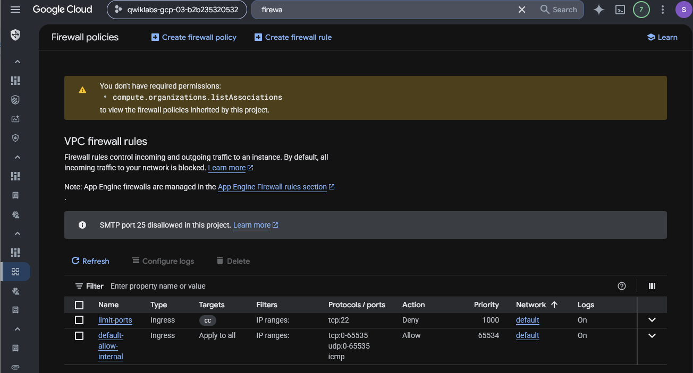
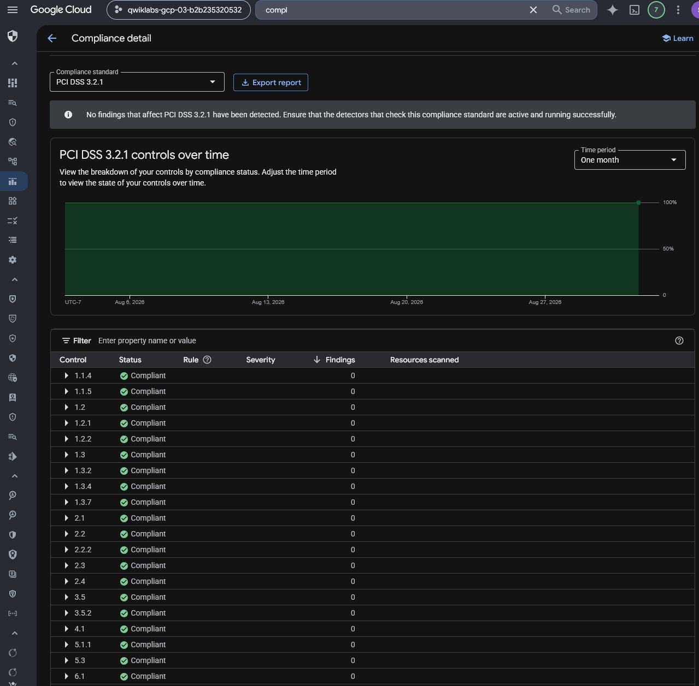

# Google Cloud Incident Response — Data Breach Remediation and Recovery

## Executive Summary

This investigation documents a simulated cloud data breach response involving misconfigured Google Cloud infrastructure at Cymbal Retail.

The exercise placed me in the role of a junior security analyst supporting incident assessment, containment, system recovery, security hardening, and compliance verification.

Using Google Cloud Security Command Center and related cloud services, I investigated configuration findings affecting Compute Engine, Cloud Storage, and VPC firewall rules.

The response workflow included recovering a virtual machine from a pre-incident snapshot, restricting public Cloud Storage access, reducing unnecessary network exposure, enabling firewall rule logging, and reviewing PCI DSS 3.2.1 compliance findings.

The objective was to demonstrate a structured approach to identifying cloud security weaknesses, prioritizing remediation, and evaluating the observable results of corrective actions.

## Incident Scenario

Cymbal Retail, a fictional organization processing customer payment information, experienced a simulated data breach involving unauthorized access to sensitive customer records.

The training scenario described exposed network services, vulnerable cloud resources, and publicly accessible storage as concerns requiring investigation.

The role of the security analyst was to identify relevant misconfigurations, support containment and recovery, and assess whether remediation improved the security posture of the environment.

The scenario's breach narrative provides investigation context. The screenshots document selected infrastructure configurations and findings rather than independent proof of an actual intrusion or data exfiltration.

## Investigation Scope

| Component | Investigation Purpose |
| --- | --- |
| Security Command Center | Identify cloud vulnerabilities and misconfigurations |
| Compute Engine | Review exposed VM configuration and recovery actions |
| Persistent Disk snapshots | Support recovery of a VM from a prior snapshot |
| Cloud Storage | Assess and restrict public bucket access |
| VPC firewall rules | Reduce unnecessary remote-access exposure |
| Identity-Aware Proxy | Preserve restricted SSH administration |
| Firewall rule logging | Improve network traffic visibility |
| PCI DSS 3.2.1 report | Review security-control findings before and after remediation |

### Investigation Objectives

1. Examine security findings associated with the simulated data breach.
2. Identify exposed infrastructure, storage, and network access configurations.
3. Review relevant PCI DSS 3.2.1 findings.
4. Document recovery of the affected Compute Engine virtual machine.
5. Evaluate remediation of public Cloud Storage access.
6. Restrict SSH administration using the Google Cloud IAP source range.
7. Document removal of unnecessary default firewall rules and enable logging.
8. Compare compliance findings before and after remediation.
9. Identify unresolved issues and limitations in the preserved evidence.

## Evidence Sources and Methodology

### Evidence Sources

The investigation uses ten preserved screenshots from Google Cloud Security Command Center, Compute Engine, Cloud Storage, VPC firewall configuration, and PCI DSS compliance reporting.

The lab instructions provide the authorized incident scenario and prescribed remediation workflow.

### Investigation Methodology

| Phase | Analyst Activity |
| --- | --- |
| Assessment | Review security findings and affected cloud resources |
| Prioritization | Identify significant exposure and misconfiguration risks |
| Containment | Reduce external access to vulnerable cloud resources |
| Recovery | Follow the Compute Engine snapshot-based restoration workflow |
| Storage remediation | Restrict public access and review bucket permissions |
| Network hardening | Limit administrative access and update firewall rules |
| Visibility | Enable firewall rule logging where required |
| Verification | Reexamine compliance findings and note remaining limitations |
| Reporting | Document evidence, remediation actions, and conclusions |

### Evidence Standards

The investigation was performed in an authorized, temporary training project.

The data breach was part of the fictional exercise scenario. The preserved screenshots do not independently establish real-world compromise, malware execution, or data theft.

The report will distinguish between remediation steps described in the lab instructions and final configurations directly supported by screenshots.

A restored VM cannot be declared malware-free solely because it was created from a snapshot. Similarly, a reduction in compliance findings does not independently demonstrate full regulatory compliance.

## Investigation Organization

The report will document the following stages:

1. Initial Cloud Security Posture Assessment
2. PCI DSS Compliance Findings Review
3. Compute Engine Vulnerability Assessment and Recovery
4. Cloud Storage Access Remediation
5. Restricted SSH Access Configuration
6. Firewall Hardening and Logging
7. Post-Remediation Compliance Verification

The final sections will summarize security implications, remediation outcomes, evidence limitations, skills demonstrated, and supporting evidence.

## Investigation Findings

### Finding 1 — Initial Cloud Security Posture Assessment

#### Investigation Context

The first phase of the simulated Cymbal Retail incident response involved evaluating existing cloud security misconfigurations.

The exercise scenario described a breach involving customer information, but the initial task focused on identifying vulnerable or misconfigured cloud resources using Google Cloud Security Command Center (SCC).

The objective was to identify the affected resource categories, evaluate the severity distribution, and prioritize subsequent investigation and remediation activities.

#### Security Command Center Risk Overview

I opened Security Command Center and reviewed the **Misconfigurations** dashboard using the **By resource type** view.

The dashboard displayed the following findings:

| Resource Type | Critical | High | Medium | Low |
| --- | ---: | ---: | ---: | ---: |
| Firewall | 0 | 2 | 4 | 0 |
| `compute.Instance` | 0 | 1 | 3 | 0 |
| Bucket | 0 | 1 | 1 | 1 |
| `resourcemanager.Project` | 0 | 0 | 2 | 9 |
| Network | 0 | 0 | 2 | 0 |
| `compute.Project` | 0 | 0 | 1 | 0 |
| `ServiceAccountKey` | 0 | 0 | 1 | 0 |
| Subnetwork | 0 | 0 | 0 | 48 |
| **Total** | **0** | **4** | **14** | **58** |

*Figure 1 — Google Cloud Security Command Center misconfigurations grouped by resource type, showing High-severity findings affecting firewall rules, Compute Engine instances, and Cloud Storage buckets.*

The resource-type breakdown contained no Critical findings but showed four High-severity misconfiguration findings.

Firewall, Compute Engine instance, and Cloud Storage bucket categories accounted for the High-severity findings.

The dashboard also displayed Medium- and Low-severity findings affecting several other resource types.

The findings counts represent the visible security-check results grouped by resource type. They do not independently establish the number of distinct affected assets, successful exploitation, or direct involvement in the simulated breach.

#### Initial Risk Prioritization

The initial review identified three resource categories for priority investigation.

| Priority | Resource Category | Investigation Rationale |
| --- | --- | --- |
| High | Firewall | Two High-severity findings indicated potentially significant network access misconfigurations |
| High | Compute Engine | One High-severity instance finding warranted examination of VM exposure and recovery requirements |
| High | Cloud Storage | One High-severity bucket finding warranted investigation of storage access controls |

These priorities were based on the severity distribution and the incident scenario's known remediation requirements.

The dashboard alone did not establish the specific technical cause of each finding or whether the affected resources were exploited.

Further finding-level investigation was therefore required before attributing the simulated data breach to a particular configuration weakness.

#### Security Relevance

Security Command Center provides an aggregated view of security misconfigurations across supported Google Cloud resources.

Grouping findings by resource type helps analysts identify areas that may require urgent review.

However, finding severity should be evaluated together with exposure, affected data, resource criticality, and operational context.

A High-severity configuration finding is not equivalent to a confirmed attack or verified breach path.

#### Analyst Assessment

**Assessment: Four High-severity misconfiguration findings identified across Firewall, Compute Engine, and Cloud Storage.**

The initial SCC review established a baseline of visible cloud security findings and identified resource categories requiring further investigation.

The results supported prioritization of network controls, virtual machine security, and storage permissions.

The next phase examines PCI DSS compliance findings to identify additional control weaknesses relevant to the simulated incident.

### Finding 2 — Initial PCI DSS 3.2.1 Compliance Assessment

#### Investigation Context

After reviewing the initial Security Command Center misconfiguration overview, I examined the project's PCI DSS 3.2.1 compliance report.

The simulated Cymbal Retail incident involved infrastructure and storage configurations that could expose sensitive customer information.

The objective was to identify relevant compliance-control findings, establish a pre-remediation baseline, and determine which security weaknesses required additional investigation.

#### Initial Compliance Report

I navigated to Security Command Center → Compliance and opened the PCI DSS 3.2.1 report.

The preserved screenshot was dated September 21, 2026, and displayed a one-month reporting period.

The report showed the following non-compliant controls:

| PCI DSS Control | Reported Status | Finding Count |
| --- | --- | ---: |
| `10.1` | Non-compliant | 29 |
| `10.2` | Non-compliant | 29 |
| `1.2.1` | Non-compliant | 2 |
| `7.1.2` | Non-compliant | 1 |
| `7.2` | Non-compliant | 1 |

*Figure 2 — Initial Security Command Center PCI DSS 3.2.1 report showing five non-compliant controls and their associated finding counts before remediation.*

The report also displayed several controls marked Compliant with zero associated findings.

The visible table established that five listed controls were assessed as Non-compliant at the time of the screenshot.

The finding counts represent associations shown in the compliance report and should not be interpreted as a count of unique vulnerabilities or affected resources.

#### Security Weaknesses Identified in the Lab

The lab instructions identified several security configuration concerns relevant to the simulated incident.

| Security Configuration | Risk Described in the Lab |
| --- | --- |
| Firewall rule logging disabled | Reduced visibility into traffic allowed or denied by firewall rules |
| RDP exposed to all IP addresses | Potential external access to TCP port `3389` |
| SSH exposed to all IP addresses | Potential external access to TCP port `22` |
| VM assigned a public IP address | Increased exposure of the virtual machine to internet-originated traffic |
| Public Cloud Storage bucket access | Potential unauthorized access to data stored in the bucket |
| Default service account with broad API access scopes | Excessive potential API access, subject to the account's IAM permissions |

These concerns were described in the original exercise instructions.

The preserved PCI DSS screenshot did not expand the individual controls to show their associated rules. Therefore, the table above documents the lab's prescribed investigation context rather than independently verified mappings between each listed control and a particular misconfiguration.

The lab also described other findings, including disabled VPC Flow Logs, overly permissive basic IAM roles, and missing egress-deny rules.

Not every identified weakness was addressed during the exercise.

#### Initial Remediation Priorities

Based on the simulated incident scenario and the security weaknesses described in the lab, I prioritized the following areas:

1. **Compute Engine recovery:** Review the affected virtual machine and follow the prescribed snapshot-based restoration procedure.
2. **Cloud Storage security:** Remove unnecessary public access and strengthen bucket-level authorization controls.
3. **Network access restrictions:** Replace overly permissive administrative-access rules with restricted SSH access.
4. **Firewall visibility:** Enable appropriate firewall rule logging.
5. **Post-remediation assessment:** Reevaluate the compliance report to determine whether relevant security findings changed.

These priorities were guided by the lab scenario and the initial Security Command Center findings.

They do not establish that any particular misconfiguration was independently proven to be the cause of the simulated data breach.

#### Compliance Interpretation

The report was useful for identifying cloud-security control weaknesses and prioritizing remediation.

However, a Security Command Center compliance report represents an automated assessment of supported checks.

It does not independently establish an organization's complete compliance with PCI DSS requirements or constitute a formal certification or assessment of the cardholder data environment.

Furthermore, a control's displayed Compliant status should be interpreted within the scope of the checks and resources evaluated by Security Command Center.

#### Analyst Assessment

**Assessment: Five PCI DSS 3.2.1 controls displayed as Non-compliant in the initial Security Command Center report.**

The report established a baseline of control findings before the documented remediation activities.

The original lab instructions identified network exposure, storage permissions, VM configuration, and logging as priority concerns.

The next investigation phase examines the affected cloud resources and the findings associated with those risks.

### Finding 3 — Detailed Compute Engine and Firewall Security Findings

#### Investigation Context

After examining the initial Security Command Center overview and PCI DSS compliance baseline, I reviewed the individual security findings associated with the simulated Cymbal Retail incident.

The objective was to identify specific misconfigurations affecting the application virtual machine and VPC firewall rules before proceeding with recovery and hardening.

#### Compute Engine Findings

The Security Command Center findings list displayed five records associated with the Compute Engine instance `cc-app-01`.

| Finding Category | Severity | Finding Class |
| --- | --- | --- |
| `Public IP address` | High | Misconfiguration |
| `Default service account used` | Medium | Misconfiguration |
| `Full API access` | Medium | Misconfiguration |
| `Compute Secure Boot disabled` | Medium | Misconfiguration |
| `Malware: bad domain` | Low | Threat |

*Figure 3 — Security Command Center showing five findings associated with the `cc-app-01` Compute Engine instance, including public IP exposure, service account configuration, API access, Secure Boot, and a low-severity threat finding.*

These findings identified several potential security concerns.

The public IP finding indicated internet-facing connectivity at the instance level, subject to the project's effective firewall rules and other controls.

The default service account and Full API access findings indicated identity and access configurations requiring further review. Broad API access scopes do not independently grant permissions beyond those available through the associated service account's IAM roles.

The Secure Boot finding identified a disabled virtual-machine security feature.

The `Malware: bad domain` finding provided a threat-detection lead, but the preserved screenshot did not include the detailed indicators, associated process activity, or network evidence necessary to independently establish malware infection.

#### Firewall Findings

The second findings view displayed six records associated with existing VPC firewall rules.

| Finding Category | Severity | Affected Firewall Rule |
| --- | --- | --- |
| `Open SSH port` | High | `default-allow-ssh` |
| `Open RDP port` | High | `default-allow-rdp` |
| `Firewall rule logging disabled` | Medium | `default-allow-ssh` |
| `Firewall rule logging disabled` | Medium | `default-allow-icmp` |
| `Firewall rule logging disabled` | Medium | `default-allow-internal` |
| `Firewall rule logging disabled` | Medium | `default-allow-rdp` |

*Figure 4 — Security Command Center showing six findings involving open SSH/RDP ports and disabled firewall rule logging.*

The Open SSH and Open RDP findings indicated potentially excessive administrative-access exposure through the corresponding firewall rules.

The disabled logging findings indicated reduced network visibility for traffic associated with those rules.

Because a firewall finding does not independently establish that a service was reachable or exploited, additional network and system evidence would be required to assess actual exposure and access.

#### Risk Prioritization

The investigation prioritized the following areas:

| Priority | Affected Component | Rationale |
| --- | --- | --- |
| High | `cc-app-01` Compute Engine instance | Public network exposure and multiple security findings |
| High | `default-allow-ssh` | High-severity SSH exposure finding |
| High | `default-allow-rdp` | High-severity RDP exposure finding |
| Medium | Firewall rule logging | Visibility gaps across multiple rules |
| Medium | Service account and API access configuration | Potentially excessive access requiring further review |
| Medium | Compute Secure Boot | Disabled VM security feature |
| Investigate | `Malware: bad domain` | Threat-detection lead requiring additional technical evidence |

These priorities reflected the reported severity, the simulated incident scenario, and the relevance of each configuration to containment and recovery.

The screenshot evidence did not independently confirm an exploit path connecting the findings to the fictional breach.

#### Analyst Assessment

**Assessment: Eleven Security Command Center findings identified across Compute Engine and VPC firewall configurations.**

Five findings affected the `cc-app-01` virtual machine, including one Low-severity threat finding.

Six findings affected existing VPC firewall rules, including two High-severity open-port findings.

The results supported recovery planning, restriction of administrative network access, and improved firewall visibility.

The following investigation stages document the corresponding cloud-resource configurations and remediation workflow.

### Finding 4 — Compute Engine Recovery and VM Hardening

#### Investigation Context

The simulated Cymbal Retail incident identified the `cc-app-01` Compute Engine instance as an affected resource requiring recovery.

The original Security Command Center findings included a public IP address, use of the default service account, full API access scopes, disabled Secure Boot, and a `Malware: bad domain` threat finding.

The exercise prescribed stopping the original instance and deploying a replacement virtual machine from a pre-existing disk snapshot.

The objective was to restore the application environment while reducing unnecessary network exposure and improving the replacement instance's security configuration.

#### Recovery Procedure

Following the lab instructions, the recovery workflow included:

1. Stopping the original `cc-app-01` instance.
2. Creating a replacement Compute Engine instance named `cc-app-02`.
3. Selecting the pre-existing `cc-app01-snapshot` disk snapshot as the source for the new boot disk.
4. Configuring an `e2-medium` machine type.
5. Applying the `cc` network tag for targeted firewall rules.
6. Configuring the external IPv4 address setting as `None`.
7. Selecting the service account specified by the detailed lab procedure.
8. Creating the replacement VM.
9. Stopping the new instance temporarily to enable Shielded VM Secure Boot.
10. Starting the replacement instance after saving the security configuration.
11. Deleting the original `cc-app-01` instance as prescribed by the exercise.

The snapshot was supplied as part of the training environment. The preserved evidence does not establish how the snapshot was created or independently verify its integrity.

The lab instructions describe this process as restoring from a clean, pre-incident state. However, the snapshot's actual security condition was not independently validated through malware scanning or forensic analysis.

#### Replacement VM Verification

The Compute Engine details page displayed the following configuration:

| Instance Attribute | Observed Value |
| --- | --- |
| Instance name | `cc-app-02` |
| Instance status | Running |
| Creation time | September 21, 2026, 5:11:57 PM UTC-7 |
| Location | `us-west1-b` |
| Machine type | `e2-medium` |
| CPU architecture | `x86_64` |
| Deletion protection | Disabled |
| Snapshot source | Not visible in the preserved screenshot |
| External IP configuration | Not visible in the preserved screenshot |
| Secure Boot status | Not visible in the preserved screenshot |
| Service account configuration | Not visible in the preserved screenshot |

*Figure 5 — Compute Engine details page showing the replacement `cc-app-02` instance running in `us-west1-b`. The screenshot verifies the replacement VM's existence and basic configuration, but does not independently establish its snapshot source or all security settings.*

The screenshot confirms that the replacement instance was created and running.

It does not independently demonstrate that the original instance was deleted, that the replacement boot disk originated from the specified snapshot, or that all intended security settings were successfully applied.

#### Security Hardening Objectives

The recovery procedure incorporated several security improvements.

| Security Control | Intended Improvement |
| --- | --- |
| Snapshot-based replacement | Restore from a prior disk state rather than continuing to use the affected VM |
| No external IPv4 address | Reduce direct internet exposure of the replacement instance |
| Shielded VM Secure Boot | Help prevent unauthorized boot components from loading |
| `cc` network tag | Apply narrowly scoped firewall rules to the intended instance |
| Service account review | Avoid unnecessary default credentials and excessive effective permissions |
| Original VM removal | Retire the previously affected instance after recovery |

These controls reflect the documented procedure and intended remediation objectives.

The preserved screenshot verifies the replacement instance's running state but does not independently confirm the effectiveness or final state of each control.

#### Incident Response Considerations

Replacing a potentially compromised virtual machine can be an effective recovery approach when an appropriate recovery point is available.

However, snapshot-based recovery does not automatically prove that a system is malware-free.

A production recovery process would also require validation of the recovery point, review of relevant persistence mechanisms, credential rotation where applicable, assessment of attached storage, and verification that the original access path had been addressed.

Deleting a compromised instance may also destroy useful forensic evidence if disk images, logs, and other artifacts have not been preserved.

In this training exercise, the recovery and deletion workflow was prescribed rather than designed as a comprehensive forensic preservation process.

#### Analyst Assessment

**Assessment: Replacement Compute Engine instance `cc-app-02` verified as running following the documented recovery workflow.**

The exercise provided a snapshot-based VM replacement procedure incorporating network and boot-security hardening objectives.

The preserved screenshot confirms the existence and running state of the new instance.

Additional configuration evidence and security validation would be required to confirm the snapshot origin, Secure Boot status, network exposure, service account privileges, and final disposition of the original VM.

### Finding 5 — Cloud Storage Public Access Remediation

#### Investigation Context

The simulated Cymbal Retail incident identified public Cloud Storage access as a potential data exposure concern.

The objective was to assess the affected bucket's original permissions, apply stronger access controls, and verify the resulting configuration.

Unlike several earlier investigation stages, this finding includes preserved screenshots of both the initial and post-remediation states.

#### Initial Bucket Security Configuration

I opened Cloud Storage and reviewed the permissions for the training bucket:

`qwiklabs-gcp-03-b2b235320532_bucket`

The initial screenshot displayed the following configuration:

| Security Setting | Initial State |
| --- | --- |
| Public access | Access granted to public principals |
| Public Access Prevention | Not enforced in the displayed configuration |
| Access control mode | Fine-grained |
| Object-level ACLs | Enabled |

*Figure 6 — Initial Cloud Storage bucket permissions showing public access granted to public principals and fine-grained object-level ACLs enabled.*

The bucket's public access status indicated that public principals had been granted access.

Fine-grained access control also allowed object-level ACLs, introducing another mechanism for managing access outside uniform bucket-level IAM.

The screenshot did not identify every public principal or show the effective permissions for individual objects.

Therefore, the evidence established a publicly accessible configuration but did not independently determine which files were exposed or accessed.

#### Storage Remediation Procedure

Following the lab instructions, I updated the Cloud Storage bucket's security configuration.

The procedure involved:

1. Opening the affected Cloud Storage bucket.
2. Reviewing the existing public access and access-control settings.
3. Enabling Public Access Prevention.
4. Switching the bucket to uniform bucket-level access.
5. Saving the configuration changes.
6. Returning to the Permissions view to verify the resulting settings.

Public Access Prevention is intended to prevent public access grants to the bucket and its objects.

Uniform bucket-level access disables object-level ACLs and centralizes authorization through IAM policies.

Together, these controls simplify access management and reduce the risk of unintended public exposure.

#### Post-Remediation Verification

The second screenshot showed the same bucket with updated security settings.

| Security Setting | Before Remediation | After Remediation |
| --- | --- | --- |
| Public access | Access granted to public principals | Not public |
| Public Access Prevention | Not enforced | Enforced |
| Access control mode | Fine-grained | Uniform |
| Object-level ACLs | Enabled | Disabled |

*Figure 7 — Post-remediation permissions showing the bucket as Not public, Public Access Prevention enabled, and uniform bucket-level access active.*

The updated Permissions view displayed **Not public**.

The presence of the **Remove Public Access Prevention** option indicated that Public Access Prevention was enabled.

The Access control panel also displayed **Uniform: No object-level ACLs enabled**.

These observations provide direct visual evidence that the bucket's public access and access-control configuration changed during the exercise.

#### Security Relevance

Public Cloud Storage access can result in unintended disclosure when sensitive information is stored in publicly accessible buckets or objects.

Enforcing Public Access Prevention reduces exposure through public IAM and ACL grants.

Uniform bucket-level access simplifies permissions management by eliminating object-level ACLs.

In a production incident, securing the bucket would be one part of the response.

An analyst would also investigate Cloud Audit Logs and available storage-access telemetry, evaluate which objects were exposed, determine whether access occurred, and assess whether credentials or IAM permissions require further remediation.

The screenshots in this exercise do not establish that data was exfiltrated or that an unauthorized party accessed the bucket.

#### Analyst Assessment

**Assessment: Cloud Storage bucket public access controls successfully hardened in the visible post-remediation configuration.**

The initial screenshot showed public access and fine-grained object-level ACLs.

The post-remediation screenshot showed a nonpublic bucket with Public Access Prevention enforced and uniform bucket-level access enabled.

This demonstrated a directly verifiable reduction in public exposure for the affected storage bucket.

The next investigation phase examines restrictions applied to administrative network access.

### Finding 6 — Restricted SSH Access and Firewall Rule Analysis

#### Investigation Context

The simulated Cymbal Retail incident identified overly permissive administrative network access as a security concern.

Earlier Security Command Center findings reported that the default SSH and RDP firewall rules allowed potentially excessive network exposure.

The lab's intended remediation was to restrict administrative SSH access using Google Cloud Identity-Aware Proxy (IAP) and reduce unnecessary public access.

The objective of this investigation phase was to examine the resulting firewall rule and determine whether its recorded configuration supported that goal.

#### Firewall Rule Configuration

I reviewed the VPC firewall rule named `limit-ports` in the Google Cloud console.

The preserved screenshot showed the following settings:

| Firewall Attribute | Observed Configuration |
| --- | --- |
| Rule name | `limit-ports` |
| VPC network | `default` |
| Direction | Ingress |
| Action on match | **Deny** |
| Priority | `1000` |
| Source IP range | `35.235.240.0/20` |
| Target network tag | `cc` |
| Protocol and port | `tcp:22` |
| Firewall rule logging | On |
| Enforcement | Enabled |

*Figure 8 — Google Cloud VPC firewall rule `limit-ports` showing an enabled ingress Deny rule for TCP port 22 from `35.235.240.0/20`, targeting instances with the `cc` network tag and with logging enabled.*

The firewall rule was enabled and scoped to instances carrying the `cc` network tag.

It matched incoming TCP port 22 traffic originating from the specified source range.

The source range `35.235.240.0/20` corresponds to Google Cloud IAP TCP forwarding.

However, the configured action was **Deny**.

#### Security Configuration Assessment

The firewall rule's stated description indicated an intention to restrict SSH access to authorized source addresses.

The configured action, however, denied matching SSH connections from the IAP source range.

This is an important distinction because firewall rule intent and enforcement behavior are not necessarily the same.

An ingress deny rule targeting the IAP source range does not enable IAP SSH access.

Furthermore, the existence of this rule does not independently establish that other SSH ingress paths were blocked.

Google Cloud VPC firewall behavior depends on applicable rules, priorities, targets, source ranges, and policy evaluation.

A complete exposure assessment would therefore require reviewing the effective firewall rules associated with the target instance.

#### Intended Secure Configuration

For a production VM requiring SSH administration through IAP, an appropriate configuration would typically include:

1. Removing or disabling unnecessarily broad SSH ingress rules.
2. Creating an ingress **allow** rule for TCP port 22 from the IAP TCP forwarding range.
3. Restricting that rule to the intended VM or target service account.
4. Granting only authorized administrators the necessary IAP access permissions.
5. Ensuring other network paths do not unintentionally expose SSH.
6. Validating connectivity through the intended IAP workflow.
7. Reviewing firewall rule logs and applicable audit records.

These are recommended controls rather than configurations independently demonstrated by the screenshot.

#### Firewall Logging

The `limit-ports` rule displayed firewall rule logging as On.

This indicated that logging was enabled for traffic evaluated against the rule, subject to Google Cloud logging behavior and the presence of matching traffic.

The screenshot did not display actual firewall log entries.

Therefore, the evidence supports the configured logging state but does not independently confirm successful traffic logging or SSH access attempts.

#### Analyst Assessment

**Assessment: Enabled SSH deny rule identified for the IAP source range, with firewall rule logging enabled.**

The preserved configuration demonstrated a scoped ingress rule targeting TCP port 22 and instances with the `cc` network tag.

However, the rule used the **Deny** action for the IAP TCP forwarding range.

As a result, the screenshot does not establish that IAP-based SSH access was enabled or that the intended restricted-access configuration was successfully achieved.

This finding illustrates the importance of verifying actual firewall actions, source ranges, priorities, and effective rules rather than relying on rule names or descriptions.

### Finding 7 — Firewall Hardening and Logging Verification

#### Investigation Context

After examining the `limit-ports` SSH firewall rule, I reviewed the remaining VPC firewall configuration.

The simulated incident identified unrestricted SSH and RDP access, along with disabled firewall rule logging, as security concerns.

The lab remediation procedure required removing three overly permissive default rules and enabling logging for the remaining rules.

The objective was to verify the visible firewall configuration after these changes and identify any remaining access-control concerns.

#### Firewall Rule Cleanup

The lab instructions directed removal of the following rules:

- `default-allow-ssh`
- `default-allow-rdp`
- `default-allow-icmp`

These rules were previously associated with security findings involving network exposure or disabled logging.

The post-remediation screenshot displayed only two VPC firewall rules in the current view.

| Firewall Rule | Direction | Action | Protocols / Ports | Logging |
| --- | --- | --- | --- | --- |
| `limit-ports` | Ingress | Deny | TCP 22 | On |
| `default-allow-internal` | Ingress | Allow | TCP 0–65535, UDP 0–65535, ICMP | On |

*Figure 9 — Google Cloud VPC firewall rules showing `limit-ports` and `default-allow-internal` with logging enabled. The custom SSH rule uses the Deny action, and the training account lacks permission to inspect inherited firewall policies.*

The three default rules targeted for deletion were absent from the displayed list.

This supports the conclusion that the visible project-level VPC firewall configuration no longer contained those permissive SSH, RDP, and ICMP rules.

However, the screenshot did not provide a complete effective-policy analysis, including inherited firewall policies.

#### Firewall Logging Verification

Both remaining rules displayed logging as **On**.

The `limit-ports` rule applied to SSH traffic matching its configured source range and target network tag.

The `default-allow-internal` rule permitted a broad range of internal network protocols and ports.

| Verification Item | Observed Result |
| --- | --- |
| `limit-ports` firewall logging | On |
| `default-allow-internal` firewall logging | On |
| Default SSH rule | Not visible |
| Default RDP rule | Not visible |
| Default ICMP rule | Not visible |
| Inherited firewall policies | Not accessible with the training account |

Enabling firewall rule logging improves visibility into traffic matching those rules.

However, the preserved screenshot documents the logging configuration, not actual log records.

It therefore does not independently demonstrate that matching traffic was generated or successfully recorded.

#### Remaining SSH Access Concern

The final firewall list confirmed the earlier observation that `limit-ports` used the **Deny** action for TCP port 22.

The source range configured for this rule was the Google Cloud IAP TCP forwarding range, `35.235.240.0/20`.

The lab objective was to preserve restricted administrative SSH access through IAP while removing broad internet-facing SSH access.

However, an ingress Deny rule matching the IAP range does not permit the intended SSH connections.

This represents a discrepancy between the intended remediation and the preserved firewall configuration.

In a production environment, I would verify the effective firewall policies and configure a properly scoped ingress Allow rule for IAP-based SSH access before concluding that restricted administrative access was functional.

The screenshot also displayed an insufficient-permissions warning for inherited firewall policies, limiting the completeness of the access assessment.

#### Security Implications

Removing broadly permissive administrative-access rules can reduce the attack surface of cloud infrastructure.

Enabling firewall rule logging supports investigation and operational monitoring.

However, secure firewall configuration requires validating the actual rule actions, matching conditions, priorities, and intended connectivity.

A restrictive rule that blocks legitimate administrative access can introduce an availability or manageability problem, even if it reduces exposure.

Similarly, the remaining `default-allow-internal` rule permits broad traffic between matching internal resources, which may warrant further segmentation in a production environment.

The preserved evidence does not independently establish the complete effective network-access posture or confirm successful IAP SSH connectivity.

#### Analyst Assessment

**Assessment: Default SSH, RDP, and ICMP rules absent from the visible VPC firewall list, with logging enabled on both remaining rules.**

The final screenshot supports the conclusion that the visible firewall configuration was simplified and logging was enabled.

However, the `limit-ports` rule continued to deny IAP-range SSH traffic, and inherited firewall policies were not available for inspection.

The evidence therefore supports the documented firewall cleanup and logging configuration, but not a claim of fully validated restricted SSH access.

### Finding 8 — Post-Remediation PCI DSS Compliance Assessment

#### Investigation Context

After completing the documented Compute Engine recovery, Cloud Storage access remediation, and VPC firewall configuration changes, I returned to Google Cloud Security Command Center to review the PCI DSS 3.2.1 compliance report.

The objective was to compare the visible compliance findings before and after remediation and evaluate whether the reported security posture had improved.

The initial assessment identified five non-compliant controls, with findings involving logging, network access, and access-control concerns.

#### Post-Remediation Compliance Report

I opened Security Command Center → Compliance and selected PCI DSS 3.2.1.

The final screenshot displayed a summary message stating that no findings affecting PCI DSS 3.2.1 had been detected.

The visible control rows were marked Compliant and displayed zero findings.

| Verification Item | Observed Result |
| --- | --- |
| Compliance standard | PCI DSS 3.2.1 |
| Reporting period | One month |
| Summary | No findings affecting the standard detected |
| Visible control statuses | Compliant |
| Visible finding counts | 0 |
| Detector health | Not independently verified |
| Complete PCI DSS compliance | Not established by this report |

*Figure 10 — Post-remediation Security Command Center PCI DSS 3.2.1 report displaying no detected findings and zero findings for visible compliant controls. Detector health and complete organizational compliance are not independently verified.*

The report also advised verifying that the detectors evaluating the compliance standard were active and running successfully.

The screenshot did not independently provide detector-health information.

Consequently, the final report supports a conclusion about the displayed Security Command Center findings, rather than a comprehensive determination of organizational compliance.

#### Before-and-After Comparison

The initial and final screenshots demonstrated a change in the compliance results displayed by Security Command Center.

| Assessment Attribute | Initial Report | Final Report |
| --- | --- | --- |
| Overall report | Multiple non-compliant controls visible | No findings affecting PCI DSS 3.2.1 detected |
| Control `10.1` | Non-compliant; 29 findings | Not individually visible |
| Control `10.2` | Non-compliant; 29 findings | Not individually visible |
| Control `1.2.1` | Non-compliant; 2 findings | Compliant; 0 findings |
| Control `7.1.2` | Non-compliant; 1 finding | Not individually visible |
| Control `7.2` | Non-compliant; 1 finding | Not individually visible |

The initial screenshot explicitly showed five controls marked Non-compliant.

The post-remediation screenshot showed the overall no-findings message and compliant results for the controls visible in the captured portion of the report.

Control `1.2.1` was individually visible in both screenshots and changed from Non-compliant with two findings to Compliant with zero findings.

The other previously non-compliant controls were not individually visible in the final screenshot, so their specific final rows could not be independently compared.

#### Relationship to Remediation Activities

The compliance-report comparison followed several documented remediation activities:

1. Replacing the affected Compute Engine virtual machine through the prescribed snapshot-based recovery workflow.
2. Changing the Cloud Storage bucket from a publicly accessible configuration to a nonpublic configuration with Public Access Prevention and uniform bucket-level access.
3. Removing the broadly permissive default SSH, RDP, and ICMP firewall rules from the visible VPC firewall configuration.
4. Enabling logging on the remaining visible firewall rules.
5. Reviewing the final Security Command Center compliance report.

The preserved screenshots provided direct before-and-after verification for Cloud Storage access controls and supporting evidence for firewall cleanup and logging changes.

However, the compliance report alone did not establish that every security weakness identified earlier had been remediated.

In particular, the `limit-ports` firewall rule remained configured as an ingress Deny rule for TCP port 22 from the Google Cloud IAP TCP forwarding source range.

This configuration did not independently demonstrate successful restricted SSH administration.

#### Compliance Interpretation

Security Command Center compliance reporting evaluates supported cloud security findings against mapped compliance controls.

A final report containing zero detected findings may indicate improvement in the assessed configuration, provided the applicable detectors are active and the expected resources are included.

It does not independently demonstrate that all PCI DSS requirements have been satisfied.

Formal compliance assessment would require additional organizational, technical, procedural, and evidentiary evaluation beyond the preserved lab screenshots.

The fictional data-breach scenario was also not independently validated through forensic evidence, so the change in compliance findings should not be interpreted as proof that an actual incident was fully resolved.

#### Analyst Assessment

**Assessment: Post-remediation Security Command Center report displayed no detected PCI DSS 3.2.1 findings, compared with five visibly non-compliant controls in the initial report.**

The final screenshot demonstrated an improved displayed compliance posture within the training environment.

Control `1.2.1` was directly observed changing from Non-compliant with two findings to Compliant with zero findings.

However, the preserved report did not independently verify detector health, all previously reported control rows, or complete PCI DSS compliance.

The investigation therefore supports a conclusion of improved reported security posture, while recognizing the remaining verification limitations.