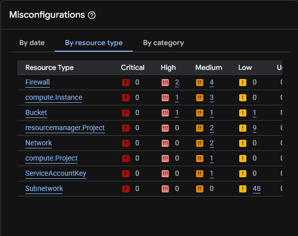
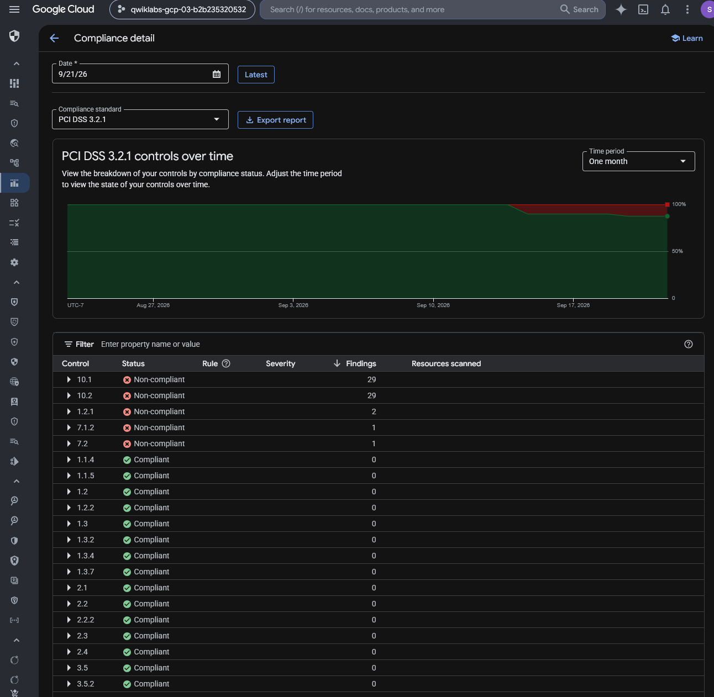
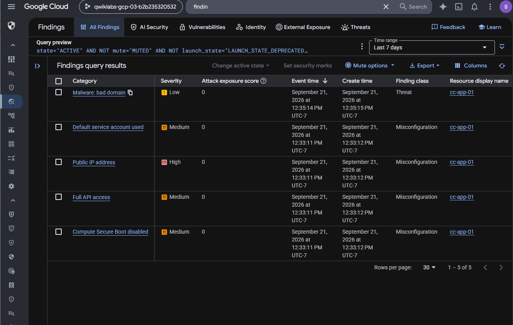
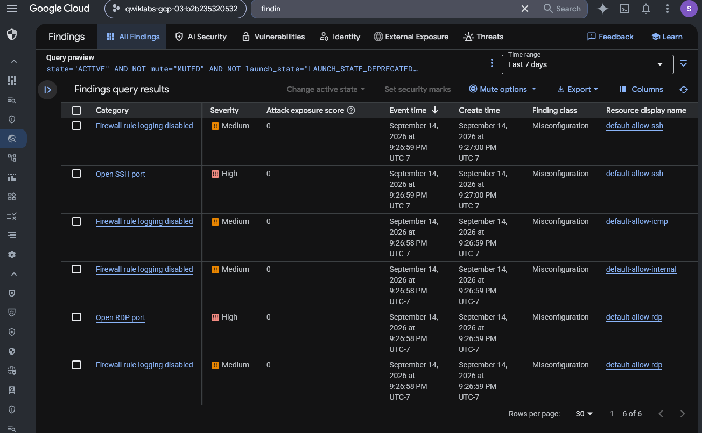

# Google Cloud Incident Response — Data Breach Remediation and Recovery

## Executive Summary

This investigation documents a simulated cloud data breach response involving misconfigured Google Cloud infrastructure at Cymbal Retail.

The exercise placed me in the role of a junior security analyst supporting incident assessment, containment, system recovery, security hardening, and compliance verification.

Using Google Cloud Security Command Center and related cloud services, I investigated configuration findings affecting Compute Engine, Cloud Storage, and VPC firewall rules.

The response workflow included recovering a virtual machine from a pre-incident snapshot, restricting public Cloud Storage access, reducing unnecessary network exposure, enabling firewall rule logging, and reviewing PCI DSS 3.2.1 compliance findings.

The objective was to demonstrate a structured approach to identifying cloud security weaknesses, prioritizing remediation, and evaluating the observable results of corrective actions.

## Incident Scenario

Cymbal Retail, a fictional organization processing customer payment information, experienced a simulated data breach involving unauthorized access to sensitive customer records.

The training scenario described exposed network services, vulnerable cloud resources, and publicly accessible storage as concerns requiring investigation.

The role of the security analyst was to identify relevant misconfigurations, support containment and recovery, and assess whether remediation improved the security posture of the environment.

The scenario's breach narrative provides investigation context. The screenshots document selected infrastructure configurations and findings rather than independent proof of an actual intrusion or data exfiltration.

## Investigation Scope

| Component | Investigation Purpose |
| --- | --- |
| Security Command Center | Identify cloud vulnerabilities and misconfigurations |
| Compute Engine | Review exposed VM configuration and recovery actions |
| Persistent Disk snapshots | Support recovery of a VM from a prior snapshot |
| Cloud Storage | Assess and restrict public bucket access |
| VPC firewall rules | Reduce unnecessary remote-access exposure |
| Identity-Aware Proxy | Preserve restricted SSH administration |
| Firewall rule logging | Improve network traffic visibility |
| PCI DSS 3.2.1 report | Review security-control findings before and after remediation |

### Investigation Objectives

1. Examine security findings associated with the simulated data breach.
2. Identify exposed infrastructure, storage, and network access configurations.
3. Review relevant PCI DSS 3.2.1 findings.
4. Document recovery of the affected Compute Engine virtual machine.
5. Evaluate remediation of public Cloud Storage access.
6. Restrict SSH administration using the Google Cloud IAP source range.
7. Document removal of unnecessary default firewall rules and enable logging.
8. Compare compliance findings before and after remediation.
9. Identify unresolved issues and limitations in the preserved evidence.

## Evidence Sources and Methodology

### Evidence Sources

The investigation uses ten preserved screenshots from Google Cloud Security Command Center, Compute Engine, Cloud Storage, VPC firewall configuration, and PCI DSS compliance reporting.

The lab instructions provide the authorized incident scenario and prescribed remediation workflow.

### Investigation Methodology

| Phase | Analyst Activity |
| --- | --- |
| Assessment | Review security findings and affected cloud resources |
| Prioritization | Identify significant exposure and misconfiguration risks |
| Containment | Reduce external access to vulnerable cloud resources |
| Recovery | Follow the Compute Engine snapshot-based restoration workflow |
| Storage remediation | Restrict public access and review bucket permissions |
| Network hardening | Limit administrative access and update firewall rules |
| Visibility | Enable firewall rule logging where required |
| Verification | Reexamine compliance findings and note remaining limitations |
| Reporting | Document evidence, remediation actions, and conclusions |

### Evidence Standards

The investigation was performed in an authorized, temporary training project.

The data breach was part of the fictional exercise scenario. The preserved screenshots do not independently establish real-world compromise, malware execution, or data theft.

The report will distinguish between remediation steps described in the lab instructions and final configurations directly supported by screenshots.

A restored VM cannot be declared malware-free solely because it was created from a snapshot. Similarly, a reduction in compliance findings does not independently demonstrate full regulatory compliance.

## Investigation Organization

The report will document the following stages:

1. Initial Cloud Security Posture Assessment
2. PCI DSS Compliance Findings Review
3. Compute Engine Vulnerability Assessment and Recovery
4. Cloud Storage Access Remediation
5. Restricted SSH Access Configuration
6. Firewall Hardening and Logging
7. Post-Remediation Compliance Verification

The final sections will summarize security implications, remediation outcomes, evidence limitations, skills demonstrated, and supporting evidence.

## Investigation Findings

### Finding 1 — Initial Cloud Security Posture Assessment

#### Investigation Context

The first phase of the simulated Cymbal Retail incident response involved evaluating existing cloud security misconfigurations.

The exercise scenario described a breach involving customer information, but the initial task focused on identifying vulnerable or misconfigured cloud resources using Google Cloud Security Command Center (SCC).

The objective was to identify the affected resource categories, evaluate the severity distribution, and prioritize subsequent investigation and remediation activities.

#### Security Command Center Risk Overview

I opened Security Command Center and reviewed the **Misconfigurations** dashboard using the **By resource type** view.

The dashboard displayed the following findings:

| Resource Type | Critical | High | Medium | Low |
| --- | ---: | ---: | ---: | ---: |
| Firewall | 0 | 2 | 4 | 0 |
| `compute.Instance` | 0 | 1 | 3 | 0 |
| Bucket | 0 | 1 | 1 | 1 |
| `resourcemanager.Project` | 0 | 0 | 2 | 9 |
| Network | 0 | 0 | 2 | 0 |
| `compute.Project` | 0 | 0 | 1 | 0 |
| `ServiceAccountKey` | 0 | 0 | 1 | 0 |
| Subnetwork | 0 | 0 | 0 | 48 |
| **Total** | **0** | **4** | **14** | **58** |

*Figure 1 — Google Cloud Security Command Center misconfigurations grouped by resource type, showing High-severity findings affecting firewall rules, Compute Engine instances, and Cloud Storage buckets.*

The resource-type breakdown contained no Critical findings but showed four High-severity misconfiguration findings.

Firewall, Compute Engine instance, and Cloud Storage bucket categories accounted for the High-severity findings.

The dashboard also displayed Medium- and Low-severity findings affecting several other resource types.

The findings counts represent the visible security-check results grouped by resource type. They do not independently establish the number of distinct affected assets, successful exploitation, or direct involvement in the simulated breach.

#### Initial Risk Prioritization

The initial review identified three resource categories for priority investigation.

| Priority | Resource Category | Investigation Rationale |
| --- | --- | --- |
| High | Firewall | Two High-severity findings indicated potentially significant network access misconfigurations |
| High | Compute Engine | One High-severity instance finding warranted examination of VM exposure and recovery requirements |
| High | Cloud Storage | One High-severity bucket finding warranted investigation of storage access controls |

These priorities were based on the severity distribution and the incident scenario's known remediation requirements.

The dashboard alone did not establish the specific technical cause of each finding or whether the affected resources were exploited.

Further finding-level investigation was therefore required before attributing the simulated data breach to a particular configuration weakness.

#### Security Relevance

Security Command Center provides an aggregated view of security misconfigurations across supported Google Cloud resources.

Grouping findings by resource type helps analysts identify areas that may require urgent review.

However, finding severity should be evaluated together with exposure, affected data, resource criticality, and operational context.

A High-severity configuration finding is not equivalent to a confirmed attack or verified breach path.

#### Analyst Assessment

**Assessment: Four High-severity misconfiguration findings identified across Firewall, Compute Engine, and Cloud Storage.**

The initial SCC review established a baseline of visible cloud security findings and identified resource categories requiring further investigation.

The results supported prioritization of network controls, virtual machine security, and storage permissions.

The next phase examines PCI DSS compliance findings to identify additional control weaknesses relevant to the simulated incident.

### Finding 2 — Initial PCI DSS 3.2.1 Compliance Assessment

#### Investigation Context

After reviewing the initial Security Command Center misconfiguration overview, I examined the project's PCI DSS 3.2.1 compliance report.

The simulated Cymbal Retail incident involved infrastructure and storage configurations that could expose sensitive customer information.

The objective was to identify relevant compliance-control findings, establish a pre-remediation baseline, and determine which security weaknesses required additional investigation.

#### Initial Compliance Report

I navigated to Security Command Center → Compliance and opened the PCI DSS 3.2.1 report.

The preserved screenshot was dated September 21, 2026, and displayed a one-month reporting period.

The report showed the following non-compliant controls:

| PCI DSS Control | Reported Status | Finding Count |
| --- | --- | ---: |
| `10.1` | Non-compliant | 29 |
| `10.2` | Non-compliant | 29 |
| `1.2.1` | Non-compliant | 2 |
| `7.1.2` | Non-compliant | 1 |
| `7.2` | Non-compliant | 1 |

*Figure 2 — Initial Security Command Center PCI DSS 3.2.1 report showing five non-compliant controls and their associated finding counts before remediation.*

The report also displayed several controls marked Compliant with zero associated findings.

The visible table established that five listed controls were assessed as Non-compliant at the time of the screenshot.

The finding counts represent associations shown in the compliance report and should not be interpreted as a count of unique vulnerabilities or affected resources.

#### Security Weaknesses Identified in the Lab

The lab instructions identified several security configuration concerns relevant to the simulated incident.

| Security Configuration | Risk Described in the Lab |
| --- | --- |
| Firewall rule logging disabled | Reduced visibility into traffic allowed or denied by firewall rules |
| RDP exposed to all IP addresses | Potential external access to TCP port `3389` |
| SSH exposed to all IP addresses | Potential external access to TCP port `22` |
| VM assigned a public IP address | Increased exposure of the virtual machine to internet-originated traffic |
| Public Cloud Storage bucket access | Potential unauthorized access to data stored in the bucket |
| Default service account with broad API access scopes | Excessive potential API access, subject to the account's IAM permissions |

These concerns were described in the original exercise instructions.

The preserved PCI DSS screenshot did not expand the individual controls to show their associated rules. Therefore, the table above documents the lab's prescribed investigation context rather than independently verified mappings between each listed control and a particular misconfiguration.

The lab also described other findings, including disabled VPC Flow Logs, overly permissive basic IAM roles, and missing egress-deny rules.

Not every identified weakness was addressed during the exercise.

#### Initial Remediation Priorities

Based on the simulated incident scenario and the security weaknesses described in the lab, I prioritized the following areas:

1. **Compute Engine recovery:** Review the affected virtual machine and follow the prescribed snapshot-based restoration procedure.
2. **Cloud Storage security:** Remove unnecessary public access and strengthen bucket-level authorization controls.
3. **Network access restrictions:** Replace overly permissive administrative-access rules with restricted SSH access.
4. **Firewall visibility:** Enable appropriate firewall rule logging.
5. **Post-remediation assessment:** Reevaluate the compliance report to determine whether relevant security findings changed.

These priorities were guided by the lab scenario and the initial Security Command Center findings.

They do not establish that any particular misconfiguration was independently proven to be the cause of the simulated data breach.

#### Compliance Interpretation

The report was useful for identifying cloud-security control weaknesses and prioritizing remediation.

However, a Security Command Center compliance report represents an automated assessment of supported checks.

It does not independently establish an organization's complete compliance with PCI DSS requirements or constitute a formal certification or assessment of the cardholder data environment.

Furthermore, a control's displayed Compliant status should be interpreted within the scope of the checks and resources evaluated by Security Command Center.

#### Analyst Assessment

**Assessment: Five PCI DSS 3.2.1 controls displayed as Non-compliant in the initial Security Command Center report.**

The report established a baseline of control findings before the documented remediation activities.

The original lab instructions identified network exposure, storage permissions, VM configuration, and logging as priority concerns.

The next investigation phase examines the affected cloud resources and the findings associated with those risks.

### Finding 3 — Detailed Compute Engine and Firewall Security Findings

#### Investigation Context

After examining the initial Security Command Center overview and PCI DSS compliance baseline, I reviewed the individual security findings associated with the simulated Cymbal Retail incident.

The objective was to identify specific misconfigurations affecting the application virtual machine and VPC firewall rules before proceeding with recovery and hardening.

#### Compute Engine Findings

The Security Command Center findings list displayed five records associated with the Compute Engine instance `cc-app-01`.

| Finding Category | Severity | Finding Class |
| --- | --- | --- |
| `Public IP address` | High | Misconfiguration |
| `Default service account used` | Medium | Misconfiguration |
| `Full API access` | Medium | Misconfiguration |
| `Compute Secure Boot disabled` | Medium | Misconfiguration |
| `Malware: bad domain` | Low | Threat |

*Figure 3 — Security Command Center showing five findings associated with the `cc-app-01` Compute Engine instance, including public IP exposure, service account configuration, API access, Secure Boot, and a low-severity threat finding.*

These findings identified several potential security concerns.

The public IP finding indicated internet-facing connectivity at the instance level, subject to the project's effective firewall rules and other controls.

The default service account and Full API access findings indicated identity and access configurations requiring further review. Broad API access scopes do not independently grant permissions beyond those available through the associated service account's IAM roles.

The Secure Boot finding identified a disabled virtual-machine security feature.

The `Malware: bad domain` finding provided a threat-detection lead, but the preserved screenshot did not include the detailed indicators, associated process activity, or network evidence necessary to independently establish malware infection.

#### Firewall Findings

The second findings view displayed six records associated with existing VPC firewall rules.

| Finding Category | Severity | Affected Firewall Rule |
| --- | --- | --- |
| `Open SSH port` | High | `default-allow-ssh` |
| `Open RDP port` | High | `default-allow-rdp` |
| `Firewall rule logging disabled` | Medium | `default-allow-ssh` |
| `Firewall rule logging disabled` | Medium | `default-allow-icmp` |
| `Firewall rule logging disabled` | Medium | `default-allow-internal` |
| `Firewall rule logging disabled` | Medium | `default-allow-rdp` |

*Figure 4 — Security Command Center showing six findings involving open SSH/RDP ports and disabled firewall rule logging.*

The Open SSH and Open RDP findings indicated potentially excessive administrative-access exposure through the corresponding firewall rules.

The disabled logging findings indicated reduced network visibility for traffic associated with those rules.

Because a firewall finding does not independently establish that a service was reachable or exploited, additional network and system evidence would be required to assess actual exposure and access.

#### Risk Prioritization

The investigation prioritized the following areas:

| Priority | Affected Component | Rationale |
| --- | --- | --- |
| High | `cc-app-01` Compute Engine instance | Public network exposure and multiple security findings |
| High | `default-allow-ssh` | High-severity SSH exposure finding |
| High | `default-allow-rdp` | High-severity RDP exposure finding |
| Medium | Firewall rule logging | Visibility gaps across multiple rules |
| Medium | Service account and API access configuration | Potentially excessive access requiring further review |
| Medium | Compute Secure Boot | Disabled VM security feature |
| Investigate | `Malware: bad domain` | Threat-detection lead requiring additional technical evidence |

These priorities reflected the reported severity, the simulated incident scenario, and the relevance of each configuration to containment and recovery.

The screenshot evidence did not independently confirm an exploit path connecting the findings to the fictional breach.

#### Analyst Assessment

**Assessment: Eleven Security Command Center findings identified across Compute Engine and VPC firewall configurations.**

Five findings affected the `cc-app-01` virtual machine, including one Low-severity threat finding.

Six findings affected existing VPC firewall rules, including two High-severity open-port findings.

The results supported recovery planning, restriction of administrative network access, and improved firewall visibility.

The following investigation stages document the corresponding cloud-resource configurations and remediation workflow.