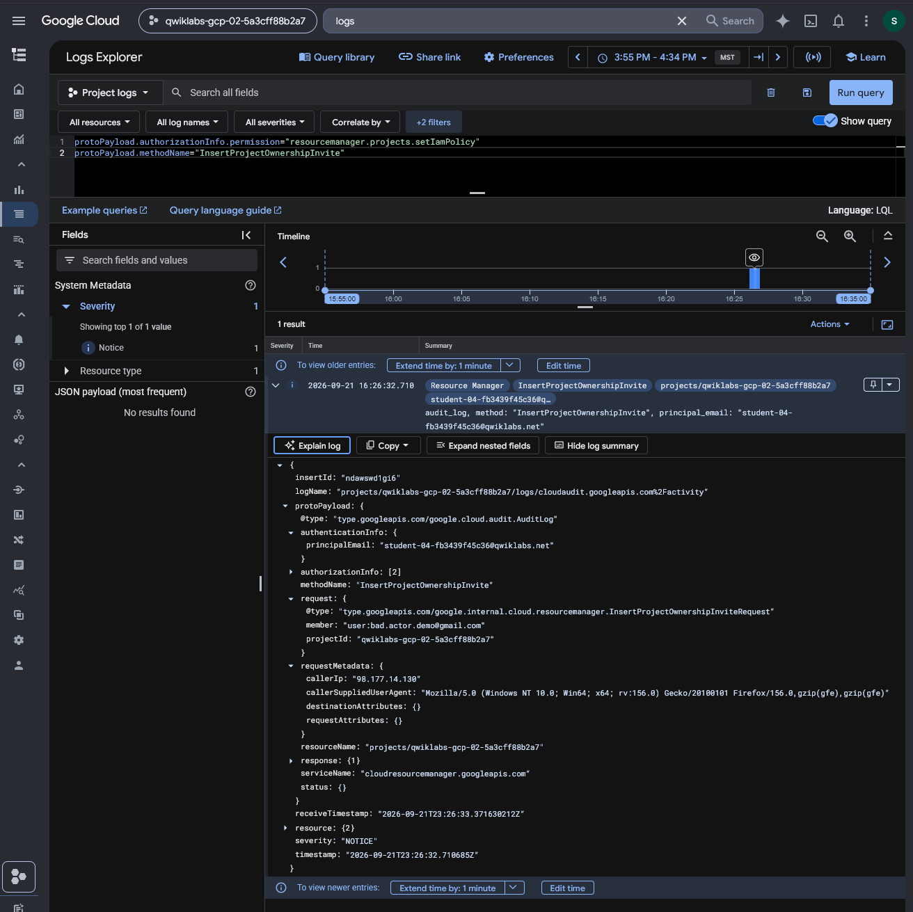
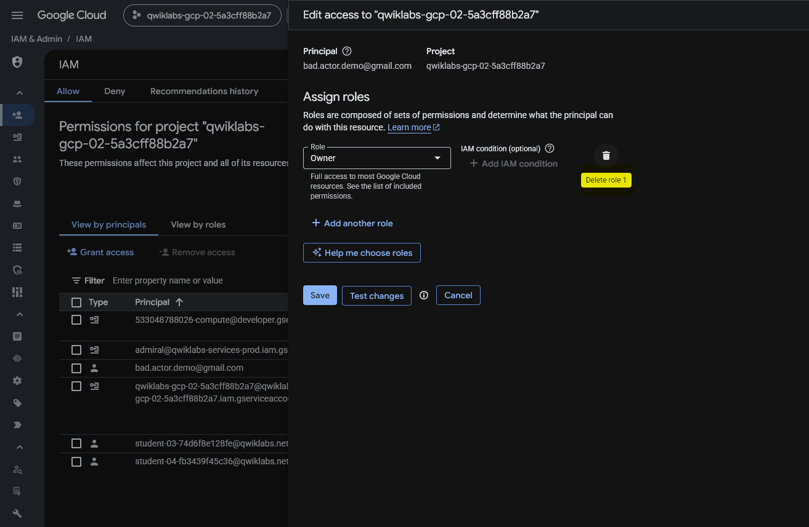
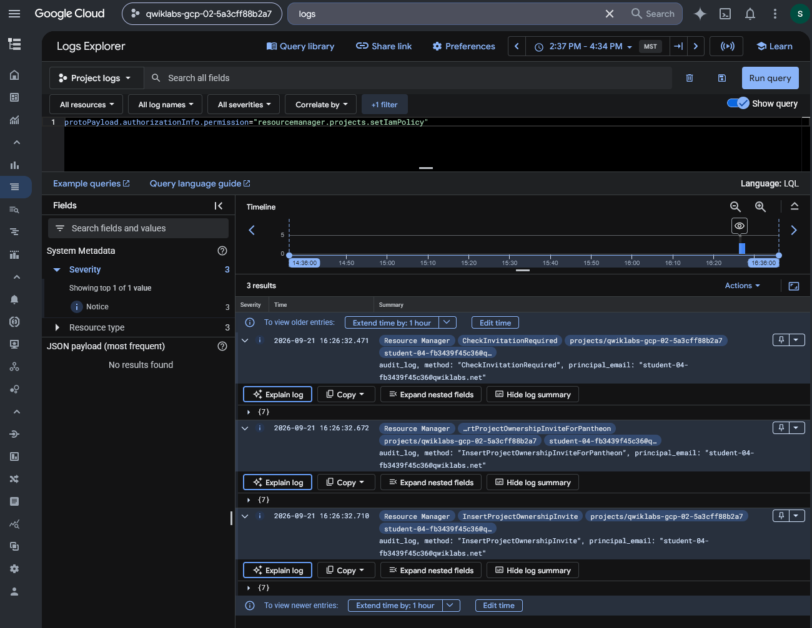

# Google Cloud Event Threat Detection — IAM Anomalous Grant Investigation

## Executive Summary

This investigation examines high-severity IAM anomalous grant findings generated by Google Cloud Security Command Center's Event Threat Detection service.

The scenario involved two types of administrative activity within an authorized Google Cloud training environment: expected project provisioning for organization-associated student accounts and a deliberately introduced Owner role grant to an external account.

I investigated the findings using Security Command Center, reviewed source properties to identify the affected principals, and examined related Cloud Audit Logs to understand the underlying IAM activity.

The guided investigation documented the workflow for removing the external account's project-level Owner access; the preserved screenshot does not verify the saved IAM policy.

An independent investigation extended the analysis by broadening the Cloud Logging query to identify related IAM policy operations surrounding the suspicious grant.

The objective was to demonstrate security alert triage, contextual analysis of IAM events, audit-log investigation, access remediation, and cross-event correlation.

## Investigation Scope

The investigation was conducted in a temporary Google Cloud project using controlled IAM changes.

| Component | Investigation Purpose |
| --- | --- |
| Security Command Center | Review high-severity IAM security findings |
| Event Threat Detection | Identify anomalous IAM role grants |
| IAM & Admin | Inspect and modify project permissions |
| Cloud Logging | Investigate administrative audit events |
| Logs Explorer | Filter and correlate IAM policy activity |
| Cloud Audit Logs | Identify recorded actors, methods, and request context |
| Project-level Owner role | Assess the impact of broad administrative access |
| External test principal | Reproduce an anomalous role-grant scenario |

### Investigation Objectives

1. Generate a controlled project-level Owner grant to an external test principal.

2. Identify IAM anomalous grant findings in Security Command Center.

3. Distinguish expected project provisioning from suspicious external access.

4. Inspect SCC finding details and source properties.

5. Examine related IAM audit events in Logs Explorer.

6. Remove the external principal's Owner role.

7. Independently broaden the log investigation to identify surrounding IAM policy operations.

8. Document the findings, remediation, security implications, and evidence limitations.

## Evidence Sources and Methodology

### Evidence Sources

The preserved evidence includes screenshots from Security Command Center finding results, individual finding summaries, source-property details, Cloud Logging, IAM access management, and an independent audit-log investigation.

The original exercise instructions provide scenario context and the sequence of authorized actions performed in the training environment.

### Investigation Methodology

| Phase | Analyst Activity |
| --- | --- |
| Activity generation | Initiate a project-level Owner invitation to an external test principal |
| Alert triage | Review high-severity IAM anomalous grant findings |
| Contextual investigation | Compare organization-associated provisioning with external access |
| Finding analysis | Examine summary and source-property information |
| Log investigation | Inspect related administrative activity in Cloud Logging |
| Remediation | Remove the external principal's Owner role |
| Independent investigation | Broaden the IAM policy-change query to identify related events |
| Reporting | Document observed evidence, conclusions, and limitations |

### Evidence Standards

The suspicious external IAM ownership invitation was deliberately created in an authorized training environment. It was anomalous in the scenario but does not represent an independently verified real-world compromise.

The investigation distinguishes expected provisioning activity from the deliberately introduced external Owner invitation.

A high-severity Event Threat Detection finding provides a reason to investigate; it does not independently prove that an attacker obtained access or abused permissions.

Remediation conclusions will be limited to the changes and validation visible in the preserved evidence.

## Investigation Organization

The report will document the following stages:

1. IAM Anomalous Grant Finding Identification

2. Expected Provisioning Activity Analysis

3. Suspicious External IAM Grant Analysis

4. Cloud Audit Log Investigation

5. IAM Access Remediation

6. Independent IAM Policy-Change Correlation

The final sections will cover security implications, evidence limitations, recommended controls, skills demonstrated, and an evidence index.

## Investigation Findings

### Finding 1 — IAM Anomalous Grant Finding Identification

#### Investigation Context

The first phase examined Google Cloud Security Command Center findings generated by Event Threat Detection.

The training scenario involved an intentionally created project-level IAM role grant to an external test principal, alongside expected administrative provisioning activity.

The objective was to identify anomalous IAM grants and determine which findings warranted further investigation.

#### Security Command Center Findings Review

I opened Security Command Center and reviewed the active findings associated with the training project.

The findings list displayed two high-severity threat findings under the category:

`Persistence: IAM anomalous grant`

| Finding | Event Time (UTC-7) | Severity | Finding Class |
| --- | --- | --- | --- |
| 1 | September 21, 2026, 4:26:52 PM | High | Threat |
| 2 | September 21, 2026, 1:39:49 PM | High | Threat |


*Figure 1 — Security Command Center displaying two active, high-severity `Persistence: IAM anomalous grant` threat findings in the same Google Cloud training project.*

Both findings had an attack exposure score of `0` and appeared in the selected seven-day time window.

The visible query preview included active and unmuted finding filters.

The records were associated with the same Google Cloud training project but represented separate detected events.

#### Initial Triage Assessment

The `Persistence: IAM anomalous grant` category indicates that Event Threat Detection identified an unusual IAM grant pattern warranting investigation.

Unexpected IAM permission grants are relevant to security operations because they may allow an identity to retain or obtain elevated access.

The severity classification indicated that these findings should receive investigative attention.

However, the finding category and High severity alone did not establish whether the activity was unauthorized or malicious.

Similarly, an attack exposure score of `0` did not independently establish that the reported activity was harmless.

At this stage, the findings list did not provide sufficient context to distinguish routine administrative provisioning from the deliberately introduced external access.

#### Investigation Priorities

The next investigation stages would examine:

1. The principals receiving IAM permissions.

2. The roles associated with the grants.

3. The source properties of each finding.

4. The relationship between the reported activity and expected project provisioning.

5. The associated Cloud Audit Logs.

6. Whether the suspicious grant remained active and required remediation.

#### Analyst Assessment

**Assessment: Two high-severity IAM anomalous grant findings identified in Security Command Center.**

The findings were categorized as threats and associated with the same Google Cloud training project.

The initial triage established a basis for investigating IAM permission changes but did not independently determine whether either grant was malicious.

Further examination of the finding details and audit records was required to distinguish expected provisioning from suspicious external access.

### Finding 2 — Expected IAM Provisioning Activity Analysis

#### Investigation Context

The second phase examined the earlier of the two high-severity IAM anomalous grant findings.

The objective was to determine whether the detected Owner role assignment represented suspicious activity or an expected administrative operation within the training environment.

The lab instructions explained that the Google Cloud project was provisioned with student accounts receiving project-level Owner permissions through an automated service account.

Although this activity triggered Event Threat Detection, the provisioned users belonged to the expected Qwiklabs training environment.

#### Finding Summary Analysis

I opened the earlier `Persistence: IAM anomalous grant` finding and reviewed its summary.

| Field | Observed Value |
| --- | --- |
| Finding category | `Persistence: IAM anomalous grant` |
| Finding state | Active |
| Severity | High |
| Event time | September 21, 2026, 1:39:49 PM GMT-7 |
| Administrative method | `SetIamPolicy` |
| Calling principal | Qwiklabs provisioning service account |
| Service | `cloudresourcemanager.googleapis.com` |
| Affected resource | Google Cloud training project |
| User agent | Terraform Google provider through `google-api-go-client` |


*Figure 2 — Security Command Center summary of the earlier high-severity IAM anomalous grant, showing a provisioning service account performing a SetIamPolicy operation.*

The finding described a sensitive IAM role being granted through a service account.

The use of a provisioning service account and Terraform-related user agent was consistent with the lab's automated project setup.

However, these characteristics alone would not prove that an IAM change was authorized in a production environment.

#### Source Properties Investigation

I examined the finding's Source properties tab and expanded:

`properties → sensitiveRoleGrant`

The source properties included the following information:

| Property | Observed Value |
| --- | --- |
| Grant action | `ADD` |
| Granted role | `roles/owner` |
| Granting principal | Qwiklabs provisioning service account |
| Receiving member | User associated with the `qwiklabs.net` training domain |
| Detection priority | High |
| Detection indicator | `iam_anomalous_grant` |


*Figure 3 — Event Threat Detection source properties showing an ADD action for roles/owner assigned to a Qwiklabs training-domain user.*

The nested `bindingDeltas` and `members` properties identified the Owner role grant and its associated receiving identity.

These properties were important because they distinguished the account performing the administrative change from the account receiving the new permissions.

The preserved source properties showed the training user as the recipient of the sensitive role grant.

#### Contextual Triage Assessment

The role assignment was security-relevant because `roles/owner` provides broad project-level privileges.

Event Threat Detection correctly identified the grant as matching a sensitive IAM-change pattern.

However, the original scenario established that the training environment automatically provisioned project Owner permissions to Qwiklabs-associated student accounts.

The observed service account, Terraform-related user agent, and receiving member were consistent with that expected setup.

Consequently, I classified the event as ****expected administrative provisioning activity within the authorized training scenario****.

This conclusion relied on the documented lab context as well as the visible finding details.

In a production investigation, an analyst would need to verify the change against trusted provisioning records, approved workflows, and the intended access requirements before treating a similar event as benign.

#### Security Relevance

High-severity findings require contextual validation rather than automatic classification as incidents.

A legitimate automation system may perform operations that resemble suspicious access changes.

At the same time, an attacker could potentially misuse a legitimate service account or automation mechanism.

For that reason, a recognizable service account name or Terraform user agent should be treated as contextual evidence rather than conclusive proof of authorization.

#### Analyst Assessment

**Assessment: Earlier high-severity IAM finding classified as expected provisioning activity in the documented lab context.**

The finding recorded a sensitive Owner role grant performed by a Qwiklabs-associated provisioning service account.

The source properties identified an expected training-domain user as the recipient.

The grant was consistent with the lab's authorized provisioning process, despite matching the Event Threat Detection anomalous-grant pattern.

The next phase examines the later finding involving an external account, where the recipient's identity and authorization context differ.

### Finding 3 — Suspicious External IAM Grant Analysis

#### Investigation Context

The third phase examined the later high-severity IAM anomalous grant finding.

Unlike the earlier event associated with automated project provisioning, this finding involved an external Gmail account being invited to receive project-level Owner access.

The objective was to identify the acting principal, recipient identity, administrative method, and detection rationale before assessing the potential security impact.

#### Finding Summary Analysis

I opened the later `Persistence: IAM anomalous grant` finding and examined its summary.

| Field | Observed Value |
| --- | --- |
| Finding category | `Persistence: IAM anomalous grant` |
| Finding state | Active |
| Severity | High |
| Event time | September 21, 2026, 4:26:52 PM GMT-7 |
| Administrative method | `InsertProjectOwnershipInvite` |
| Calling principal | Qwiklabs student training account |
| Caller IP | `98.177.14.130` |
| Service | `cloudresourcemanager.googleapis.com` |
| Affected resource | Google Cloud training project |
| Finding class | Threat |


*Figure 4 — Security Command Center finding identifying an external project ownership invitation through the `InsertProjectOwnershipInvite` method.*

The finding description stated that an external member was invited as the project's Owner through the `InsertProjectOwnershipInvite` API.

The recorded calling principal was a Qwiklabs student account rather than the provisioning service account associated with the earlier finding.

This difference warranted additional investigation into the intended recipient and authorization context.

#### Source Properties Investigation

I examined the finding's Source properties tab and expanded the `sensitiveRoleGrant` fields.

| Property | Observed Value |
| --- | --- |
| Detection rule | `iam_anomalous_grant` |
| Detection subrule | `external_member_invited_to_policy` |
| Detection priority | High |
| Administrative principal | Qwiklabs student training account |
| Invited member | `user:bad.actor.demo@gmail.com` |
| Sensitive role context | Project Owner invitation |
| Detection technique | Persistence |


*Figure 5 — Event Threat Detection source properties showing the `external_member_invited_to_policy` subrule and identifying the external Gmail account as the invitation recipient.*

The source properties identified the external Gmail account as the invited member.

The administrative principal and receiving identity were distinct: the student training account initiated the operation, while the external Gmail identity was the invitation recipient.

This distinction is important for attributing IAM changes and investigating how external access was introduced.

#### Comparison with Expected Provisioning

The two high-severity Event Threat Detection findings involved different administrative contexts.

| Investigation Attribute | Expected Provisioning | External Invitation |
| --- | --- | --- |
| Acting identity | Provisioning service account | Student training account |
| Administrative method | `SetIamPolicy` | `InsertProjectOwnershipInvite` |
| Receiving identity | Qwiklabs training-domain user | External Gmail account |
| Operational context | Automated project provisioning | Deliberately introduced test scenario |
| Triage assessment | Expected in documented lab context | Suspicious within the scenario |

The comparison demonstrated why the same broad detection category can encompass both expected and suspicious activity.

The investigation required examining the acting identity, receiving identity, administrative method, and known operational context rather than relying solely on alert severity.

#### Security Relevance

Inviting an external identity to receive the project-level Owner role is a security-sensitive administrative operation.

If the access is granted and becomes effective, Owner privileges can provide broad control over cloud resources and project configuration.

In an unauthorized scenario, such access could support persistence, privilege misuse, or other administrative activity.

However, the observed event established an invitation operation, not independently verified acceptance, successful authentication, or subsequent use of Owner privileges.

The activity was deliberately performed in an authorized training project.

#### Analyst Assessment

**Assessment: High-severity external project ownership invitation identified and classified as suspicious within the lab scenario.**

Event Threat Detection identified an invitation to grant project ownership to an external Gmail identity.

The source properties confirmed the invitation recipient and the recorded acting principal.

The finding provided sufficient context to prioritize further audit-log review and access remediation.

The next phase investigates the underlying Cloud Audit Log record to corroborate the reported IAM operation.

### Finding 4 — Cloud Audit Log Investigation of External Ownership Invitation

#### Investigation Context

After identifying the suspicious external project ownership invitation in Security Command Center, I investigated the corresponding administrative activity in Google Cloud Logs Explorer.

The objective was to corroborate the Event Threat Detection finding using the underlying Cloud Audit Log and identify the recorded actor, requested recipient, source IP address, and administrative operation.

#### Logs Explorer Query

I used the following Logs Explorer query to isolate project ownership invitation events:

```text

protoPayload.authorizationInfo.permission="resourcemanager.projects.setIamPolicy"

protoPayload.methodName="InsertProjectOwnershipInvite"

```

The query filtered audit records by the relevant IAM policy permission and administrative method.

The preserved screenshot shows one matching log entry within the selected time window.

#### Observed Audit Event

The expanded event contained the following fields:

| Audit Field | Observed Value |
| --- | --- |
| Log type | Admin Activity |
| Timestamp (UTC) | `2026-09-21T23:26:32.710685Z` |
| Method | `InsertProjectOwnershipInvite` |
| Service | `cloudresourcemanager.googleapis.com` |
| Recorded principal | Qwiklabs student training account |
| Caller IP | `98.177.14.130` |
| Request member | `user:bad.actor.demo@gmail.com` |
| Resource | Google Cloud training project |
| Severity | Notice |



*Figure 6 — Expanded Cloud Audit Log for the `InsertProjectOwnershipInvite` operation, including the calling principal, external Gmail recipient, caller IP address, and event timestamp.*

The `protoPayload.authenticationInfo.principalEmail` field identified the training account that initiated the request.

The `protoPayload.request.member` field identified the external Gmail identity targeted by the ownership invitation.

The `protoPayload.requestMetadata.callerIp` field recorded the source IP address associated with the administrative request.

The user-agent field also provided request-client context. This information may be useful when comparing administrative actions with expected workflows, but it does not independently establish who physically operated the client.

#### Correlation with Security Command Center

The Cloud Audit Log corroborated several elements of the Event Threat Detection finding.

| Investigation Attribute | SCC Finding | Cloud Audit Log |
| --- | --- | --- |
| Administrative method | `InsertProjectOwnershipInvite` | `InsertProjectOwnershipInvite` |
| Calling principal | Qwiklabs student account | Qwiklabs student account |
| Invited identity | External Gmail account | External Gmail account |
| Caller IP | `98.177.14.130` | `98.177.14.130` |
| Event time (UTC) | Approximately 23:26:52 | 23:26:32 |

The shared method, principal, recipient, and caller IP supported correlation between the detection and its underlying administrative activity.

The timestamps were approximately 20 seconds apart. This is consistent with the SCC finding and audit log recording different stages of the activity or detection process, although the preserved evidence does not establish the exact cause of that difference.

#### Security Relevance

An external project ownership invitation can indicate an attempt to introduce privileged access into a cloud environment.

In a production investigation, an analyst would examine whether the recipient was authorized, whether the invitation was accepted, and whether any permissions became effective.

The source IP address and user agent could also be compared with authentication records, change approvals, and normal administrative behavior.

However, the observed audit event established an ownership invitation request. It did not independently establish successful invitation acceptance, subsequent authentication, or misuse of project resources.

The operation was deliberately performed as part of the authorized training scenario.

#### Analyst Assessment

**Assessment: External project ownership invitation corroborated in Cloud Audit Logs.**

Logs Explorer returned one matching administrative event containing the recorded calling principal, external recipient, caller IP address, and ownership invitation method.

The audit record provided independent supporting evidence for the high-severity Event Threat Detection finding.

The next investigation phase examines the IAM access-remediation evidence associated with the external identity.

### Finding 5 — External IAM Owner Access Remediation

#### Investigation Context

After correlating the high-severity Event Threat Detection finding with its underlying Cloud Audit Log, I proceeded to the IAM remediation phase.

The investigation identified an external Gmail identity that had been invited to receive project-level Owner access through a training-account administrative operation.

The objective was to remove the external principal's broad permissions and address the suspicious access configuration introduced during the exercise.

#### IAM Remediation Procedure

I navigated to Google Cloud IAM & Admin and located the external principal:

`bad.actor.demo@gmail.com`

I opened the principal's access editor and reviewed the assigned role.

The IAM interface displayed the following configuration:

| IAM Attribute | Observed Value |
| --- | --- |
| Principal | `bad.actor.demo@gmail.com` |
| Resource scope | Google Cloud training project |
| Role displayed | Basic Owner |
| Remediation interface | Edit access |
| Available action | Delete role |
| Save control | Available |
| Final role-removal state | Not visible in the preserved screenshot |



*Figure 7 — Google Cloud IAM access editor showing the external test principal assigned the Basic Owner role, with the role-deletion control highlighted. The screenshot captures the remediation workflow before final confirmation.*

The Owner role provides broad administrative access within its applicable resource scope.

Because the external account did not belong to the expected Qwiklabs training identities, the role assignment was treated as suspicious within the exercise.

#### Remediation Action

The lab remediation procedure required:

1. Opening IAM & Admin → IAM.

2. Locating the external principal.

3. Opening the principal's access editor.

4. Selecting the deletion control for the Owner role.

5. Saving the updated IAM policy.

The screenshot captures the access editor and identifies the Owner role targeted for deletion.

The original lab notes document the required role-removal workflow, including saving the change.

However, the preserved screenshot does not independently verify that the updated policy was saved or that the principal disappeared from the IAM access list.

#### Security Relevance

Removing unauthorized or unnecessary project-level Owner access is an important containment and remediation action.

An external principal with effective Owner access may possess extensive permissions to administer project resources and modify security-sensitive configurations.

In a production incident, analysts should determine whether privileged access became effective, whether the identity performed additional administrative actions, and whether associated credentials or sessions require further investigation.

Removal of a role assignment is only one part of a broader response to suspected identity compromise.

In this authorized training scenario, the suspicious grant was deliberately created and the remediation workflow was prescribed by the exercise.

#### Remediation Verification Limitations

The screenshot confirms the affected principal, the displayed Owner role, and the role-removal interface.

It does not independently demonstrate a successfully saved IAM policy or the final absence of the external principal's Owner grant.

A stronger production verification would include reviewing the updated IAM policy, checking relevant `SetIamPolicy` audit events, and validating the principal's effective access.

The following independent investigation examines broader IAM policy activity, but it should not be treated as conclusive proof of final role removal without an explicit record of the completed change.

#### Analyst Assessment

**Assessment: External Owner grant identified and role-removal workflow documented; final IAM access state not independently verified.**

The evidence established the principal and broad role targeted for remediation.

The lab instructions documented the intended removal procedure, while the screenshot captured the edit stage.

The investigation supports the remediation decision, but the preserved evidence does not independently establish completion of the IAM policy update.

### Finding 6 — Independent IAM Policy-Change Correlation

#### Investigation Context

After completing the guided Event Threat Detection investigation, I independently expanded the Cloud Audit Logs analysis beyond the specific ownership invitation method.

The guided exercise focused on the `InsertProjectOwnershipInvite` event associated with the suspicious external IAM grant.

The independent investigation addressed a broader question:

****What other IAM administrative operations occurred around the suspicious ownership invitation?****

The objective was to identify related administrative activity that might provide additional context for the detected event.

#### Expanded Logs Explorer Query

I removed the method-specific filter and retained the IAM policy permission filter:

```text

protoPayload.authorizationInfo.permission="resourcemanager.projects.setIamPolicy"

```

This broadened the search beyond `InsertProjectOwnershipInvite` while preserving the focus on IAM-policy-related administrative activity.

The query returned three matching records.

#### Correlated Administrative Activity

The results contained three Resource Manager events recorded on September 21, 2026.

| Timestamp (MST) | Administrative Method | Recorded Principal |
| --- | --- | --- |
| `16:26:32.471` | `CheckInvitationRequired` | Qwiklabs student account |
| `16:26:32.672` | `InsertProjectOwnershipInviteForPantheon` | Qwiklabs student account |
| `16:26:32.710` | `InsertProjectOwnershipInvite` | Qwiklabs student account |



*Figure 8 — Expanded Logs Explorer query identifying three IAM-policy-related operations associated with the same student principal and training project within approximately 239 milliseconds.*

All three visible event summaries referenced the same training project and the same student principal.

The timestamps placed the records within approximately 239 milliseconds of one another.

The records were therefore temporally and contextually associated with the same ownership-invitation workflow.

#### Investigative Interpretation

The expanded query revealed more activity than the detector-specific search.

The results showed three methods associated with the project ownership invitation process:

1. `CheckInvitationRequired` — an operation associated with determining whether an invitation is required.

2. `InsertProjectOwnershipInviteForPantheon` — an additional ownership-invitation-related method.

3. `InsertProjectOwnershipInvite` — the operation associated with the Event Threat Detection finding.

The event names and close timing were consistent with related stages of an administrative invitation workflow.

However, the screenshot displayed event summaries rather than fully expanded audit payloads for every record.

Therefore, the evidence does not independently establish the internal execution sequence, success status, or complete request parameters of each operation.

The correlation supports treating these records as related investigative context rather than proof of a specific undocumented cloud service workflow.

#### Value of Broadening the Investigation

The original alert directed attention to a single administrative method.

By removing the exact-method filter, I identified additional IAM-related operations performed by the same principal within the same short time period.

This approach is useful in SOC investigations because security alerts often represent one event within a larger administrative or authentication sequence.

Examining surrounding events can help analysts:

- Reconstruct activity preceding or accompanying the detected operation.

- Identify additional methods associated with the same principal.

- Compare related administrative activity across a narrow time window.

- Determine whether further audit-log inspection is warranted.

- Avoid treating a detection as an isolated event without surrounding context.

#### Security Relevance

Unexpected project ownership invitations are security-sensitive because they may introduce highly privileged external identities into a cloud environment.

Correlating related IAM operations provides additional context for investigating how such an invitation was initiated.

In a production investigation, further analysis should examine the complete audit payloads, effective IAM policy, invitation acceptance state, approved change records, and any subsequent activity by the recipient.

The three visible events did not independently establish invitation acceptance, successful external authentication, or misuse of project resources.

The activity was intentionally generated in an authorized training environment.

#### Analyst Assessment

**Assessment: Three IAM-policy-related administrative records independently correlated around the external ownership invitation.**

The expanded Logs Explorer query identified three Resource Manager operations associated with the same recorded principal and training project within approximately 239 milliseconds.

The investigation demonstrated how broadening a detector-specific query can reveal surrounding administrative activity and improve alert context.

The evidence supports correlation of the recorded operations, but not a claim of confirmed malicious activity or successful external account access.

## Security Implications

This investigation demonstrated how Google Cloud Event Threat Detection findings can support the identification and investigation of sensitive IAM changes.

The primary security concern was an external project ownership invitation generated from an authorized training account. The investigation also demonstrated why analysts must distinguish expected administrative provisioning from suspicious access changes.

| Security Area | Observation | Security Implication |
| --- | --- | --- |
| Threat detection | SCC displayed two high-severity IAM anomalous grant findings | Sensitive IAM changes can trigger security investigations |
| Contextual triage | One finding matched expected automated project provisioning | Alert severity must be interpreted with trusted operational context |
| External access | An external Gmail identity was invited to receive project Owner access | Unexpected external privileged access warrants investigation |
| Audit-log corroboration | Cloud Audit Logs recorded the ownership invitation method and associated principal | Underlying telemetry can corroborate a detection |
| Remediation | IAM access editor showed the external principal's Owner role selected for removal | Role removal is an appropriate response to unauthorized or unnecessary access |
| Cross-event correlation | Three related IAM methods appeared within approximately 239 milliseconds | Broader log searches can reveal additional activity surrounding an alert |

### Detection Versus Confirmed Compromise

The high-severity Event Threat Detection findings identified security-sensitive IAM operations. They did not independently establish that an attacker compromised an identity or accessed the project.

The suspicious external invitation was deliberately generated during an authorized lab exercise.

In a production investigation, the analyst would need to establish whether the invitation was approved, whether the external identity obtained effective access, and whether it performed any subsequent administrative actions.

The presence of a high-severity finding should therefore trigger an evidence-based investigation rather than an automatic conclusion of compromise.

### Value of Audit-Log Correlation

The investigation combined Security Command Center findings with Google Cloud Admin Activity logs.

The underlying audit event corroborated the ownership invitation's administrative method, recorded principal, recipient, and caller IP.

The independent investigation then expanded the audit-log query and identified three temporally related operations involving the same training account and project.

This demonstrated how surrounding administrative events can improve alert interpretation beyond the original finding.

## Remediation Recommendations

The following recommendations distinguish the lab's documented remediation workflow from additional controls appropriate in a production environment.

| Priority | Recommended Action | Investigation Status |
| --- | --- | --- |
| High | Review unexpected external Owner invitations | Investigated |
| High | Remove unauthorized or unnecessary project-level Owner access | Removal workflow documented; final saved policy not independently verified |
| High | Verify invitation acceptance and effective permissions | Not independently verified |
| High | Review subsequent activity by external privileged identities | Recommended |
| Medium | Restrict broad Owner grants according to least privilege | Recommended |
| Medium | Monitor sensitive IAM role grants and policy changes | Recommended |
| Medium | Correlate SCC findings with Cloud Audit Logs | Demonstrated |
| Medium | Confirm remediation using updated IAM policy and audit evidence | Recommended; not independently completed |

### Recommended Production Investigation Workflow

For a comparable production finding, an analyst should:

1. Validate the SCC finding category, severity, resource, and event timestamp.

2. Identify the calling principal and the identity receiving permissions.

3. Confirm the administrative operation using Cloud Audit Logs.

4. Compare the change with approved IAM provisioning workflows.

5. Determine whether an external invitation was accepted or access became effective.

6. Review the recipient's subsequent authentication and administrative activity.

7. Remove unauthorized or unnecessary privileged access.

8. Verify the updated IAM policy and examine relevant policy-change audit events.

9. Assess whether broader identity compromise or additional unauthorized changes occurred.

10. Document evidence, containment decisions, and remaining investigative gaps.

These recommendations extend beyond the preserved lab evidence and should not be interpreted as actions completed during the exercise.

## Evidence Limitations

The investigation was conducted in an authorized Google Cloud training project using intentionally generated IAM activity.

The following limitations apply:

1. ****Simulated scenario:**** The suspicious external Owner invitation was intentionally created for training. No real-world compromise was demonstrated.

2. ****Expected provisioning classification:**** The earlier finding was assessed as expected activity using the documented Qwiklabs provisioning context. The screenshot alone would not prove authorization in another environment.

3. ****Detection scope:**** Two high-severity findings were visible, but the preserved screenshots do not establish comprehensive detection coverage or the absence of other security events.

4. ****Invitation outcome:**** The `InsertProjectOwnershipInvite` audit event establishes an invitation request, not independently verified acceptance or successful use of Owner permissions.

5. ****Identity attribution:**** Cloud Audit Logs recorded the calling principal and source IP address. These fields do not independently identify the physical operator or establish malicious intent.

6. ****Remediation verification:**** The IAM screenshot shows the external principal's Owner role in the access editor and the deletion control. It does not demonstrate a saved policy or final absence of the role.

7. ****Audit correlation:**** The three independently identified IAM operations occurred close together and involved the same principal and project, but the screenshot does not expose complete payloads for every event.

8. ****Timestamp differences:**** The SCC finding and corresponding Cloud Audit Log recorded timestamps approximately 20 seconds apart. The preserved evidence does not establish the exact reason for this difference.

9. ****Environment scope:**** The investigation did not evaluate production identity governance, organization policies, long-term telemetry retention, or enterprise-wide access review controls.

## Skills Demonstrated

### Cloud Threat Detection and SOC Triage

- Investigated high-severity Google Cloud Event Threat Detection findings.

- Analyzed IAM anomalous grant alerts in Security Command Center.

- Differentiated expected provisioning activity from suspicious external access.

- Examined alert severity, source properties, administrative methods, and affected identities.

- Correlated cloud threat findings with underlying audit-log evidence.

### IAM and Cloud Security

- Investigated project-level Owner role grants.

- Identified an external identity targeted by a privileged access invitation.

- Distinguished the calling principal from the receiving IAM member.

- Reviewed an IAM access-remediation workflow.

- Developed recommendations for least privilege and validation of effective access.

### Log Analysis and Incident Investigation

- Applied Logs Explorer filters to isolate sensitive IAM operations.

- Examined Cloud Audit Log fields for actor, recipient, source IP, resource, and timestamp.

- Independently broadened a method-specific search to identify related IAM policy operations.

- Reconstructed a short administrative activity sequence from three audit records.

- Documented evidence limitations and avoided unsupported compromise or remediation claims.

## Conclusion

This investigation examined two high-severity IAM anomalous grant findings generated by Google Cloud Event Threat Detection.

The first finding represented automated project provisioning that was expected within the documented training environment.

The second finding involved a deliberately introduced invitation to grant project-level Owner access to an external Gmail identity.

Cloud Audit Logs corroborated the suspicious invitation by recording the administrative method, acting principal, external recipient, and caller IP address.

The remediation phase documented the external principal's Owner role in the IAM access editor and the role-removal workflow. However, the preserved screenshot did not independently verify the final IAM policy state.

The independent investigation extended the guided exercise by broadening the audit-log query and identifying three IAM-policy-related operations within approximately 239 milliseconds.

The primary learning outcome was the importance of combining cloud threat detection, contextual triage, audit-log corroboration, IAM access assessment, and surrounding-event correlation.

These skills are relevant to SOC investigations, cloud security operations, identity security, and incident response.

## Evidence Index

| Figure | Evidence File | Description |
| --- | --- | --- |
| 1 | `01-iam-anomalous-grant-findings.png` | Two high-severity IAM anomalous grant findings in SCC |
| 2 | `02-expected-iam-grant-summary.png` | Earlier finding associated with automated provisioning |
| 3 | `03-expected-iam-grant-source-properties.png` | Expected training-domain Owner grant source properties |
| 4 | `04-external-owner-invitation-summary.png` | Suspicious external Owner invitation finding |
| 5 | `05-external-owner-invitation-source-properties.png` | External recipient and anomalous-grant source properties |
| 6 | `06-external-owner-invitation-audit-log.png` | Cloud Audit Log corroborating the ownership invitation |
| 7 | `07-external-owner-role-removal.png` | IAM access editor showing Owner role-removal workflow |
| 8 | `08-independent-iam-policy-correlation.png` | Independent correlation of three IAM-related administrative events |

All eight screenshots are located in the accompanying [`evidence/`](evidence/) directory.
