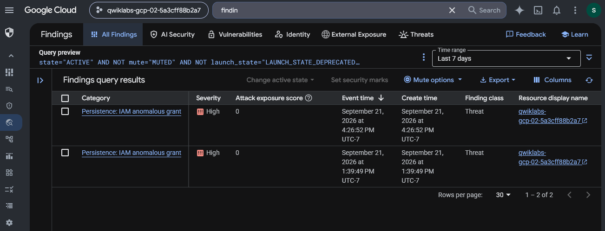
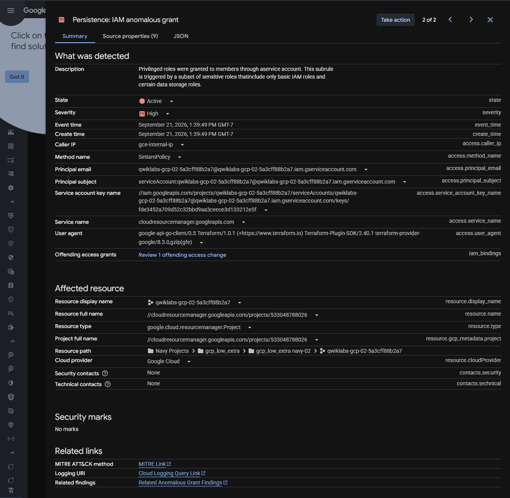
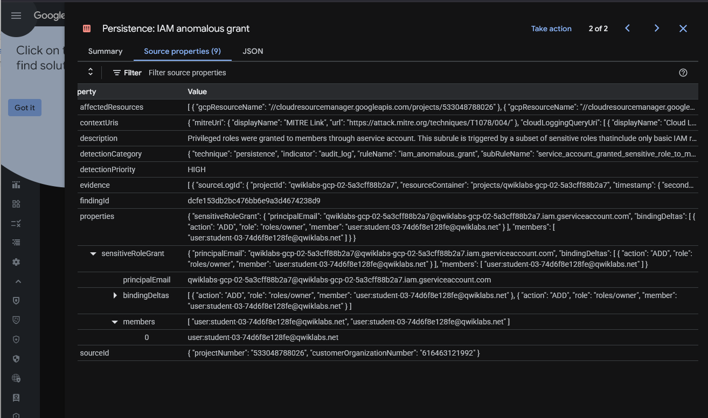
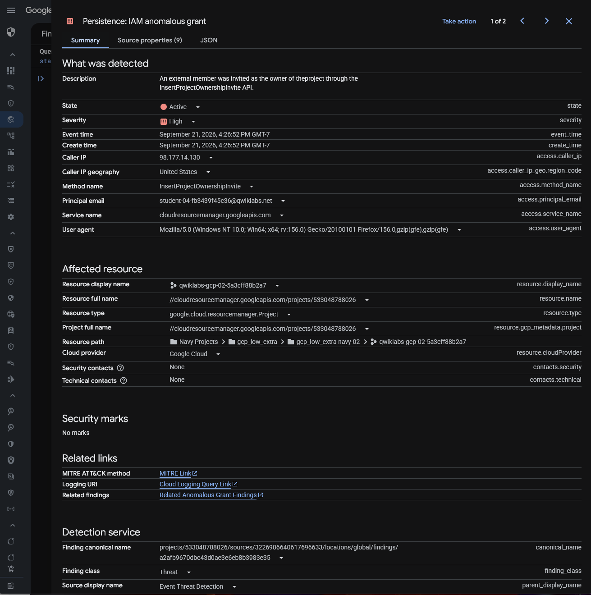
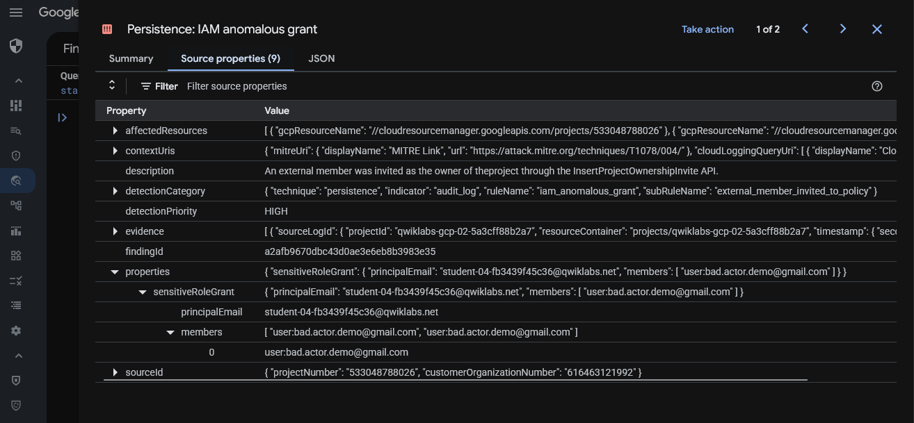

# Google Cloud Event Threat Detection — IAM Anomalous Grant Investigation

## Executive Summary

This investigation examines high-severity IAM anomalous grant findings generated by Google Cloud Security Command Center's Event Threat Detection service.

The scenario involved two types of administrative activity within an authorized Google Cloud training environment: expected project provisioning for organization-associated student accounts and a deliberately introduced Owner role grant to an external account.

I investigated the findings using Security Command Center, reviewed source properties to identify the affected principals, and examined related Cloud Audit Logs to understand the underlying IAM activity.

The guided investigation concluded with removing the external account's project-level Owner access.

An independent investigation extended the analysis by broadening the Cloud Logging query to identify related IAM policy operations surrounding the suspicious grant.

The objective was to demonstrate security alert triage, contextual analysis of IAM events, audit-log investigation, access remediation, and cross-event correlation.

## Investigation Scope

The investigation was conducted in a temporary Google Cloud project using controlled IAM changes.

| Component | Investigation Purpose |
| --- | --- |
| Security Command Center | Review high-severity IAM security findings |
| Event Threat Detection | Identify anomalous IAM role grants |
| IAM & Admin | Inspect and modify project permissions |
| Cloud Logging | Investigate administrative audit events |
| Logs Explorer | Filter and correlate IAM policy activity |
| Cloud Audit Logs | Identify recorded actors, methods, and request context |
| Project-level Owner role | Assess the impact of broad administrative access |
| External test principal | Reproduce an anomalous role-grant scenario |

### Investigation Objectives

1. Generate a controlled project-level Owner grant to an external test principal.
2. Identify IAM anomalous grant findings in Security Command Center.
3. Distinguish expected project provisioning from suspicious external access.
4. Inspect SCC finding details and source properties.
5. Examine related IAM audit events in Logs Explorer.
6. Remove the external principal's Owner role.
7. Independently broaden the log investigation to identify surrounding IAM policy operations.
8. Document the findings, remediation, security implications, and evidence limitations.

## Evidence Sources and Methodology

### Evidence Sources

The preserved evidence includes screenshots from Security Command Center finding results, individual finding summaries, source-property details, Cloud Logging, IAM access management, and an independent audit-log investigation.

The original exercise instructions provide scenario context and the sequence of authorized actions performed in the training environment.

### Investigation Methodology

| Phase | Analyst Activity |
| --- | --- |
| Activity generation | Assign project-level Owner access to an external test principal |
| Alert triage | Review high-severity IAM anomalous grant findings |
| Contextual investigation | Compare organization-associated provisioning with external access |
| Finding analysis | Examine summary and source-property information |
| Log investigation | Inspect related administrative activity in Cloud Logging |
| Remediation | Remove the external principal's Owner role |
| Independent investigation | Broaden the IAM policy-change query to identify related events |
| Reporting | Document observed evidence, conclusions, and limitations |

### Evidence Standards

The suspicious IAM grant was deliberately created in an authorized training environment. It was anomalous in the scenario but does not represent an independently verified real-world compromise.

The investigation distinguishes expected provisioning activity from the deliberately introduced external Owner grant.

A high-severity Event Threat Detection finding provides a reason to investigate; it does not independently prove that an attacker obtained access or abused the granted permissions.

Remediation conclusions will be limited to the changes and validation visible in the preserved evidence.

## Investigation Organization

The report will document the following stages:

1. IAM Anomalous Grant Finding Identification
2. Expected Provisioning Activity Analysis
3. Suspicious External IAM Grant Analysis
4. Cloud Audit Log Investigation
5. IAM Access Remediation
6. Independent IAM Policy-Change Correlation

The final sections will cover security implications, evidence limitations, recommended controls, skills demonstrated, and an evidence index.

## Investigation Findings

### Finding 1 — IAM Anomalous Grant Finding Identification

#### Investigation Context

The first phase examined Google Cloud Security Command Center findings generated by Event Threat Detection.

The training scenario involved an intentionally created project-level IAM role grant to an external test principal, alongside expected administrative provisioning activity.

The objective was to identify anomalous IAM grants and determine which findings warranted further investigation.

#### Security Command Center Findings Review

I opened Security Command Center and reviewed the active findings associated with the training project.

The findings list displayed two high-severity threat findings under the category:

`Persistence: IAM anomalous grant`

| Finding | Event Time (UTC-7) | Severity | Finding Class |
| --- | --- | --- | --- |
| 1 | September 21, 2026, 4:26:52 PM | High | Threat |
| 2 | September 21, 2026, 1:39:49 PM | High | Threat |

*Figure 1 — Security Command Center displaying two active, high-severity `Persistence: IAM anomalous grant` threat findings in the same Google Cloud training project.*

Both findings had an attack exposure score of `0` and appeared in the selected seven-day time window.

The visible query preview included active and unmuted finding filters.

The records were associated with the same Google Cloud training project but represented separate detected events.

#### Initial Triage Assessment

The `Persistence: IAM anomalous grant` category indicates that Event Threat Detection identified an unusual IAM grant pattern warranting investigation.

Unexpected IAM permission grants are relevant to security operations because they may allow an identity to retain or obtain elevated access.

The severity classification indicated that these findings should receive investigative attention.

However, the finding category and High severity alone did not establish whether the activity was unauthorized or malicious.

Similarly, an attack exposure score of `0` did not independently establish that the reported activity was harmless.

At this stage, the findings list did not provide sufficient context to distinguish routine administrative provisioning from the deliberately introduced external access.

#### Investigation Priorities

The next investigation stages would examine:

1. The principals receiving IAM permissions.
2. The roles associated with the grants.
3. The source properties of each finding.
4. The relationship between the reported activity and expected project provisioning.
5. The associated Cloud Audit Logs.
6. Whether the suspicious grant remained active and required remediation.

#### Analyst Assessment

**Assessment: Two high-severity IAM anomalous grant findings identified in Security Command Center.**

The findings were categorized as threats and associated with the same Google Cloud training project.

The initial triage established a basis for investigating IAM permission changes but did not independently determine whether either grant was malicious.

Further examination of the finding details and audit records was required to distinguish expected provisioning from suspicious external access.

### Finding 2 — Expected IAM Provisioning Activity Analysis

#### Investigation Context

The second phase examined the earlier of the two high-severity IAM anomalous grant findings.

The objective was to determine whether the detected Owner role assignment represented suspicious activity or an expected administrative operation within the training environment.

The lab instructions explained that the Google Cloud project was provisioned with student accounts receiving project-level Owner permissions through an automated service account.

Although this activity triggered Event Threat Detection, the provisioned users belonged to the expected Qwiklabs training environment.

#### Finding Summary Analysis

I opened the earlier `Persistence: IAM anomalous grant` finding and reviewed its summary.

| Field | Observed Value |
| --- | --- |
| Finding category | `Persistence: IAM anomalous grant` |
| Finding state | Active |
| Severity | High |
| Event time | September 21, 2026, 1:39:49 PM GMT-7 |
| Administrative method | `SetIamPolicy` |
| Calling principal | Qwiklabs provisioning service account |
| Service | `cloudresourcemanager.googleapis.com` |
| Affected resource | Google Cloud training project |
| User agent | Terraform Google provider through `google-api-go-client` |

*Figure 2 — Security Command Center summary of the earlier high-severity IAM anomalous grant, showing a provisioning service account performing a SetIamPolicy operation.*

The finding described a sensitive IAM role being granted through a service account.

The use of a provisioning service account and Terraform-related user agent was consistent with the lab's automated project setup.

However, these characteristics alone would not prove that an IAM change was authorized in a production environment.

#### Source Properties Investigation

I examined the finding's Source properties tab and expanded:

`properties → sensitiveRoleGrant`

The source properties included the following information:

| Property | Observed Value |
| --- | --- |
| Grant action | `ADD` |
| Granted role | `roles/owner` |
| Granting principal | Qwiklabs provisioning service account |
| Receiving member | User associated with the `qwiklabs.net` training domain |
| Detection priority | High |
| Detection indicator | `iam_anomalous_grant` |

*Figure 3 — Event Threat Detection source properties showing an ADD action for roles/owner assigned to a Qwiklabs training-domain user.*

The nested `bindingDeltas` and `members` properties identified the Owner role grant and its associated receiving identity.

These properties were important because they distinguished the account performing the administrative change from the account receiving the new permissions.

The preserved source properties showed the training user as the recipient of the sensitive role grant.

#### Contextual Triage Assessment

The role assignment was security-relevant because `roles/owner` provides broad project-level privileges.

Event Threat Detection correctly identified the grant as matching a sensitive IAM-change pattern.

However, the original scenario established that the training environment automatically provisioned project Owner permissions to Qwiklabs-associated student accounts.

The observed service account, Terraform-related user agent, and receiving member were consistent with that expected setup.

Consequently, I classified the event as **expected administrative provisioning activity within the authorized training scenario**.

This conclusion relied on the documented lab context as well as the visible finding details.

In a production investigation, an analyst would need to verify the change against trusted provisioning records, approved workflows, and the intended access requirements before treating a similar event as benign.

#### Security Relevance

High-severity findings require contextual validation rather than automatic classification as incidents.

A legitimate automation system may perform operations that resemble suspicious access changes.

At the same time, an attacker could potentially misuse a legitimate service account or automation mechanism.

For that reason, a recognizable service account name or Terraform user agent should be treated as contextual evidence rather than conclusive proof of authorization.

#### Analyst Assessment

**Assessment: Earlier high-severity IAM finding classified as expected provisioning activity in the documented lab context.**

The finding recorded a sensitive Owner role grant performed by a Qwiklabs-associated provisioning service account.

The source properties identified an expected training-domain user as the recipient.

The grant was consistent with the lab's authorized provisioning process, despite matching the Event Threat Detection anomalous-grant pattern.

The next phase examines the later finding involving an external account, where the recipient's identity and authorization context differ.

### Finding 3 — Suspicious External IAM Grant Analysis

#### Investigation Context

The third phase examined the later high-severity IAM anomalous grant finding.

Unlike the earlier event associated with automated project provisioning, this finding involved an external Gmail account being invited to receive project-level Owner access.

The objective was to identify the acting principal, recipient identity, administrative method, and detection rationale before assessing the potential security impact.

#### Finding Summary Analysis

I opened the later `Persistence: IAM anomalous grant` finding and examined its summary.

| Field | Observed Value |
| --- | --- |
| Finding category | `Persistence: IAM anomalous grant` |
| Finding state | Active |
| Severity | High |
| Event time | September 21, 2026, 4:26:52 PM GMT-7 |
| Administrative method | `InsertProjectOwnershipInvite` |
| Calling principal | Qwiklabs student training account |
| Caller IP | `98.177.14.130` |
| Service | `cloudresourcemanager.googleapis.com` |
| Affected resource | Google Cloud training project |
| Finding class | Threat |

*Figure 4 — Security Command Center finding identifying an external project ownership invitation through the `InsertProjectOwnershipInvite` method.*

The finding description stated that an external member was invited as the project's Owner through the `InsertProjectOwnershipInvite` API.

The recorded calling principal was a Qwiklabs student account rather than the provisioning service account associated with the earlier finding.

This difference warranted additional investigation into the intended recipient and authorization context.

#### Source Properties Investigation

I examined the finding's Source properties tab and expanded the `sensitiveRoleGrant` fields.

| Property | Observed Value |
| --- | --- |
| Detection rule | `iam_anomalous_grant` |
| Detection subrule | `external_member_invited_to_policy` |
| Detection priority | High |
| Administrative principal | Qwiklabs student training account |
| Invited member | `user:bad.actor.demo@gmail.com` |
| Sensitive role context | Project Owner invitation |
| Detection technique | Persistence |

*Figure 5 — Event Threat Detection source properties showing the `external_member_invited_to_policy` subrule and identifying the external Gmail account as the invitation recipient.*

The source properties identified the external Gmail account as the invited member.

The administrative principal and receiving identity were distinct: the student training account initiated the operation, while the external Gmail identity was the invitation recipient.

This distinction is important for attributing IAM changes and investigating how external access was introduced.

#### Comparison with Expected Provisioning

The two high-severity Event Threat Detection findings involved different administrative contexts.

| Investigation Attribute | Expected Provisioning | External Invitation |
| --- | --- | --- |
| Acting identity | Provisioning service account | Student training account |
| Administrative method | `SetIamPolicy` | `InsertProjectOwnershipInvite` |
| Receiving identity | Qwiklabs training-domain user | External Gmail account |
| Operational context | Automated project provisioning | Deliberately introduced test scenario |
| Triage assessment | Expected in documented lab context | Suspicious within the scenario |

The comparison demonstrated why the same broad detection category can encompass both expected and suspicious activity.

The investigation required examining the acting identity, receiving identity, administrative method, and known operational context rather than relying solely on alert severity.

#### Security Relevance

Inviting an external identity to receive the project-level Owner role is a security-sensitive administrative operation.

If the access is granted and becomes effective, Owner privileges can provide broad control over cloud resources and project configuration.

In an unauthorized scenario, such access could support persistence, privilege misuse, or other administrative activity.

However, the observed event established an invitation operation, not independently verified acceptance, successful authentication, or subsequent use of Owner privileges.

The activity was deliberately performed in an authorized training project.

#### Analyst Assessment

**Assessment: High-severity external project ownership invitation identified and classified as suspicious within the lab scenario.**

Event Threat Detection identified an invitation to grant project ownership to an external Gmail identity.

The source properties confirmed the invitation recipient and the recorded acting principal.

The finding provided sufficient context to prioritize further audit-log review and access remediation.

The next phase investigates the underlying Cloud Audit Log record to corroborate the reported IAM operation.