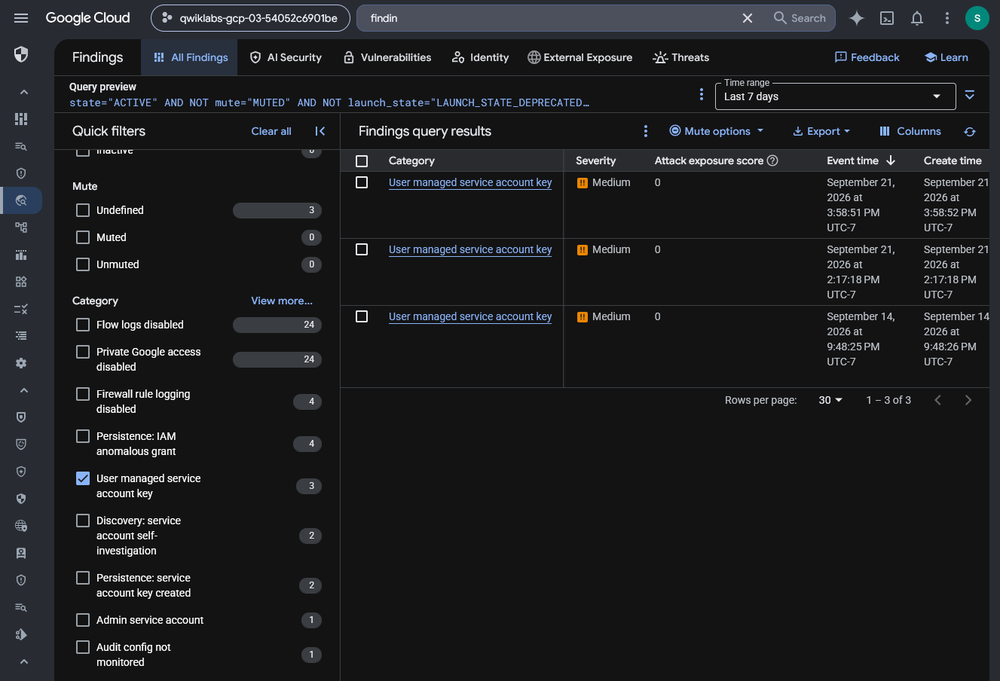
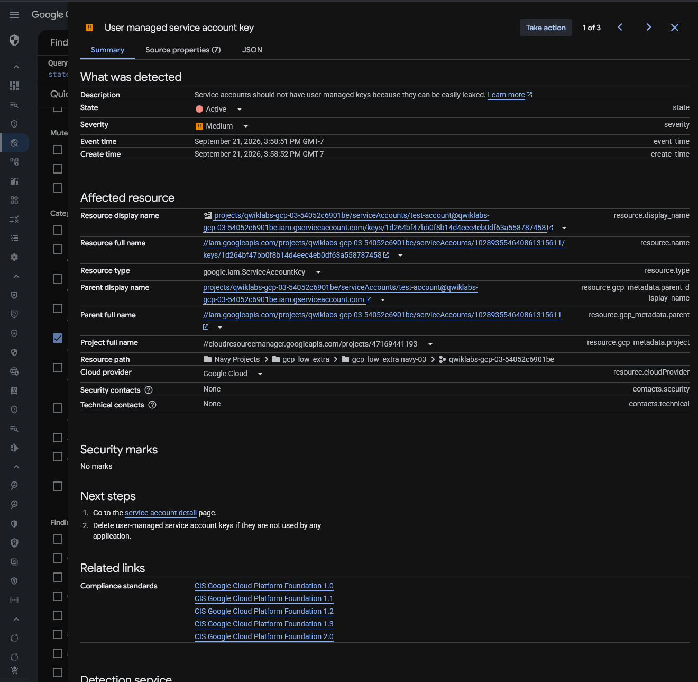
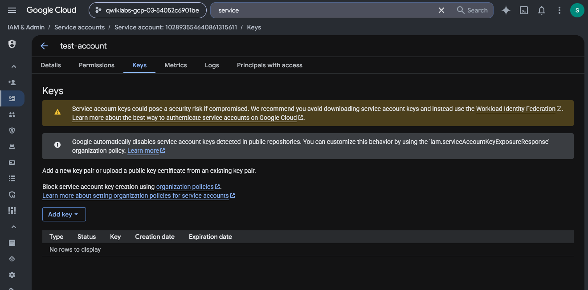
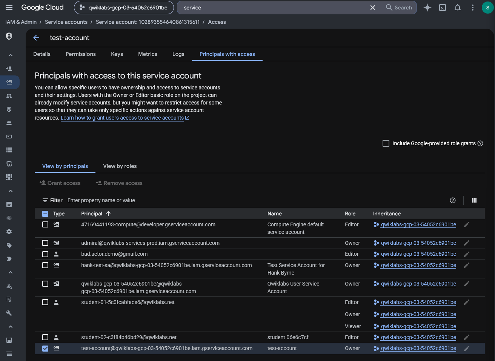

# Google Cloud Security Command Center — Service Account Finding Triage and Remediation

## Executive Summary

This investigation examines a Google Cloud Security Command Center (SCC) finding involving user-managed service account credentials.

The exercise recreated a security finding by configuring a test service account with project-level Owner privileges, generating a user-managed JSON authentication key, and activating the service account in Cloud Shell.

Using a separate training account, I investigated the resulting finding in Security Command Center and followed the remediation procedure to delete the authentication key.

An independent IAM review extended the investigation by examining the service account's remaining access permissions. This review identified project-level Owner access as a separate security concern that was not resolved by deleting the key.

The investigation demonstrates security finding triage, credential-risk remediation, IAM privilege assessment, and evidence-based validation in an authorized Google Cloud training environment.

## Investigation Scope

The investigation was conducted in a temporary Google Cloud lab project using controlled service account activity.

| Component | Investigation Purpose |
| --- | --- |
| Security Command Center | Identify and investigate service account security findings |
| IAM | Review service account access and permissions |
| Service Accounts | Examine the affected test identity |
| User-managed JSON key | Reproduce the credential-management finding |
| Cloud Shell | Activate and verify the test service account |
| SCC finding details | Assess severity, affected resources, and recommended actions |
| Service account Keys | Verify removal of the user-managed key |
| Principals with access | Independently examine remaining Owner-level permissions |

### Investigation Objectives

1. Reproduce a user-managed service account key finding in a controlled environment.

2. Identify the finding in Google Cloud Security Command Center.

3. Examine the finding's category, severity, affected resource, and recommended action.

4. Remove the user-managed key as directed by the lab procedure.

5. Verify the state of the service account's Keys tab.

6. Independently review the service account's IAM permissions.

7. Determine whether deleting the key addresses all identified risks.

8. Document findings, security implications, and evidence limitations.

## Evidence Sources and Methodology

### Evidence Sources

This investigation uses screenshots from Security Command Center, service account key management, and IAM access review.

The evidence was collected during a guided Google Cloud security exercise and an additional independent IAM assessment.

### Investigation Methodology

| Phase | Analyst Activity |
| --- | --- |
| Preparation | Establish a test service account in an authorized cloud project |
| Finding generation | Create and activate a user-managed service account key |
| Triage | Identify and inspect the resulting SCC finding |
| Remediation | Delete the service account key |
| Validation | Inspect the Keys tab after remediation |
| Independent assessment | Examine project-level permissions associated with the service account |
| Reporting | Document observed evidence, remaining risks, and recommended controls |

### Evidence Standards

The finding was intentionally generated within a training environment.

The exercise described the alert as a false positive because the activity was authorized and performed for testing. However, the underlying user-managed credential and broad IAM permissions represented genuine security concerns within that configuration.

This report therefore distinguishes the benign context of the activity from the validity of the detected configuration risk.

The investigation also distinguishes observed changes from recommended production remediation. In particular, deleting the JSON key does not automatically remove the service account's IAM role assignments.

## Investigation Organization

The report documents four stages:

1. Security Command Center Finding Identification

2. Service Account Finding Analysis

3. User-Managed Key Remediation Verification

4. Independent IAM Excessive Privilege Assessment

The final sections will address security implications, remediation recommendations, evidence limitations, skills demonstrated, and supporting screenshots.

## Investigation Findings

### Finding 1 — Security Command Center Finding Identification

#### Investigation Context

The first phase involved reviewing Google Cloud Security Command Center (SCC) for findings associated with user-managed service account authentication keys.

The training scenario intentionally introduced a user-managed JSON key for a test service account. The objective was to determine whether Security Command Center identified the resulting configuration risk.

#### Security Command Center Findings Review

I opened Security Command Center, navigated to the Findings interface, and filtered the findings list by the following category:

`User managed service account key`

The interface displayed three matching findings under the selected seven-day filter, including one row dated September 14, 2026. The displayed timestamps should not be interpreted as proof that all three findings were first created within an identical seven-day interval.

| Finding | Category | Severity | Event Date |
| --- | --- | --- | --- |
| 1 | User managed service account key | Medium | September 21, 2026 |
| 2 | User managed service account key | Medium | September 21, 2026 |
| 3 | User managed service account key | Medium | September 14, 2026 |

*Figure 1 — Google Cloud Security Command Center displaying three medium-severity findings in the User managed service account key category, filtered within the selected seven-day window.*

Each displayed finding had an attack exposure score of `0`.

The list also showed the findings as unmuted. The visible records included event and creation timestamps, allowing the analyst to distinguish recently observed findings from older records.

The list alone did not establish whether the three findings involved the same service account, separate resources, or repeated observations of similar configurations.

#### Initial Triage Assessment

The category indicated the presence of user-managed service account keys, which can introduce credential-management risks.

Unlike automatically managed credentials, exported user-managed keys can potentially be copied, stored insecurely, or retained beyond their intended lifetime.

An exposed key may allow someone possessing it to authenticate as the associated service account, subject to the account's effective permissions and other applicable controls.

However, the presence of a user-managed key does not independently establish credential compromise.

Similarly, an attack exposure score of `0` does not prove that the underlying configuration is harmless or that the associated identity cannot be abused.

#### Analyst Assessment

**Assessment: Three medium-severity user-managed service account key findings identified in Security Command Center.**

The initial triage confirmed that Security Command Center detected the relevant credential-management category.

The available evidence supported further investigation of affected service accounts, key status, associated permissions, and remediation options.

The next phase examines the details of a selected finding to determine the affected resource and recommended corrective action.

### Finding 2 — Service Account Credential Risk Analysis

#### Investigation Context

After identifying three user-managed service account key findings, I opened the details of a recent Security Command Center finding to investigate the affected resource.

The objective was to determine what Security Command Center detected, identify the associated service account, assess the severity, and review the recommended corrective action.

#### Finding Details

The Security Command Center summary identified the following information:

| Field | Observed Value |
| --- | --- |
| Finding category | `User managed service account key` |
| Finding state | Active |
| Severity | Medium |
| Event time | September 21, 2026, 3:58:51 PM GMT-7 |
| Creation time | September 21, 2026, 3:58:52 PM GMT-7 |
| Resource type | `google.iam.ServiceAccountKey` |
| Affected service account | `test-account` |
| Cloud provider | Google Cloud |
| Security contacts | None listed |

*Figure 2 — Security Command Center finding details identifying an active, medium-severity user-managed service account key associated with the test service account. The panel displays the affected credential resource and recommended corrective actions.*

The affected resource was a user-managed service account key associated with the test identity created earlier in the lab.

Security Command Center described the concern as the presence of a user-managed key that could be leaked.

The finding did not indicate that a credential leak, attacker authentication, or account compromise had occurred.

#### Risk Analysis

User-managed service account keys can remain usable over long periods unless the credentials expire or the keys are disabled or deleted.

Because the private key material can be exported, user-managed keys introduce risks associated with insecure storage, accidental disclosure, credential reuse, and unauthorized access if compromised.

The potential impact depends partly on the privileges granted to the service account.

In this exercise, the test service account had been assigned project-level Owner permissions.

This combination is important because a compromised credential associated with a highly privileged service account could provide extensive administrative capabilities within the project's permission boundaries.

However, the screenshot only confirms the presence of a user-managed key and the associated finding. It does not establish that the key was compromised or that its permissions were abused.

#### Recommended Corrective Action

The SCC finding provided two next steps:

1. Open the affected service account's details page.

2. Delete user-managed service account keys that are not used by any application.

This recommendation addresses the existence of unnecessary user-managed credential material.

Before deleting a key in a production environment, an analyst should identify dependent workloads and coordinate with the relevant service owners to prevent unintended service disruption.

Where possible, applications should use short-lived credentials or supported workload identity mechanisms rather than downloadable private keys.

#### False Positive Classification

The lab scenario characterized this finding as a false positive because the service account and key were intentionally created for authorized testing.

That classification describes the benign context of the activity.

It does not mean that Security Command Center incorrectly identified the existence of the user-managed key.

The finding represented a real key-management configuration in the simulated environment; the authorized testing context did not make the key nonexistent or the configuration inherently risk-free.

An analyst should therefore distinguish between a finding that is technically accurate and activity that is not associated with an actual security incident.

#### Analyst Assessment

**Assessment: Active, medium-severity user-managed service account key finding confirmed for the test service account.**

The investigation identified the affected credential resource, documented the associated risk, and reviewed the remediation guidance provided by Security Command Center.

The evidence supports a credential-management concern rather than a confirmed security compromise.

The next investigation phase verifies whether the unnecessary user-managed key was removed from the service account.

### Finding 3 — User-Managed Service Account Key Remediation

#### Investigation Context

After examining the active Security Command Center finding, I followed the lab remediation procedure to remove the user-managed JSON authentication key associated with the `test-account` service account.

The objective was to address the credential-management risk and verify the resulting key inventory through the Google Cloud console.

#### Remediation Procedure

The remediation focused on deleting the unnecessary user-managed service account key.

The procedure involved:

1. Navigating to IAM & Admin → Service Accounts.

2. Opening the `test-account` service account.

3. Selecting the **Keys** tab.

4. Deleting the user-managed authentication key.

5. Reviewing the Keys tab to verify the remaining key inventory.

Deleting the key revokes that service account key as a Google Cloud authentication credential.

This does not automatically delete copies of the downloaded JSON file or change IAM roles assigned to the service account.

#### Post-Remediation Verification

After completing the deletion procedure, I reviewed the service account's Keys tab.

| Verification Item | Observed Result |
| --- | --- |
| Affected identity | `test-account` |
| Console location | Service Accounts → Keys |
| Displayed key records | No rows to display |
| Remaining user-managed keys | None visible in the captured inventory |
| IAM role changes | Not demonstrated by this screenshot |
| SCC finding resolution | Not independently demonstrated by this screenshot |

*Figure 3 — Google Cloud IAM service account Keys tab showing no key records for `test-account` following the remediation procedure.*

The screenshot showed no user-managed key records for the selected service account at the time of verification.

This supports that the targeted key was no longer present in the visible key inventory. It does not establish that all copies of the JSON credential file had been destroyed or that the SCC finding had closed.

However, no subsequent SCC finding-status screenshot was preserved. Therefore, the evidence does not independently establish that the original finding had transitioned to an inactive or resolved state.

#### Security Relevance

User-managed service account keys can become security risks when they are stored insecurely, exposed in source repositories, shared unnecessarily, or retained after their intended use.

Removing an unnecessary key eliminates that specific credential's ability to authenticate to Google Cloud.

For production environments, organizations should prefer supported short-lived or keyless authentication mechanisms, including attached service account identities or Workload Identity Federation where appropriate.

Organizations can also implement policies restricting user-managed key creation to reduce unnecessary credential exposure.

Before key deletion in a production environment, dependencies should be reviewed to avoid interrupting legitimate applications.

#### Residual Risk

Deleting a user-managed service account key addresses the credential-management finding, but it does not automatically reduce the permissions assigned to the service account.

In this exercise, the account had also been granted project-level Owner access.

The next investigation phase independently examines these permissions to determine whether a separate excessive-privilege concern remained after key deletion.

#### Analyst Assessment

**Assessment: No user-managed key records remained visible in the selected service account inventory.**

The service account's Keys tab displayed no key records following the documented remediation procedure.

This verified the post-remediation state of the key inventory, but did not independently confirm SCC finding closure or changes to the account's IAM permissions.

Further review was therefore warranted to assess remaining privilege-related risks.

### Finding 4 — Independent IAM Excessive Privilege Assessment

#### Investigation Context

After verifying the removal of the user-managed service account key, I performed an independent review of the affected service account's IAM permissions.

The guided Security Command Center exercise focused on identifying and remediating a user-managed authentication key.

However, the lab setup had also assigned the test service account the project-level Basic Owner role.

The independent investigation addressed a separate security question:

**Did the service account retain excessive privileges after its user-managed authentication key was removed?**

#### IAM Permission Review

I navigated to IAM & Admin, opened the `test-account` service account, and selected the **Principals with access** tab.

The interface displayed principals with access to the service account, including inherited project-level grants. This tab is not a complete standalone inventory of every IAM permission the service account itself possesses.

The selected row associated the test service account principal with an Owner role shown as inherited from the project. Because this page lists principals with access to the service account, the screenshot was interpreted alongside the lab setup instructions, which specify the project-level Owner assignment.

| IAM Attribute | Observed Value |

| --- | --- |

| Service account | `test-account` |

| Principal type | Service account |

| Assigned role | Basic Owner |

| Grant scope | Project-level |

| Role visible during review | Yes |

| Role removal performed | No |

*Figure 4 — Google Cloud IAM view showing the `test-account` service account associated with a project-level Owner role. The independent review confirms that the broad permission assignment remained visible after the user-managed key remediation.*

The independent review showed the Owner role still associated with the test principal after the key-removal procedure; the lab setup independently described that role as project-level.

This was a separate configuration concern from the user-managed key identified by Security Command Center.

#### Excessive Privilege Analysis

The Google Cloud Basic Owner role provides broad administrative permissions across project resources and services.

Assigning this role to a service account can increase the potential impact of credential compromise or misuse, especially if the account does not require administrative access for its intended workload.

The test service account was created for a controlled exercise. The evidence does not establish that its privileges were abused or that unauthorized activity occurred.

However, the broad Owner assignment illustrated a least-privilege concern.

A production review would need to establish the service account's legitimate operational requirements before selecting an appropriately restricted replacement role.

#### Credential Remediation Versus Access Remediation

The investigation identified two distinct security concerns:

| Security Concern | Observed State | Assessment |
| --- | --- | --- |
| User-managed JSON authentication key | No keys visible after deletion | Key inventory remediation verified |
| Project-level Owner role | Owner grant remained visible | Excessive privilege concern remained unremediated |

Deleting the user-managed key prevents that specific key from being used for authentication.

It does not automatically remove IAM bindings or prevent authentication through every other mechanism available to the service account.

As a result, the credential-management finding and the account's broad permissions require separate assessment.

#### Recommended Least-Privilege Remediation

For a production service account, the next steps would be to:

1. Identify the application's legitimate resource-access requirements.

2. Review the service account's existing IAM grants.

3. Replace the Basic Owner assignment with the minimum appropriate predefined or custom roles.

4. Validate that required application operations continue to function.

5. Review the account's remaining authentication mechanisms.

6. Monitor relevant IAM and administrative activity after the changes.

These steps are recommendations rather than actions completed during this investigation.

I did not change the project-level role assignment during the documented independent assessment. Role replacement was outside the scope of the recorded remediation.

#### Analyst Assessment

**Assessment: Excessive project-level Owner permissions remained visible after key remediation.**

The independent IAM review identified an additional security concern that was not resolved by removing the user-managed service account key.

The investigation demonstrated why analysts should assess both authentication credentials and authorization privileges when reviewing service account findings.

The key-removal procedure addressed the visible credential risk, while the broad IAM assignment remained a separate least-privilege issue requiring further remediation in a production environment.

## Security Implications

This investigation demonstrated why service account security requires evaluating both authentication credentials and authorization privileges.

The Security Command Center finding identified a user-managed service account key, while the independent IAM review identified a separate excessive-permissions concern.

| Security Area | Observation | Security Implication |
| --- | --- | --- |
| Security finding triage | SCC displayed three medium-severity findings for user-managed service account keys | Configuration findings provide starting points for investigating credential-management risks |
| Credential exposure risk | The selected finding identified a user-managed JSON authentication key | Exportable private keys can become security risks if copied, exposed, or inadequately protected |
| Credential remediation | The service account's Keys tab displayed no remaining key records | Removing unnecessary credentials reduces authentication exposure associated with those keys |
| IAM privilege review | The test service account retained a project-level Owner role | Broad permissions increase potential impact if the identity is compromised or misused |
| Remediation completeness | Key removal did not change the observed Owner grant | Authentication and authorization concerns require separate remediation |
| Finding interpretation | The risky configuration was intentionally created for testing | Benign activity context does not automatically invalidate an accurate security finding |

### Credential Risk Versus Privilege Risk

Two related but distinct issues were identified during the investigation.

**Credential-management risk:** A user-managed service account key existed and could potentially be exposed or misused. The key-removal procedure addressed the visible credential configuration.

**Authorization risk:** The service account retained the broad Basic Owner role at project scope. Removing the JSON key did not change that role assignment.

This distinction is important in security operations because an alert can be remediated without resolving every related security weakness.

### Detection and Monitoring Opportunities

Security teams can use similar findings and audit records to identify unusual service account configurations.

Potential monitoring opportunities include:

- Creation of new user-managed service account keys.

- Unexpected changes to project-level IAM role bindings.

- Assignment of Basic Owner or other highly privileged roles to service accounts.

- Authentication activity inconsistent with a service account's expected workload.

- Repeated creation of service account keys after remediation.

These are proposed monitoring opportunities. No production detection rules were implemented or validated during this exercise.

## Remediation Recommendations

The following recommendations distinguish the remediation completed during the lab from additional controls appropriate for production environments.

| Priority | Recommendation | Status in This Investigation |

| --- | --- | --- |
| High | Delete the unnecessary user-managed authentication key | Completed; no keys visible in post-remediation inventory |
| High | Review and reduce the service account's project-level Owner permissions | Recommended; not performed |
| High | Identify any workloads dependent on the service account before modifying access | Recommended for production |
| Medium | Prefer keyless or short-lived workload authentication where supported | Recommended |
| Medium | Restrict unnecessary creation of user-managed service account keys using organization policies | Recommended |
| Medium | Monitor privileged IAM changes and service account key creation | Recommended |
| Medium | Recheck SCC finding status after remediation | Not independently verified in the preserved evidence |

### Recommended Production Remediation Sequence

For a production service account, the appropriate remediation sequence would include:

1. Validate the affected identity, resource, and finding details.

2. Determine whether the user-managed credential supports a legitimate workload.

3. Coordinate credential removal with application owners.

4. Delete unnecessary keys and migrate applicable workloads to safer authentication mechanisms.

5. Verify the remaining key inventory and reevaluate the SCC finding state.

6. Examine the service account's IAM bindings and access requirements.

7. Replace excessively broad roles with the minimum necessary permissions.

8. Validate application functionality and review subsequent authentication and IAM audit activity.

Only the key-removal and key-inventory verification steps were completed as part of the documented remediation.

The independent investigation identified the Owner assignment but did not modify its IAM role bindings.

## Evidence Limitations

This investigation was performed in an authorized Google Cloud training project. The service account, Owner assignment, and user-managed key were intentionally configured for the exercise.

The following evidence limitations apply:

1. **Simulated finding:** The detected configuration was generated for training. No real-world service account compromise was established.

2. **Finding scope:** The initial SCC list contained three matching findings. The screenshots do not establish that all three corresponded to the same service account.

3. **Credential compromise:** The finding demonstrated the existence of a user-managed key, not evidence that the key was stolen, leaked, or used by an attacker.

4. **Remediation verification:** The post-remediation screenshot showed no remaining key records in the selected service account's Keys tab. It did not verify the removal of any previously downloaded local JSON files.

5. **SCC finding status:** No preserved screenshot confirmed that the original SCC finding had transitioned to inactive or resolved after the key was deleted.

6. **IAM authorization:** The independent screenshot showed the test service account associated with a project-level Owner role. It did not provide a comprehensive effective-permissions assessment across all resource scopes.

7. **Residual privilege risk:** The Owner role remained visible after key deletion. No least-privilege role replacement was performed or validated.

8. **Environment scope:** The investigation did not evaluate production application dependencies, organization-wide IAM policies, or enterprise credential-monitoring coverage.

## Skills Demonstrated

### Google Cloud Security Operations

- Investigated Google Cloud Security Command Center findings.

- Examined finding categories, severity, state, affected resources, and remediation guidance.

- Differentiated an accurate configuration finding from confirmed malicious activity.

- Evaluated credential-management risks associated with user-managed service account keys.

### IAM and Credential Security

- Reviewed service account authentication-key configuration.

- Performed and verified user-managed key removal.

- Examined project-level IAM permissions.

- Identified excessive Basic Owner privileges.

- Distinguished authentication remediation from authorization remediation.

- Developed least-privilege remediation recommendations.

### Security Investigation and Documentation

- Conducted a structured investigation from finding identification through remediation verification.

- Independently expanded the guided exercise to assess residual IAM risks.

- Interpreted screenshots according to the evidence they actually demonstrated.

- Documented unresolved risks and limitations rather than assuming complete remediation.

- Produced evidence-backed security findings and actionable recommendations.

## Conclusion

This investigation examined a user-managed service account key finding in Google Cloud Security Command Center.

The guided exercise demonstrated how to identify a medium-severity finding, inspect the affected service account credential, follow the recommended key-removal procedure, and verify that no user-managed keys remained visible in the account's Keys tab.

The independent investigation extended the assessment by reviewing the service account's IAM permissions after the key was removed.

This review identified a remaining project-level Basic Owner role, demonstrating that credential remediation does not automatically address excessive authorization privileges.

The key security outcome was distinguishing between two remediation requirements: removing unnecessary authentication credentials and enforcing appropriate IAM privileges.

The exercise also reinforced the importance of separating benign activity context from valid configuration risks, validating remediation evidence, and identifying remaining security concerns before closing an investigation.

These skills apply directly to cloud security operations, identity and access management, security finding triage, and incident investigation.

## Evidence Index

| Figure | Evidence File | Description |
| --- | --- | --- |
| 1 | `01-scc-service-account-findings.png` | SCC findings list showing three medium-severity user-managed service account key findings |
| 2 | `02-scc-finding-details.png` | Active finding details for the affected test service account |
| 3 | `03-service-account-key-remediation.png` | Post-remediation Keys tab showing no remaining key records |
| 4 | `04-service-account-owner-privileges.png` | Independent IAM review showing the remaining project-level Owner assignment |

All four evidence screenshots are located in the accompanying [`evidence/`](evidence/) directory.
