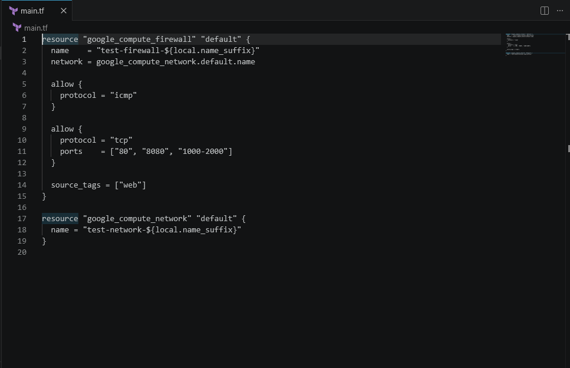
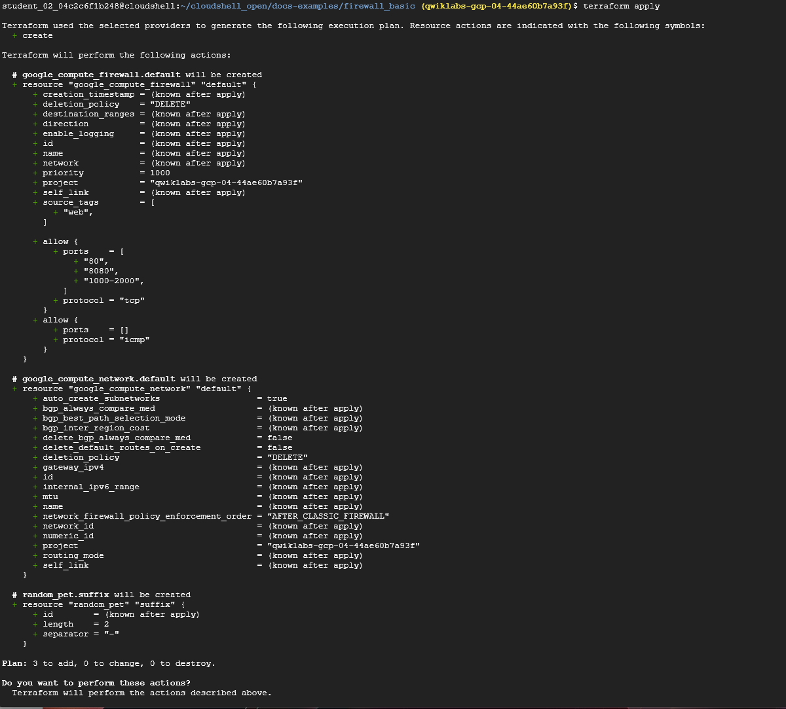
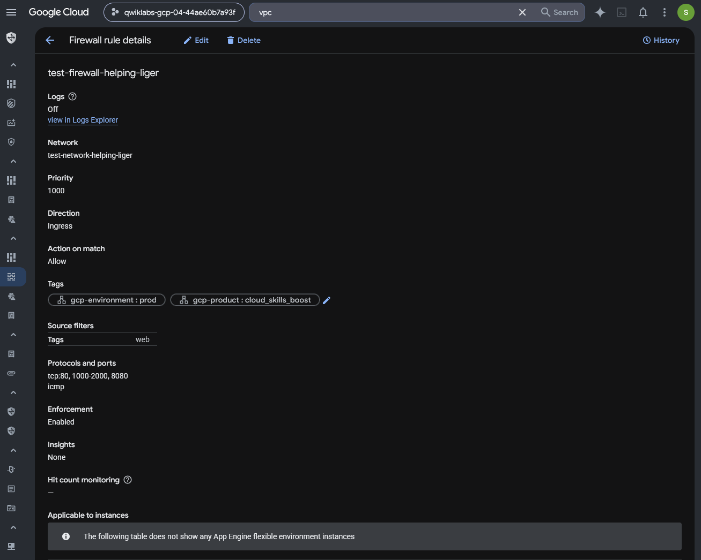
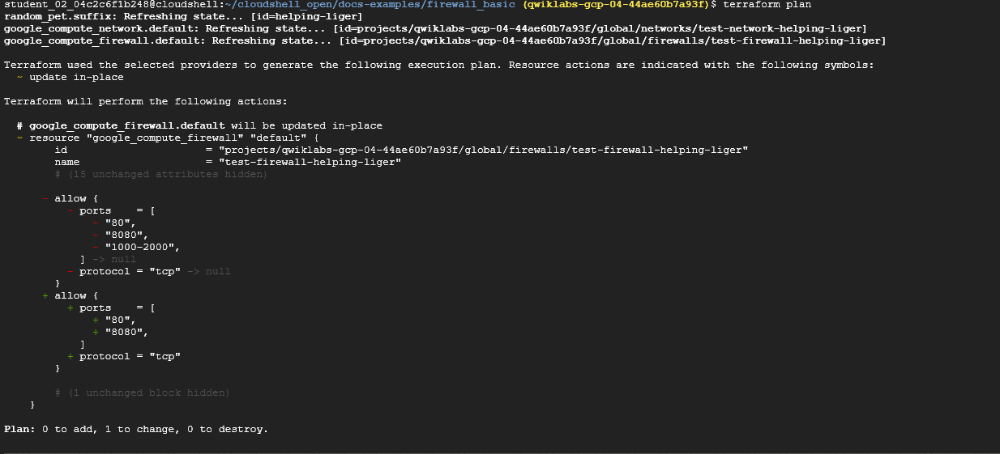
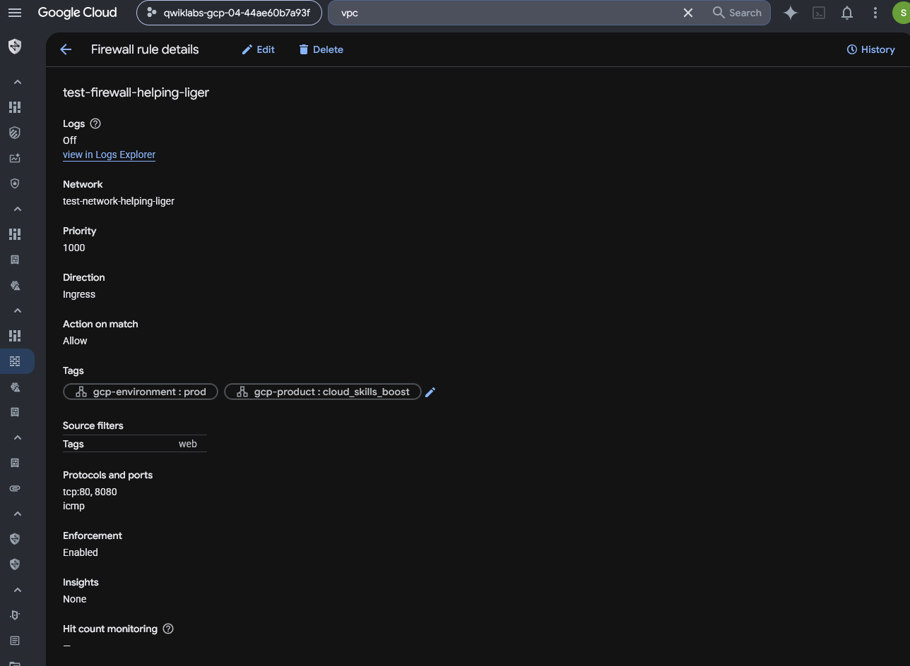

# Google Cloud Terraform Firewall Security — Infrastructure as Code Hardening

## Executive Summary

This investigation demonstrates the use of Terraform to provision and harden Google Cloud network infrastructure.

The scenario involved deploying a Virtual Private Cloud (VPC) network and associated firewall rule for a fictional banking application's cloud environment.

Using Google Cloud Shell and Terraform, I examined the supplied infrastructure configuration, reviewed the initial deployment plan, and verified the resulting VPC firewall rule in the Google Cloud console.

An independent security review identified an unnecessarily broad TCP port range in the original firewall configuration.

I modified the Terraform code to remove TCP ports `1000-2000` while preserving ports `80` and `8080`, reviewed the resulting Terraform execution plan, and verified that the deployed firewall reflected the updated configuration.

The objective was to demonstrate repeatable infrastructure provisioning, firewall rule analysis, least-privilege network configuration, and evidence-based change validation through Infrastructure as Code.

## Investigation Scenario

Cymbal Bank, a fictional financial organization, required a new Google Cloud VPC network and firewall configuration to support deployment of a banking application.

The infrastructure team chose Terraform to define and provision these resources in a repeatable way.

My role was to examine the network configuration, deploy the infrastructure, verify the resulting firewall behavior, and independently assess whether the firewall permitted unnecessary traffic.

The independent hardening step assumed that the application required only TCP ports `80` and `8080`.

The preserved evidence documents configuration and deployment changes rather than network exploitation or a confirmed security incident.

## Investigation Scope

| Component | Investigation Purpose |
| --- | --- |
| Terraform | Define and manage cloud infrastructure as code |
| Google Cloud Shell | Execute Terraform commands |
| Google Cloud VPC | Provide an isolated network resource |
| VPC firewall rule | Control permitted network traffic |
| `main.tf` | Define the desired infrastructure configuration |
| `terraform plan` | Preview proposed infrastructure changes |
| `terraform apply` | Deploy approved changes |
| Google Cloud console | Verify deployed firewall settings |

### Investigation Objectives

1. Review the supplied Terraform configuration for the VPC and firewall.
2. Identify the protocols and ports permitted by the original firewall rule.
3. Review the initial Terraform infrastructure deployment plan.
4. Verify the deployed firewall configuration in Google Cloud.
5. Independently identify an unnecessarily broad TCP port range.
6. Modify the Terraform configuration to retain only the assumed required application ports.
7. Review the planned infrastructure update.
8. Apply and verify the firewall change.
9. Document the security implications and limitations of the observed configuration.

## Evidence Sources and Methodology

### Evidence Sources

The investigation uses five preserved screenshots of Terraform configuration, Terraform execution plans, and Google Cloud VPC firewall settings.

The original exercise instructions document the guided Terraform provisioning workflow.

The independent investigation notes document the decision to remove an unnecessary TCP port range and validate the resulting infrastructure change.

### Investigation Methodology

| Phase | Analyst Activity |
| --- | --- |
| Configuration review | Examine the initial `main.tf` |
| Infrastructure planning | Review the initial Terraform plan |
| Deployment verification | Inspect the initial firewall in Google Cloud |
| Security assessment | Identify unnecessary permitted TCP ports |
| Code modification | Remove the broad port range from Terraform |
| Change planning | Review the in-place Terraform update |
| Change application | Apply the modified configuration |
| Final verification | Inspect the deployed firewall rule |
| Reporting | Document the change and evidence limitations |

### Evidence Standards

The work was completed within an authorized, temporary Google Cloud training environment.

The original Terraform configuration came from a supplied example repository.

The independent hardening decision was based on assumed application requirements and was not derived from production traffic analysis.

The firewall's `source_tags = ["web"]` configuration is an important scope limitation: the initial firewall rule should not be described as unrestricted public internet exposure.

The preserved Terraform plan and Google Cloud firewall screenshots support conclusions about the planned update and final visible configuration. They do not independently demonstrate application connectivity or the complete effective network security posture.

## Investigation Organization

The report will document four findings:

1. Terraform VPC and Firewall Configuration Review
2. Initial Infrastructure Planning and Deployment Verification
3. Independent Firewall Hardening Through Terraform
4. Post-Change Firewall Configuration Verification

The final sections will summarize security implications, evidence limitations, skills demonstrated, and supporting screenshots.

## Investigation Findings

### Finding 1 — Terraform VPC and Firewall Configuration Review

#### Investigation Context

The first phase involved reviewing a supplied Terraform configuration used to provision networking resources for the fictional Cymbal Bank application.

The objective was to identify the VPC and firewall resources defined in `main.tf`, determine the traffic permitted by the firewall, and establish the original configuration before deployment.

This configuration would later provide the baseline for an independent network-security hardening exercise.

#### Terraform Resource Configuration

I examined the Terraform file containing two Google Cloud resources:

- `google_compute_network.default` — defines the application VPC network.
- `google_compute_firewall.default` — defines a firewall rule associated with that VPC.

The original configuration included the following resource definitions:

```hcl
resource "google_compute_firewall" "default" {
  name    = "test-firewall-${local.name_suffix}"
  network = google_compute_network.default.name

  allow {
    protocol = "icmp"
  }

  allow {
    protocol = "tcp"
    ports    = ["80", "8080", "1000-2000"]
  }

  source_tags = ["web"]
}

resource "google_compute_network" "default" {
  name = "test-network-${local.name_suffix}"
}
```



*Figure 1 — Original `main.tf` defining the Google Cloud VPC and firewall resources, including ICMP, TCP ports 80 and 8080, the broader TCP 1000–2000 range, and a `web` source-tag restriction.*

The use of `local.name_suffix` allowed the resource names to include a locally defined suffix.

The screenshot did not show the definition of that local value, so its exact value could not be determined from this image alone.

#### Firewall Configuration Analysis

The Terraform firewall resource defined the following traffic permissions:

| Attribute | Original Configuration |
| --- | --- |
| Firewall resource | `google_compute_firewall.default` |
| Target VPC | `google_compute_network.default.name` |
| Rule direction | Ingress, by default |
| Rule action | Allow |
| ICMP | Allowed |
| TCP port `80` | Allowed |
| TCP port `8080` | Allowed |
| TCP port range `1000-2000` | Allowed |
| Source restriction | `source_tags = ["web"]` |
| Explicit target tags | Not specified in the visible resource |
| Explicit firewall priority | Not specified in the visible resource |

The firewall permitted ICMP and selected TCP traffic from sources matching the `web` network tag.

Because no explicit target tags appeared in the resource definition, the rule was not restricted to a specific target tag in the visible configuration.

The source-tag restriction is important: the rule should not be described as granting access to all public internet addresses.

The screenshot documents the desired Terraform configuration, not an independently validated effective firewall policy.

#### Initial Security Assessment

The most significant issue identified in the original configuration was the permitted TCP port range:

`1000-2000`

This range included numerous ports beyond the two ports assumed to be required by the banking application.

Allowing unnecessary ports can increase network exposure if matching source instances can connect to services listening on those ports.

However, an allowed firewall port does not independently establish that a service is running, reachable, or vulnerable.

The security assessment therefore focused on reducing unnecessary network permissions rather than claiming an observed exploit or confirmed public exposure.

#### Least-Privilege Considerations

Network least privilege involves permitting only the traffic necessary for legitimate application operations.

Under the independent exercise's assumed requirements, the application needed TCP ports `80` and `8080`.

The original Terraform configuration permitted those ports but also allowed TCP ports `1000-2000`.

Removing the unnecessary range would create a narrower firewall configuration while preserving the explicitly required application ports.

Before making the change in a production environment, an analyst would need to confirm application dependencies, source identities, and expected traffic patterns.

#### Analyst Assessment

**Assessment: Terraform configuration identified with an unnecessarily broad TCP port allowance under the assumed application requirements.**

The original `main.tf` defined a Google Cloud VPC and associated ingress firewall rule.

The firewall permitted ICMP, TCP ports `80` and `8080`, and TCP ports `1000-2000`, with a `web` source-tag restriction.

The review established the baseline configuration for subsequent Terraform deployment and independent hardening.

The next phase examines the Terraform execution plan and the initial deployed firewall rule.

### Finding 2 — Initial Terraform Planning and Firewall Deployment Verification

#### Investigation Context

After reviewing the initial Terraform configuration, I examined the infrastructure deployment plan and verified the resulting firewall rule in Google Cloud.

The objective was to establish that the original Infrastructure as Code configuration was reflected in the deployed environment before performing independent security hardening.

#### Terraform Execution Plan

From the supplied Terraform project directory in Google Cloud Shell, I ran:

```bash
terraform apply
```

Terraform generated an execution plan containing three resource additions.

| Terraform Resource | Planned Action | Purpose |
| --- | --- | --- |
| `google_compute_network.default` | Create | Provision the VPC network |
| `google_compute_firewall.default` | Create | Provision the firewall rule |
| `random_pet.suffix` | Create | Generate a resource-name suffix |



*Figure 2 — Terraform apply execution plan showing three resource additions, including a VPC, firewall rule, and random resource-name suffix. The screenshot captures the plan before confirmation.*

The plan summary reported:

```text
Plan: 3 to add, 0 to change, 0 to destroy.
```

The planned firewall allowed ICMP and TCP ports `80`, `8080`, and `1000-2000`.

It also specified a `web` source-tag restriction and priority `1000`.

The screenshot shows the plan and the interactive confirmation prompt. It does not independently capture the completed Terraform apply operation.

#### Deployed Firewall Verification

I then opened the Google Cloud VPC firewall rule details page.

The deployed firewall showed the following configuration:

| Firewall Attribute | Observed Value |
| --- | --- |
| Rule name | `test-firewall-helping-liger` |
| Network | `test-network-helping-liger` |
| Direction | Ingress |
| Action on match | Allow |
| Priority | `1000` |
| Source filter | Network tag `web` |
| Allowed TCP ports | `80`, `8080`, `1000-2000` |
| ICMP | Allowed |
| Firewall rule logging | Off |
| Enforcement | Enabled |



*Figure 3 — Google Cloud firewall `test-firewall-helping-liger` allowing ICMP and TCP ports 80, 8080, and 1000–2000 from sources with the `web` network tag. Firewall logging is Off.*

The firewall's visible settings matched the traffic permissions defined in the original Terraform configuration.

This provided evidence that the infrastructure resources had been provisioned with the intended initial firewall settings.

The rule used a source network tag rather than an unrestricted source IP range.

Consequently, the screenshot does not demonstrate that the allowed ports were exposed to all public internet addresses.

#### Initial Security Assessment

The deployed firewall allowed TCP ports `1000-2000` in addition to the application's assumed required ports.

Under the independent exercise's requirements, those additional TCP ports were unnecessary.

Their presence expanded the set of traffic that could be permitted from matching source instances if corresponding services were listening.

The firewall also displayed logging as Off, limiting the availability of firewall rule logs for monitoring traffic evaluated against the rule.

However, logging configuration was not the focus of the subsequent independent modification, and no evidence was preserved showing that logging was enabled later.

#### Security Relevance

Terraform enables infrastructure configurations to be defined and updated consistently through code.

Comparing Terraform plans with deployed cloud-resource settings helps verify whether the intended configuration matches the visible infrastructure state.

However, a successful deployment does not automatically establish that the resulting firewall follows least-privilege principles.

This investigation identified an opportunity to reduce permitted TCP ports based on the application's assumed requirements.

#### Analyst Assessment

**Assessment: Original Terraform firewall configuration verified in the deployed Google Cloud environment.**

The Terraform execution plan proposed creating three resources, including the VPC network and firewall.

The deployed firewall permitted ICMP and TCP ports `80`, `8080`, and `1000-2000`, matching the original configuration.

The review established a baseline for independently narrowing the firewall's permitted ports while documenting the source-tag restriction and disabled firewall logging.

### Finding 3 — Independent Firewall Hardening Through Terraform

#### Investigation Context

Following the initial Terraform deployment, I conducted an independent security review of the VPC firewall configuration.

The original firewall permitted TCP ports `80`, `8080`, and `1000-2000`, as well as ICMP, from sources matching the `web` network tag.

Under the independent exercise's assumed application requirements, TCP ports `80` and `8080` were necessary, while the broader TCP range `1000-2000` was not.

The objective was to reduce unnecessary network permissions through Terraform without replacing the existing VPC or firewall resources.

#### Security Issue Identified

The original Terraform configuration contained the following TCP allowance:

```hcl
allow {
  protocol = "tcp"
  ports    = ["80", "8080", "1000-2000"]
}
```

The inclusion of `1000-2000` permitted a substantially broader set of TCP destination ports than the assumed application requirements justified.

Although the rule was restricted to eligible sources with the `web` network tag, unnecessary port allowances could still increase exposure between matching cloud resources.

The preserved evidence did not establish that services were listening on those ports or that the additional access had been exploited.

#### Terraform Configuration Modification

I modified the TCP allowance in `main.tf` to retain only the assumed required ports:

```hcl
allow {
  protocol = "tcp"
  ports    = ["80", "8080"]
}
```

The independent modification removed TCP ports `1000-2000` while preserving the application ports `80` and `8080`.

The intended change did not require creating a new firewall or VPC network.

#### Terraform Change Validation

After editing the configuration, I ran:

```bash
terraform plan
```

Terraform refreshed the existing resource state and produced an execution plan identifying an in-place update to:

`google_compute_firewall.default`

The plan displayed removal of the original TCP `allow` block containing ports `80`, `8080`, and `1000-2000`, followed by the addition of a TCP `allow` block containing only `80` and `8080`.

An unchanged firewall configuration block was hidden in the plan output.

The execution plan reported:

```text
Plan: 0 to add, 1 to change, 0 to destroy.
```

| Terraform Plan Attribute | Observed Result |
| --- | --- |
| Resource | `google_compute_firewall.default` |
| Firewall name | `test-firewall-helping-liger` |
| Planned operation | Update in place |
| TCP ports removed from permitted configuration | `1000-2000` |
| TCP ports retained | `80`, `8080` |
| Resources to add | 0 |
| Resources to change | 1 |
| Resources to destroy | 0 |



*Figure 4 — Terraform plan showing an in-place update to `google_compute_firewall.default`, removing TCP ports `1000-2000` while retaining ports `80` and `8080`. The plan reports zero additions, one change, and zero destructions.*

The plan indicated that Terraform could modify the existing firewall resource without replacing it.

This was a useful change-control checkpoint because it allowed the proposed modifications to be reviewed before deployment.

The preserved screenshot does not show a completed `terraform apply` operation.

#### Security Impact

The proposed modification followed the principle of least privilege by narrowing the set of TCP ports permitted by the firewall.

| Security Consideration | Original Configuration | Proposed Configuration |
| --- | --- | --- |
| TCP port `80` | Allowed | Allowed |
| TCP port `8080` | Allowed | Allowed |
| TCP ports `1000-2000` | Allowed | Removed from allowance |
| ICMP | Allowed | No change indicated |
| Source restriction | `web` network tag | No change indicated |
| Firewall resource | Existing firewall | Update in place |

Removing the unnecessary TCP range would reduce the permitted network traffic from matching sources, assuming no other applicable rules independently allowed those ports.

The change did not establish that application connectivity remained functional, because no application testing was preserved in this evidence.

It also did not address the previously observed disabled firewall rule logging.

#### Analyst Assessment

**Assessment: Terraform plan successfully identified an in-place firewall hardening change that removed the unnecessary TCP port range `1000-2000`.**

The independent review identified an opportunity to narrow network permissions while retaining the assumed required application ports.

The Terraform plan showed one resource modification with no resource additions or destructions.

The result demonstrated how Infrastructure as Code can support controlled security changes and allow analysts to inspect proposed modifications before deployment.

The next phase verifies whether the updated firewall configuration was reflected in Google Cloud.

### Finding 4 — Post-Change Firewall Configuration Verification

#### Investigation Context

After independently modifying the Terraform firewall configuration and reviewing the resulting execution plan, I examined the deployed Google Cloud firewall rule to verify whether the proposed hardening change was reflected in the cloud environment.

The objective was to confirm that the unnecessary TCP port range `1000-2000` had been removed while preserving the assumed required application ports `80` and `8080`.

The previous Terraform plan identified an in-place update to `google_compute_firewall.default`, with zero resources added, one changed, and zero destroyed.

#### Final Firewall Configuration

I opened the firewall rule details page in the Google Cloud console.

The preserved screenshot displayed the following configuration:

| Firewall Attribute | Observed Value |
| --- | --- |
| Rule name | `test-firewall-helping-liger` |
| VPC network | `test-network-helping-liger` |
| Direction | Ingress |
| Action on match | Allow |
| Priority | `1000` |
| Source filter | Network tag `web` |
| Allowed TCP ports | `80`, `8080` |
| ICMP | Allowed |
| Firewall rule logging | Off |
| Enforcement | Enabled |



*Figure 5 — Final Google Cloud firewall configuration showing TCP ports 80 and 8080, ICMP, and the `web` source network tag. The previously permitted TCP range 1000–2000 is absent. Firewall logging remains Off.*

The final firewall rule no longer included TCP ports `1000-2000`.

The screenshot demonstrated that the deployed configuration reflected the narrower TCP allowance shown in the Terraform hardening plan.

The screenshot did not capture the completed Terraform apply output, but the deployed rule's visible configuration was consistent with the intended update.

#### Before-and-After Security Comparison

I compared the initial deployed firewall configuration with the final configuration.

| Firewall Setting | Initial State | Final State |
| --- | --- | --- |
| TCP port `80` | Allowed | Allowed |
| TCP port `8080` | Allowed | Allowed |
| TCP ports `1000-2000` | Allowed | Removed from this rule |
| ICMP | Allowed | Allowed |
| Source network tag | `web` | `web` |
| Firewall priority | `1000` | `1000` |
| Firewall rule logging | Off | Off |
| Rule enforcement | Enabled | Enabled |

The principal security improvement was the removal of the unnecessary TCP destination-port range.

The remaining TCP permissions matched the assumed application requirements.

The source network-tag restriction was preserved, and the rule remained enabled.

#### Security Impact

Reducing the permitted TCP ports narrowed the traffic authorized by this firewall rule.

Under the independent exercise's assumptions, the change reduced unnecessary network permissions without removing the application's required ports.

This aligned with the principle of least privilege by defining a smaller set of approved destination ports.

However, the security impact is limited to the configuration of this particular firewall rule.

The screenshots do not independently establish whether other VPC firewall rules or hierarchical firewall policies permit the same destination ports.

The preserved evidence also does not demonstrate actual application connectivity or functional testing following the change.

#### Remaining Security Considerations

Although the firewall's TCP permissions were reduced, several considerations remain relevant to a production security assessment.

**Firewall rule logging**

The final screenshot continued to display logging as Off.

The independent Terraform modification focused on permitted destination ports and did not include evidence of enabling firewall rule logging.

**Source identity and access scope**

The firewall used the `web` source network tag.

This is not equivalent to unrestricted internet access, but its security depends on which source instances carry the tag and how network tags are administered.

**Effective firewall evaluation**

The screenshot displayed a single firewall rule rather than the complete set of applicable network access controls.

A comprehensive assessment would require examining other applicable rules, effective firewall policies, and relevant application traffic.

**Application validation**

The independent exercise assumed that only TCP ports `80` and `8080` were necessary.

Production hardening would require validating those assumptions with application owners and confirming that the configuration change did not disrupt legitimate services.

#### Analyst Assessment

**Assessment: Terraform-based firewall hardening verified in the deployed Google Cloud configuration.**

The initial firewall permitted TCP ports `80`, `8080`, and `1000-2000`.

The independent Terraform modification removed the unnecessary range, and the final Google Cloud screenshot showed only TCP ports `80` and `8080`, alongside ICMP.

This demonstrated a successful configuration-level reduction in permitted TCP destination ports.

Firewall rule logging remained disabled, and the preserved evidence did not independently establish full network-policy coverage or post-change application functionality.